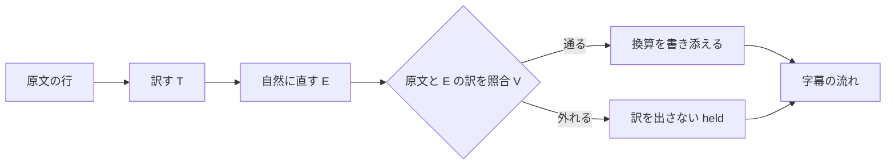

# 会話字幕：日英の双方向翻訳を、会議、動画、配信の上に出す

日本語話者と英語話者が話すとき、相手の言葉を自分の言語で読めるようにする。
日本語の発話は英語へ、英語の発話は日本語へ訳し、どちらも 1 枚の重ね窓に出す。
字幕は Zoom、Teams、YouTube、MPC-HC の上に重ねて読め、OBS を通して相手へも届く。
動画ファイルを指定すれば、同じ directory に SRT を書き出す。
通貨や長さなどの値には、読む側の地の単位へ換算した値を括弧で書き添える。

## 1. 結論

作る物は次の 5 つである。

- **訳の中継**（`hayamimi-relay live`）：2 つの認識 process の確定文と清書を受け、訳す、自然に直す、原文と照合する、の 3 段を通し、単位の換算を書き添えて、1 本の字幕の流れにまとめる。
- **重ね窓**（`hayamimi-overlay`）：2 つの認識の確定文と中継の訳を読み、`id` で結んで、透明で最前面の窓に出す（11）。
- **OBS の字幕頁**：重ね窓と同じ画面部品を web 向けに組み、中継が配る。自分の発話の英訳だけを映す。
- **SRT の書き出し**（`hayamimi-relay srt`）：動画ファイルから、同じ 3 段と換算を通した SRT を書く。
- **為替の取得**（`hayamimi-relay fx-fetch`）：1 日 1 回、朝に公開の参照値を取り、file に保存する。

作らない物は次の 3 つである。

- YouTube Live の字幕取り込みへの送信。配信では OBS の字幕頁を映像に焼き込む経路で足りる。
- CPU の翻訳器を GPU の翻訳器の代わりに立てる経路。理由は 3.6 に書く。
- 換算の上書き。原文の値は残し、換算値は必ず括弧の中に添える。

認識は `rust_port.ja.md` の Rust の `hayamimi`（GPU）が行い、event に 3.3 の 5 項目を足す。
訳の採点は `hayamimi-eval chrf` が行い、sacrebleu と同じ値を出すことを `rust_port.ja.md` の RP-14 で測る。

翻訳のモデルと、自然に直す段のモデルは、9 の決め方で held-out の実測から決める。

同じ場所で 2 人が 1 本のマイクに日本語と英語で話す対面の場面は、10 に置く。

## 2. 数えた結果

数えた日時は 2026-10-13 10:1x JST、範囲は repo の全体（`node_modules`、`build`、`target` を除く）である。

### 2.1 字幕の event の producer と consumer

| pattern | 当たった file | 陽性対照 |
|---|---|---|
| `["']translation["']` | 11 本：`scripts/realtime_transcribe.py`、`scripts/subtitle_server.py`、`tests/test_embed_runtime.py`、`docs/guide/embedding.md`、`docs/guide/embedding.ja.md`、`mobile/hayamimi_core/lib/server/subtitle_event.dart`、`mobile/hayamimi_core/lib/remote/remote_event.dart`、`mobile/hayamimi_core/test/remote_event_test.dart`、`mobile/hayamimi_core/README.md`、`demo/remotion/src/timeline.ts`、`demo/remotion/src/components/ReplayUI.tsx` | 同じ式で `scripts/subtitle_server.py` の `"refine"` が 3 件 |
| `audio_s\|audioS` | 36 本（scripts 12、mobile 15、docs 5、tests 4。`rg -l` の一覧を数えた） | `scripts/subtitle_server.py` に在る |
| `== *\{"type": *"(final\|refine)"`（形を固定する test） | 1 件：`tests/test_embed_runtime.py` の `test_eventhub_replays_refine_events_to_new_subscribers`。自分で publish した dict を比べており、producer に項目を足しても落ちない | 同じ式で `translation` が 1 件（`test_translation_worker_publishes_on_hub_with_no_http_server`） |

| consumer | 読む物 | 項目を足したときの扱い |
|---|---|---|
| `scripts/subtitle_server.py` の `OVERLAY_HTML` | `partial`、`final` | 変えない。OBS には中継の字幕頁を使う |
| `scripts/subtitle_server.py` の `DASHBOARD_HTML` | `final`、`translation`（直前の card に貼る） | 変えない。Python の `translation` は今の形のまま出し続ける |
| `mobile/hayamimi_core/lib/remote/remote_event.dart` | 全 type を key で読み、知らない type は `default` の枝 | 互換 |
| `mobile/hayamimi_core/lib/server/subtitle_event.dart` | desktop の wire 形式を写して出す | 互換。「desktop と同じ形」と書いた `subtitle_event_test.dart` は足した項目を持たないまま古くなる |
| `docs/guide/embedding.md`、`embedding.ja.md` の event の表 | `final`、`refine` の項目 | 古くなる。実装の commit で 5 項目を足す |
| `tests/test_embed_runtime.py` | `translation` の形を等号で固定 | Python の `translation` を変えないので落ちない |
| `demo/remotion/src/timeline.ts` | 録った event を再生 | 互換 |
| `mobile/lib/remote/remote_page.dart` | `translation` を最後の確定文（`_finals.last`）に貼る | 変えない。Python の port を読み、その `translation` の形は変わらない。訳の遅れで別の行に貼る弱さは残るが、会話字幕の経路（中継）は通らない |
| 訳の中継（新しい consumer） | `final`、`refine` の 5 項目 | 足した項目が要る |

この表の producer（`scripts/` の Python）は、`rust_port.ja.md` で Rust の `hayamimi` に置き換わる。
`hayamimi` は event の型ごとの key と値の型を Python と同じに保ち（`rust_port.ja.md` の RP-12）、その上で 3.3 の 5 項目を足す。
表の「Python の `translation`」は、置き換えの後は `hayamimi` の `--translate` が出す `translation` を指す。

### 2.2 いまの翻訳の経路

`scripts/realtime_transcribe.py` の翻訳は、認識の言語が `ja` のときだけ走る。
英→和の経路は、いまの repo に無い。
数字の守りは `digits_consistent` で、ASCII の数字の並びだけを比べ、漢数字は素通しする。

### 2.3 試しの実測

出所は `testdata/probe1_*.log` と `testdata/conv20.tsv`（どちらも 2026-10-13 に採った）。
`conv20.tsv` の参照訳は agent が書いた物で、人は確かめていない。
3 本は測った時の機械の混み方が違い、ms を厳密には比べられない（`testdata/probe1_cat-translate-3.3b.log` の末尾の注）。

| 項目 | CAT-Translate-3.3b（正式版、自分で Q8_0 へ変換） | TranslateGemma-4B-it（第三者の Q8_0） | CAT-Translate-3.3b-beta（Q8_0） |
|---|---|---|---|
| 初回 | 418 ms | 298 ms | 1910 ms |
| 2 回目以降 39 回の中央値と p95 | 148 / 277 ms | 262 / 401 ms | 321 / 866 ms |
| 同時 2 件（3 組の遅い側） | 572、326、319 ms | 800、992、561 ms | 936、493、502 ms |
| VRAM の増え | 約 4013 MiB | 約 4590 MiB | 約 4026 MiB |
| 末尾の `</s>` | 40 行中 40 行 | 40 行中 0 行 | 40 行中 40 行 |
| 前置きの混入 | 0 行 | 0 行 | 1 行（j12） |
| 訳さずに原文の言語のまま返した行 | 0 | 0 | 2（e10、e12） |
| 数の取り違え（2 以上の値） | 4 行：j08（五百万円が 1,500,000 yen）、j12（10-day を足す）、e01（100% を足す）、e20（10時を足す） | 0 行 | 5 行（j07 の 3 時が 1 p.m.、ほか CAT 正式版と同じ 4 行） |
| 1 を足した行 | 3 行：e02、e09、e16 | 0 行 | 2 行 |
| 意味の変わった行（読んで判定） | e11 | j13、e05 | e11 |
| 許諾 | MIT（S1） | Gemma の利用条件 | MIT |

行の数え方：`awk -F'\t' 'NF>=5 && $1 ~ /^[je][0-9][0-9]$/' <log> | wc -l` が 3 本とも 40（陽性対照は j01 の行）。
`</s>` で終わる行は同じ式に `$5 ~ /<\/s>$/` を足して CAT 正式版 40。
TranslateGemma は `grep -c '</s>'` が 0（rc=1。同じ式が CAT の log では 43 を返し、うち 3 行は log の見出しと注）。
数の取り違え、1 を足した行、意味の変わった行は、40 行を読んで数えた。

CAT 正式版を量子化せずに f16 で動かした log（`testdata/probe4_cat-translate-3.3b-f16.log`）でも、j08、e01、e20、j14 は Q8_0 と同じ訳を返し、j12 は別の誤り（`14‑day` を足す）を返した。
CAT の数の取り違えは量子化によるものではなく、model 自体の癖である。

### 2.4 外の事実と出所

| 番号 | 事実 | 出所（取得日 2026-10-13） |
|---|---|---|
| S1 | CAT-Translate-3.3B の BLEU の平均は全体 36.16、ja→en 37.51、en→ja 34.80。同じ表で translategemma-4b-it は 28.09、29.41、26.76。許諾は MIT。推奨の prompt は `Translate the following {src_lang} text into {tgt_lang}.` の後に空行と原文 | https://huggingface.co/cyberagent/CAT-Translate-3.3b |
| S2 | Zoom で外部の字幕を送るには、host が web の設定で caption API token を許し、会議中に host が token を写して渡す。token は会議が続く間だけ有効 | https://support.cmts.jhu.edu/hc/en-us/articles/40888716745997-Setting-Up-Closed-Captioning-in-Zoom-Using-a-Third-Party-Captioning-Service 、https://live.maestra.ai/help/zoom （第三者の手引き） |
| S3 | Teams の CART 字幕は、主催者が会議の option で「Provide CART Captions」を入れて link を作り、字幕者へ渡す | https://support.microsoft.com/en-US/teams/meetings-events/use-cart-captions-in-a-microsoft-teams-meeting-human-generated-captions |
| S4 | ECB のユーロ参照為替は、TARGET の休業日を除く毎営業日の 16:00 CET ごろに更新される。JPY、USD、GBP、CAD、AUD を含む。情報のための値で、取引への使用は勧めない。2026-10-12 の値は USD 1.1181、JPY 177.33。日次の file は `https://www.ecb.europa.eu/stats/eurofxref/eurofxref-daily.xml` | https://www.ecb.europa.eu/stats/policy_and_exchange_rates/euro_reference_exchange_rates/html/index.en.html |
| S5 | llama-server の `/completion` は `stop`（止める文字列の配列）を受け、止めた文字列を出力から除く。`-np` は slot の数。中継は `/v1/chat/completions` で頼み、model の chat template を server に当てさせる（`rust_port.ja.md` 3.6 の「訳の依頼の形」） | https://github.com/ggml-org/llama.cpp/blob/master/tools/server/README.md |
| S6 | 字形の file：cinecaption 2.28（`cinecaption2.28.ttf`）と UDEV Gothic v2.2.0（`UDEVGothic35-Regular.ttf` ほか）。配布条件は cinecaption が無料、改造禁止、再配布自由、UDEV Gothic が OFL 1.1 | `%USERPROFILE%\hayamimi_fonts\` の 2 つの zip（`unzip -l` で確かめた）。配布条件は `state.json` の `fonts` の転記 |
| S7 | 換算の係数：mile 1609.344 m、ft 0.3048 m、in 0.0254 m、yd 0.9144 m、sq ft 0.09290304 m²、英ガロン 4.54609 L、°C = (°F − 32)/1.8 は厳密値。lb 0.4535924 kg、oz 28.34952 g、米ガロン 3.785412 L、米 fl oz 29.57353 mL、英 fl oz 28.41306 mL、acre 4046.873 m²（米測量 ft） | https://www.nist.gov/pml/special-publication-811/nist-guide-si-appendix-b-conversion-factors/nist-guide-si-appendix-b9 |
| S8 | 住宅の畳数の表示は 1 畳 = 1.62 m² 以上（不動産の表示に関する公正競争規約施行規則とされる） | https://smtrc.jp/useful/glossary/detail?n=3751 （用語集。規約の原文は確かめていない） |
| S9 | 既存の ja→en の採点：FLEURS validation、n=50、seed 0、sacrebleu の corpus chrF で FuguMT 47.57、M2M-100 418M 48.88 | `docs/eval/translate_candidates.md` |

## 3. 方針と理由

### 3.1 音源と言語の規則

話者は音源で決め、音源ごとに 1 つの認識 process を動かす。
マイクは自分の声で、言語は `ja` に固定する。
スピーカー出力（loopback）は場面で規則が変わるので、process の起動引数 `--scene` で選ぶ。

| `--scene` | loopback の言語 | 訳 | 理由 |
|---|---|---|---|
| `meeting`（Zoom、Teams） | `en` に固定 | en→ja | 会議の相手は英語話者で、言語判定の取り違えで字幕が途切れることを避ける |
| `media`（YouTube、MPC-HC） | 既存の認識の言語判定に任せ、候補は絞らない | `en` なら en→ja。`ja` と、それ以外の言語は訳さず原文だけを出す | 鳴る音は日本語のことも第三の言語のこともあり、`en` に固定すると崩れる |

言語判定は既存の認識が持つ物を使い、新しい段は足さない。

この表は、音源が 2 つ在る遠隔の場面の規則である。
同じ場所で 2 人が 1 本のマイクに話す対面の場面は、音源で話者を分けられないので、10 の規則で発話ごとに言語を決める。

### 3.2 訳の中継を 1 か所に置く

2 つの認識 process の event は、訳の中継 1 本が受ける。
中継は訳を `id` 付きの 1 本の流れ（SSE）として配る。
重ね窓は、この訳の流れと 2 つの認識の確定文の流れを読み、`id` で行と訳を結ぶ（11.3）。
結ぶ所は `hayamimi-ui` の `Model` の 1 か所である。
相手への送信（OBS、Zoom、Teams）も中継が行う。

### 3.3 event に足す項目

`final` と `refine` の両方に、同じ次の 5 項目を足す。
既存の項目は変えない。

| 項目 | 型 | 意味 |
|---|---|---|
| `id` | string | `<source>-<連番>`。process の起動ごとに 1 から数える。確定文と清書は別々に番号を取る |
| `source` | `"mic"` \| `"loopback"` \| `"file"` | どの音源か。`hayamimi` の `--input` から決め（`wav` は `file`、`mic` と `mix` と `ws` は `mic`、`loopback` は `loopback`）、`--source` で上書きできる（`rust_port.ja.md` 8 の R5 の行） |
| `t0_s` | float | 流れの先頭からの発話の始まり（秒）。動画では動画の先頭から |
| `t1_s` | float | 同じく発話の終わり |
| `end_wall_ms` | integer | 発話の終わりを VAD が決めた時刻（epoch ms） |

重ね窓は確定文の訳だけを出し、清書の訳は SRT と議事の写しに使う。
清書の訳で重ね窓の行を置き換えないので、清書と確定文を結ぶ項目は要らない。

中継が出す `translation` は、次の形にする。
`hayamimi` の `translation` とは別の port に出し、`hayamimi` 側の形は変えない。

```
{"type":"translation","id":str,"of":"final"|"refine"|"partial","source":str,"src_lang":str,"lang":str,
 "src_sha256":str,"stage":"t"|"e","settled":bool,
 "status":"ok"|"held",
 "hold_reason":null|"number"|"negation"|"uncertainty"|"proper_noun"|"form"|"unavailable",
 "text":str,"annotations":[{"start":int,"end":int,"text":str}],
 "skipped":[{"kind":str,"reason":"ambiguous"|"no_rate"|"stale_rate"|"unplaced"}]}
```

- `src_sha256` は、訳の元にした原文の文字列の sha256 を小文字の hex で書いた物である（`rust_port.ja.md` 3.1 の `t_tr` が読む）。
- `stage` は `text` を出した段（T か E）で、`settled` はその訳が確定の訳かどうかである（`rust_port.ja.md` 3.6 の 2）。
- 1 つの `id` に付く `translation` は、`of` が `final` の行では多くて 2 件である。T の訳が V を通れば先に草稿（`stage: "t"`、`settled: false`）を出し、続けて確定を 1 件出す。草稿を出すのは `of` が `final` の行だけで、`refine` の行は確定の 1 件だけを出す。`of` が `partial` の速報の訳は、T と V だけを通り、`stage: "t"`、`settled: false`、`status: "ok"` で出す。`id` は、その発話の確定文が取る `id`（同じ入力の直前の確定文の次の番号）で、`source` と `src_lang` は直前の確定文から読む。速報の event は `id` を持たないので、入力の最初の発話と `session_start` の直後は、番号と原文の言語が決まらず、速報の訳を出さない。速報の訳は外の送り先へ渡さない（`rust_port.ja.md` 3.6 の 3）。
- 確定の `text` は、E の訳が V を通れば E の応答そのまま（`stage: "e"`）、E が V に落ちれば T の草稿と同じ文字列（`stage: "t"`、`settled: true`）である。どちらも添え書きを差し込まない。
  画面と SRT は、`annotations` の各要素の `text` を `end` の位置に差し込んで描く。
- `status` が `held` の event の `text` は空の文字列で、`annotations` と `skipped` も空である。止めた訳の文字列は wire に載せない。
- `start` と `end` は `text` の中の Unicode の文字（scalar value）の位置で、0 から数える。
  `start` から `end` の手前までが、換算の元にした値と単位の表現である。
- `skipped` は、換算の元になる表現を見つけたが添えなかった物を 1 つずつ持つ。
  `kind` は `currency`、`length`、`mass`、`temperature`、`volume`、`area` のどれかである。
  添えなかった理由を観測する場所は、この `skipped` だけとする。
  log の `annotate.line.skipped` は同じ `kind` と `reason` を写す。

訳は `id` で行に結ぶ。
直前の行に貼る形では、訳が遅れて次の確定文が先に着くと、訳を別の行に貼るためである。

中継は同じ port に、外の送り先の `fallback` の event も出す（`rust_port.ja.md` 3.15 の外の送り先の行）。
送り先に届かなくなった時に `{"type":"fallback","stage":"sink","reason":"unreachable","to":"local"}` を、届くようになった時に `{"type":"fallback","stage":"sink","to":null}` を 1 回ずつ出す。
効いている `fallback` は取っておき、遅れて接続した client に最初に送る。

### 3.4 翻訳の 3 段

訳は次の 3 段を、この順に 1 回ずつ通す。
ja と en の外の言語（`--translate` の zh、ko、es ほか）の訳は T と V だけで、E を掛けず、V で外れた行は `held` にする（`rust_port.ja.md` の 3.6）。
E がそれらの言語の chrF に効く量は測っていない（NOT VERIFIED）。



照合は T の訳と原文の組に 1 回、E の訳と原文の組に 1 回、多くて 1 行に 2 回掛け、通った訳にだけ換算を添える。
T の訳が通れば先に字幕に出し、E の訳が通れば同じ `id` の行を置き換える（速度を先に取るため。`rust_port.ja.md` 3.6）。
E の訳が外れたら T の訳を残す。
**確定の訳**は、E の訳が通ればその訳、外れて T の訳が通っていれば T の訳とし、E の応答を受けて照合した後に 1 回だけ決まる。
相手へ送る物（3.10）と SRT（3.13）は確定の訳だけを使い、先に出した T の訳は自分の重ね窓にだけ出す。

- **T（訳す）**：原文の意味を対象の言語へ移す。llama-server に 1 回頼む。`stop` に `</s>` を渡す（S5）。
- **E（自然に直す）**：T の訳と原文を渡し、対象の言語として自然な語順、つなぎ、話し言葉の調子に直させる。事実、数、固有名、否定、不確実性は変えないと指示する。和訳では 3.5 の和文の型の表（敬体にそろえる、直訳の型を避ける）も渡す。llama-server に 1 回頼む。
- **V（照合する）**：原文と T の訳を 1 回、原文と E の訳を 1 回比べる。同じ訳に 2 回は掛けない。言語モデルを使わず、規則と表で決める Rust の関数にする。比べるのは次の 5 つで、1 つでも外れたら STOP とする。

| 照合 | 規則 |
|---|---|
| 数 | 両方から値を取り出して正規化し（算用数字、全角、漢数字の万と億、英語の数詞、桁区切り）、2 以上の値の多重集合が一致すること。値 1 は比べない（「もう一度」「a week」のように、片方にだけ 1 が出る言い回しが多いため） |
| 否定 | 否定の印（`ない`、`ません`、`ず`、`not`、`n't`、`no`、`never`、`without` ほか）の有無が一致すること。否定でない定型句（`すみません`、`申し訳ありません`、`ないといけ`、`なければなら` ほか）は数えない |
| 不確実性 | 推量と概数の印（`かもしれ`、`可能性`、`と思`、`そう`、`想定`、`約`、`くらい`、`may`、`might`、`probably`、`think`、`seem`、`look like`、`around`、`about` ほか）の有無が一致すること。依頼の `Could you`、`Can you` は数えない |
| 固有名 | 用語表に載った語が原文に在れば、表の訳語が訳に在ること。和→英では、原文の英字の語が訳にそのまま在ること |
| 形 | 訳が空でない、原文と同じでない、対象の言語の文字である、前置きと原文に無い引用符で包んでいない |

照合は表の 5 つを、形、数、否定、不確実性、固有名の順に見て、最初に外れた物を `hold_reason` にする。
形を先に見るのは、空の訳や `</s>` の残る訳には、ほかの照合を掛けても意味が無いからである。
形の照合では、前後の空白を除いた訳のどこかに `</s>` が在れば外れとする。

llama-server の応答そのものの検査は、V とは別に、T と E の両方の応答に掛ける。
T の応答に `</s>` が在れば、E を頼まずにその行を `held`、`hold_reason: form` で出す。
`stop` が効いていない応答であり、そのまま E に渡すと E の指示文に印が入るからである。

印の一覧、定型句、用語表は repo の既定の表から始め、利用者の設定の directory（`%APPDATA%\hayamimi\`）の file で上書きできる。
file が変わったら再起動せずに読み直し、読めない file は使わずに前の内容を使い、warn を 1 行出す。

T の訳と E の訳の両方が外れた行を、訳し直さない。
温度 0 で同じ原文を渡すと同じ訳が返り、訳し直しても同じ所で外れるからである。

STOP のときに字幕へ出す物は次のとおりである。

| 場合 | 自分の重ね窓 | SRT | 相手へ（OBS、Zoom、Teams） |
|---|---|---|---|
| V が外れる（`held`） | 原文を原文の字形で、薄くして、頭に「原文」の印を付けて出す | 原文の cue の頭に「〔訳を控えました〕」を付ける | 何も送らない |
| 翻訳器が答えない（`unavailable`） | 原文に「訳なし」の印 | 書き出しを止め、何行目で止まったかを言う | 何も送らない |

相手へ原文を送らないのは、相手は原文の言語を読めない前提で、印の付いた原文は字幕の幅を使うだけだからである。
数を取り違えた訳を出すより、訳を出さない方が害が小さい。
一方、V が正しい訳を誤って止めると相手の字幕が消えるので、誤って止める数を CS-24 で測る。

### 3.5 自然さの 3 段（測る、作り込む、見張る）

**評価の文の 2 組**：訳の文の組を、調整用と held-out に分ける。

| 組 | file | 行数 | 書く席 | 見てよい席 |
|---|---|---|---|---|
| 調整用 | `native/hayamimi-relay/tests/fixtures/conv20.tsv`（`testdata/conv20.tsv` の写し。7.14 の「test の材料の置き場」） | 和 20、英 20 | 既存（agent 作成、人の確認なし） | 全員 |
| held-out | repo の外の file。path は code に書かず、`eval --final --heldout <path>` の引数で渡す | 和 40、英 40 | test-designer が実装の前に書き、参照訳を付ける（agent 作成。人が確かめたら、その旨を file の頭に書く） | test-designer と検証の席だけ。V、表、E の指示文を直す席の brief には path を書かない |

held-out の文は、会議の言い回しのほか、数、否定、推量、固有名、通貨と単位を含む行を方向ごとに 10 行以上入れる。
合否は held-out の数でだけ出し、調整用の数は記録だけにする。

held-out は 1 batch ごとに 1 回だけ合否に使う。

| 決め事 | 内容 |
|---|---|
| batch の sha256 | 1 本目の batch は未作成である。書いた test-designer が、この行に sha256 を書く |
| 結果の file に残す物 | `heldout_sha256`、`tables_sha256`（8 の表の file をつないだ bytes の sha256）、T と E の model の名前、日付、方向ごとの行数と STOP の数 |
| 2 回目の拒み | `eval --final` は、結果の file に同じ `heldout_sha256` が別の `tables_sha256` で既に在れば、打たずに止まり `eval.heldout.spent` を出す形にする（CS-30）。`--final`、`--heldout` とこの拒みは今の code に無く、`rust_port.ja.md` の 8 の R12y が持つ。それまでは 2 回目を止める物が無い。使った batch は燃やした物として扱い、決め直すときは新しい batch を書く |
| 落ちたときの出力 | CS-4b と CS-24 が落ちたときに出すのは、行の id と件数だけで、文の本文は出さない |
| 読み取りの gate | held-out の directory の名前に当たる Read、Grep、Glob、Bash を止める PreToolUse の gate を、hooks の repo で作る（9 の「この文書の外で直す物」） |

診断のために、`eval` は E を外して T の訳に V を掛ける腕（`--t-only`）を 1 本持つ。
この腕の数は記録だけにし、合否にも batch の燃やしにも数えない。

**測る**：held-out に、中継の評価の subcommand（`hayamimi-relay eval --final --heldout <path>`）を通す。
次を機械で数え、`docs/results/translate_conv.md` へ日付と model の名前と一緒に追記する。

| 指標 | 数え方 | 扱い |
|---|---|---|
| 照合の STOP | V が `held` を返した行の数 | 合否：方向ごとに 40 行中 2 行以下 |
| 誤った STOP | held-out の原文と参照訳の 80 組に V を掛け、STOP した組の数 | 合否：0（CS-24） |
| 形の欠け | `</s>`、前置き、包みの引用符、対象の言語でない行 | 合否：0 |
| 直訳の型 | 直訳の型の表に当たった行。T の訳と E の訳の両方で数える | 合否：E の数が T の数以下（CS-26） |
| 和文の型 | 和訳の 1 行の中で敬体と常体が混ざる行、和文の型の表に当たった行 | 合否：E の訳で 0（CS-27） |
| chrF（参照訳との文字 n-gram の F 値） | corpus chrF を `hayamimi-eval chrf` で数える（sacrebleu と同じ値を出すことは `rust_port.ja.md` の RP-14） | 記録だけ。参照訳が agent 作成のため合否に使わない |
| FLEURS の ja→en chrF | S9 と同じ組（n=50、seed 0）を `hayamimi-eval fleurs-pairs` で取り直し、`hayamimi-eval chrf` で採点する | 合否：FuguMT の 47.57 を超える（CS-3） |

FLEURS の採点は、`hayamimi-eval fleurs-pairs` が原文と参照訳を書き出し、中継が 3 段を通して訳し、`hayamimi-eval chrf` が採点する。
採点するのは確定の訳（3.4）である。
V が T の訳と E の訳の両方を STOP した行は、hyp を空の文字列として採点に入れる。
除くと止めた行の分だけ点が上がり、止めるほど得をする形になるからである。
採点の道具に llama-server の backend を足す形は採らない。
T だけを採点することになり、3 段を通した訳を測れないからである。

**作り込む**：E の指示文、用語表、直訳の型の表、和文の型の表、否定と不確実性の定型句の表を直す。
直したら調整用の 40 行で測り、悪くならないときだけ残す。
model と llama.cpp は外が更新する物なので、版と sha256 は結果の file に記録するだけにし、動作の条件にしない。

**見張る**：中継は、1 行ごとに次の log を JSONL で stdout へ出す。
本文、原文、訳文、token、link は log に書かない。

| event | 項目 |
|---|---|
| `translate.line.ok`、`translate.line.held` | `id`、`source`、`hold_reason`、`t_ms`、`e_ms`、`v_ms` |
| `translate.request.failed` | `id`、`dependency: "llama-server"`、`duration_ms`、`error_code` |
| `translate.hedge.logged`（info） | `id`、`lang`、`src_hedge`、`dst_hedge`。zh、ko、es への訳で、推量の語が原文と訳の片方にしか無いまま V を通って出した行ごとに 1 件。`src_hedge` と `dst_hedge` は `verify_markers.toml` の語で、語が無い側は `null`。本文は書かない |
| `annotate.line.added`、`annotate.line.skipped` | `id`、`kind`（currency、length ほか）、`reason`（ambiguous、no_rate、stale_rate ほか） |

直近 50 行で `held` が 5 行を超えたら、warn の event `translate.hold_rate.high` を 1 回出す。

### 3.6 翻訳器が落ちた、遅い、余計な文を返したとき

1 回の依頼の上限は 1500 ms とする。
上限を超えた、接続できない、5xx を返した場合は、その行を `hold_reason: unavailable` で出し、次の行は改めて頼む。
説明文や前置きを返した場合は、V の「形」で STOP になる。

CPU の翻訳器（FuguMT、M2M-100）を代わりに立てる経路は作らない。
その訳の質が、この作り直しの理由そのものだからである。
したがって会話字幕の訳には GPU が要る。
認識も GPU で動く（`rust_port.ja.md` 3.5）。

### 3.7 llama-server を置く場所

llama-server は Windows の native で、llama.cpp の release の Windows の CUDA 13 版を使って動かす。
WSL に置くと、Windows の端末を閉じたときに VM が止まり訳も止まる恐れが残るからである。
model の GGUF は `%LOCALAPPDATA%\hayamimi\models\llm\` に置く。
正本は WSL の `/mnt/h3-models` に在り、そこは ext4 の image で Windows から直には読めないので、使う model を Windows の上の置き場へ写し、写した file の sha256 を `%LOCALAPPDATA%\hayamimi\models\llm\manifest.json` に記録する（記録で、起動の条件にしない）。
llama.cpp の版は使う前に最新の release を確かめて入れ替える。
llama-server は `--port 8080`（llama-server の既定）で起こし、中継は既定で `http://127.0.0.1:8080` に届く。中継の既定（`--llm`、`--serve` 8835、`--events`）と持ち主は `rust_port.ja.md` の 8 の「07:00 の計画」の端から端の受入の表のそばに在る。
slot は 4 とし（`-np 4`。mic の確定、loopback の確定、速報、E）、中継は音源ごとに先入れ先出しの列を持つ（`rust_port.ja.md` 3.6）。

hooks の `guard_commands.rs` は、command に `llama-` で始まる実行 file の名前が在ると、WSL の build（`~/source/llama.cpp/build-cuda120`）が source より古いときに refuse する。
Windows の `llama-server.exe` を WSL の shell から起こしても同じ検査に当たり、検査が見る build は Windows の物ではない。
Windows の llama-server は Windows の shell（PowerShell）から起こすか、検査の対象を名前でなく path で分ける直しを hook-engineer の席へ出す（`rust_port.ja.md` 10 の H20）。

### 3.8 部品ごとの言語

| 部品 | 言語 | 理由 |
|---|---|---|
| 認識（マイク、loopback、動画） | Rust（`hayamimi`、GPU。`rust_port.ja.md`） | 実行時の経路に Python を残さない |
| 訳の採点 | Rust（`hayamimi-eval chrf`） | sacrebleu と同じ値を RP-14 で確かめる |
| 訳の中継、3 段、照合、換算 | Rust（`hayamimi-relay`） | 新しく作る部品は Rust にする |
| SRT の書き出し | Rust（`hayamimi-relay srt`）。音声の取り出しと認識は `hayamimi` を子 process で呼ぶ | 3 段と換算を live と同じ関数で通す |
| 為替の取得と、その予定の登録 | Rust（`hayamimi-relay fx-fetch`、`fx-schedule`） | 新しく作る部品は Rust にする |
| 重ね窓 | Rust、Dioxus desktop（`hayamimi-overlay`） | 画面は Dioxus |
| OBS の字幕頁 | Rust、Dioxus web。重ね窓と同じ画面部品を web 向けに組み、中継が配る | 画面は Dioxus。部品を 1 つにする |
| 相手への送信（Zoom、Teams） | Rust（中継の中） | 新しく作る部品は Rust にする |
| 翻訳 | llama.cpp（`llama-server`、CUDA） | 既存の build を使う |

Rust は repo の `native/` に 1 つの workspace として置く。
Windows 向けの build は Windows の上で `x86_64-pc-windows-msvc` で行う（`rust_port.ja.md` 3.12）。

### 3.9 認識の置き場

認識は `rust_port.ja.md` のとおり Rust と GPU で動かす。
遅れの目標と測り方は `rust_port.ja.md` の 3.1 と RP-3、RP-4 に在り、この文書の CS-7 はその上に重ね窓までの時間を足して測る。

### 3.10 相手へ届ける経路

| 経路 | 前提 | 既定か |
|---|---|---|
| OBS の字幕頁を焼き込み、OBS の仮想カメラを会議のカメラにする | 前提なし。guest でも使える | 既定 |
| Zoom の字幕 API へ和→英を送る | host が caption API token を許し、token を渡す（S2） | token が在るときだけ |
| Teams の CART 字幕へ和→英を送る | 主催者が CART の link を作って渡す（S3） | link が在るときだけ |

Zoom と Teams の字幕は参加者全員に 1 本だけ届くので、送るのは和→英だけにする。
送るのは確定の訳（3.4）だけで、1 つの `id` につき 1 回送る。
先に出した T の訳と速報の訳は送らない（送った字幕は相手の画面で置き換えられないため）。
OBS の字幕頁は自分の画面と同じく置き換えを描けるので、T の訳を先に描き、確定の訳で置き換える。
token と link は会議ごとに変わるので、`%APPDATA%\hayamimi\send.toml` に書き、再起動せずに読み直す。
この file の権限は、今の利用者と SYSTEM と Administrators だけが読める形にする。
中継は読み直しのたびに ACL を見て、ほかの主体が読めるなら送信を止め、`send.config.too_open` を error で出す（CS-28）。

`send.toml` は、使う送り先の表だけを書く。

```toml
[zoom]
token = "https://…"   # host が渡す caption API token の URL
[teams]
link = "https://…"    # 主催者が作る CART の link
```

中継は `hayamimi-relay live --send <send.toml>` で file を指す。
`--send` が無ければ外へは送らない。
file が無い間、または送り先の表が無い間は、その送り先を黙って飛ばす。
会議の token は起動の後に渡されるためである。
Zoom へは token の URL の query に `seq`（送るたびに 1 ずつ増やす）と `lang=en-US` を足して、訳の文字列を `text/plain` の本文に入れて POST する。
Teams へは link へ同じ本文を POST する。
2xx が返れば送れた印で、それ以外の status、答えのない相手、3 秒の上限の超過は、送れなかった印にする（`translate.send.failed`、`sink.fallback.local`）。
redirect は辿らない。token を別の宛先へ運ばないためである。
ACL は caption を送るたびに確かめる。
確かめられないときも、読めるものとして止める。
読めない内容に書き換えられた file は、前の内容を使い続けて `table.load.failed` を 1 回出す。
token と link の値は、log にも error の文にも出さない。

### 3.11 単位の換算

**順番**：換算は V を通った後に行い、V の比べる対象に入れない。
書き添えた値は `annotations` に位置と一緒に持ち、V に渡す文字列には含めない。

**部品**：換算は言語モデルを使わず、Rust の規則と表で決める。
数の読み取りは V と同じ関数を使う。
認識の文字列が「a hundred dollars」のように語で来ても、この関数が 100 と読むので、ITN（語を数字へ直す段）は足さない。

**書き方**：原文の値は訳の中にそのまま残し、その直後に換算値を括弧で添える。
添える位置は、訳の中で原文と同じ値を持つ単位の表現の直後とする。
対応づけは次の規則で決める。
原文から「値と単位」の組を取り出し、訳の中で、同じ値を持ち、単位が `local_units.toml` の同じ単位の別名（`$`、`dollar`、`ドル` など）に当たる表現を探す。
当たりが 1 つならその表現の直後に添え、0 か 2 つ以上なら添えずに `skipped` へ `reason: unplaced` で載せる。
換算値は有効数字 3 桁に丸め、「約」と「about」を付ける。
1000 以上の値は、通貨も通貨でない値も、3 桁ごとに `,` で区切る（`15,900 円`、`1,610 km`）。
通貨には為替の日付を添える。
添え書きの型は locale の文字列表に置き、code に直書きしない。

| 読む側の言語 | 原文 | 字幕 |
|---|---|---|
| ja | $100 | `100ドル（約 15,900 円、10/12 の値）` |
| ja | 5 miles | `5 マイル（約 8.05 km）` |
| ja | 98.6°F | `98.6°F（約 37.0℃）` |
| ja | 10 lb | `10 ポンド（約 4.54 kg）` |
| en | 五百万円 | `five million yen (about $31,500, rate of Oct 12)` |
| en | 3 坪 | `3 tsubo (about 9.92 m², 107 sq ft)` |

通貨の例は S4 の 2026-10-12 の値（USD 1.1181、JPY 177.33）から EUR を介して出した。
字幕は「$100（15000円）」の形より長くなる。
「約」は為替と丸めで値が目安であることを、日付は為替が日ごとに動くことを読む側に示すために付け、7 日の打ち切りは古い値を今の値と読ませないために置く。

**地の単位と係数の表**：言語の組ごとに表で持ち、repo の既定を利用者の設定の directory の file で上書きできる。
多言語へ広げるときは、表に行を足す。

| 読む側の言語 | 通貨 | 長さ | 重さ | 温度 | 体積 | 面積 |
|---|---|---|---|---|---|---|
| ja | JPY | m、km、cm | kg、g | ℃ | L、mL | m² |
| en | USD | mile、ft、in | lb、oz | °F | US gallon、US fl oz | sq ft、m² の併記 |

| 元の単位 | 換算先 | 係数 | 出所 |
|---|---|---|---|
| mile | km | 1.609344 | S7（厳密） |
| ft | m | 0.3048 | S7（厳密） |
| inch | cm | 2.54 | S7（厳密） |
| yd | m | 0.9144 | S7（厳密） |
| lb | kg | 0.4535924 | S7 |
| oz | g | 28.34952 | S7 |
| °F | ℃ | (x − 32)/1.8 | S7（厳密） |
| US gallon | L | 3.785412 | S7 |
| US fl oz | mL | 29.57353 | S7 |
| sq ft | m² | 0.09290304 | S7（厳密） |
| acre | m² | 4046.873 | S7 |
| 坪 | m² | 400/121（≒ 3.305785） | 1 尺 = 10/33 m からの導出（9 の H14） |
| 畳 | m² | 1.62 | S8（住宅の広告の表示の目安） |
| km | mile | 1 / 1.609344 | S7 の逆数 |
| m | ft | 1 / 0.3048 | S7 の逆数 |
| cm | inch | 1 / 2.54 | S7 の逆数 |
| kg | lb | 1 / 0.4535924 | S7 の逆数 |
| g | oz | 1 / 28.34952 | S7 の逆数 |
| ℃ | °F | x × 1.8 + 32 | S7 の逆 |
| L | US gallon | 1 / 3.785412 | S7 の逆数 |
| mL | US fl oz | 1 / 29.57353 | S7 の逆数 |
| m² | sq ft | 1 / 0.09290304 | S7 の逆数 |

逆向きの行は、和→英の字幕で日本語の側の値を en の地の単位へ直すために使う。
坪と畳は、m² を経て sq ft へ直す。

**曖昧な物**：決められないときは添えない。

| 表現 | 扱い |
|---|---|
| `$`、`dollar` | 表の既定（en は USD）とみなす。`C$`、`CA$`、`Canadian dollar` は CAD、`A$`、`AU$` は AUD |
| `pound` の語だけ | 添えない。`£`、`GBP`、`pounds sterling` は GBP、`lb`、`lbs` は重さ |
| `in` | 単位として読まない（"at 5 in the morning" のように前置詞と区別できない）。`inch`、`inches`、数の直後の `″` だけを inch とする |
| `gallon` の語だけ | 添えない（米ガロンと英ガロンで約 20% 違う、S7）。`US gallon` と `imperial gallon` だけ換算する |
| `fl oz` | 米 fl oz とみなす。英 fl oz との差は約 4%（S7）で、「約」の幅に収める |
| `oz` | 重さとみなす。`fl oz` は体積 |
| `ton` | 添えない（米、英、メートル法の 3 つがある） |
| `degrees` だけ | 添えない |
| `billion`、億 | 値の読み取りは行い（10^9、10^8）、単位が付いたときだけ換算する |

**為替の値**：字幕は、為替の file の値だけを基準にする。
字幕を出している間は網に出ない。

| 決めること | 決定 |
|---|---|
| 取得先 | ECB のユーロ参照為替の日次の XML（S4）。毎営業日 16:00 CET ごろに出る。JPY と他の通貨の交差値は EUR を介して計算する |
| 起動の仕組み | Windows のタスク スケジューラ。`hayamimi-relay fx-schedule --install` が task を登録し、毎日 07:30 JST に `fx-fetch` を打つ。「逃した実行は起動後すぐに走らせる」を入れる。`--remove` で消す。task の名前は既定が `hayamimi-fx-fetch` で、`--task-name <名>` で替えられる。test は本番の名前を使わず、`hayamimi-fx-fetch-test-<連番>` を渡す。test は `--out` で書き先を、`--source-url` で取得先を替える。WSL の cron は、朝に WSL の VM が起きている保証が無いので使わない |
| 網に出す物 | 上の URL への GET 1 本だけ。body も query も付けない |
| file の path と形式 | `%LOCALAPPDATA%\hayamimi\fx_rates.json`。項目は `source_url`、`rate_date`（ECB が値に付けた日。ECB の `time` と同じ `YYYY-MM-DD`）、`fetched_at`（RFC 3339、+09:00）、`base: "EUR"`、`rates`（通貨 code と値）。同じ directory の一時 file に書いてから rename で入れ替える |
| 何日の値かの示し方 | `rate_date` を「10/12 の値」「rate of Oct 12」と添える。取得した日ではなく、ECB が値を出した日を示す |
| 取得に失敗したとき | 前の file をそのまま使い、日付もそのまま示す。`fx.fetch.failed` を error で出す。失敗に数えるのは、接続できない、2xx 以外、200 だが XML として読めない、`Cube` の `time` か USD と JPY の値が無い、の 4 つである。前の file が無いまま失敗したら、file を作らない（空の file も仮の値の file も置かない）。そのとき通貨の換算は `no_rate` になる |
| 古すぎる値 | 日数は、`now` の JST の日付から `rate_date` を引いた暦の日数とする。7 日までは添え、8 日以上なら通貨の換算を添えない（reason `stale_rate`） |
| 週末と祝日 | ECB は値を出さないので、朝の取得は前の営業日の値を取る。月曜の朝は金曜の値を示す。7 日の上限は、連休をまたいでも越えない幅として置く |
| file が無いとき | 通貨の換算を添えない（reason `no_rate`）。長さや重さの換算は為替に依らないので添える |

中継は file の変更を検知して読み直し、読めない file は使わずに前の内容を使う。

### 3.12 字幕の字形と重ね窓の画面

hayamimi に Figma の板は無い。
画面の要素と寸法と条件をここに書き、見た目の詰めは designer の席が持つ。

**字形**：日本語の行は cinecaption（`cinecaption2.28.ttf`）、英語の行は UDEV Gothic 35（`UDEVGothic35-Regular.ttf` と `-Bold.ttf`）で描く。
字形の file は repo に入れず、Windows にも入れない。
設定 file に書いた path から `@font-face` で読み、OBS の字幕頁には中継が同じ file を localhost でだけ配る。
file が無いときは Yu Gothic UI で描き、`overlay.font.missing` を warn で 1 回出す。
cinecaption に無い字は Yu Gothic UI で描く。

**窓**：枠と題名の帯を持たず、背景は透明で、常に最前面にあり、クリックを下のアプリへ素通しする。
窓の影と 1 px の縁も出さない。
閉じる手段は taskbar の項目だけにする。
DPI は monitor ごとに追う（per-monitor DPI aware）。

**並べ方**：画面の下に、作業領域の幅の 80% の帯を 1 本置く。

| 段 | 中身 | 字形と大きさ（100% のとき） | 行数 |
|---|---|---|---|
| 上の段（相手の段） | loopback の行：相手の発話の和訳（en→ja）、または media の原文 | cinecaption、36 px、白 | 新しい 2 行 |
| 下の段（自分の段） | mic の行：自分の発話の英訳（ja→en）。相手に届く物の確認 | UDEV Gothic 35、26 px、白で不透明度 0.8 | 新しい 1 行 |

**OBS の字幕頁**は下の段（自分の段）だけを映す。
頁は相手へ届ける経路であり、相手が読むのは自分の発話の英訳だからである。

1 行は最後の更新から 8 秒で消える。
字の縁は 2 px の黒い線で描き（`paint-order: stroke`）、明るい背景の上でも読めるようにする。
`held` の行は原文の字形で、不透明度 0.6、頭に「原文」の印を付ける。
印と添え書きの文言は locale の文字列表から取る。

**字が切れない条件**：行の高さは字の大きさの 1.5 倍、帯の下に字の大きさの 0.3 倍の余白を置く。
窓の高さは「表示する行数 × 行の高さ + 余白」を CSS px で計算し、拡大率を掛けて物理 px にする。
拡大率 100%、125%、150%、200% のどれでも、各行の要素で `scrollHeight` が `clientHeight` 以下であり、各行と各段の要素の `getBoundingClientRect().bottom` が窓の `innerHeight` 以下であること（CS-11）。
前者は行の箱の中のはみ出しを、後者は箱が窓の下端を越えて切れることを捕まえる。

### 3.13 SRT の書き出し

動画ファイルを 1 つ指定すると、最初に `<動画名>.ja.srt` と `<動画名>.en.srt` の有無を見る。
どちらかが在れば、音声を取り出す前に止めて知らせる。
上書きの option は作らない。

無ければ、音声を取り出して認識（`--scene media` と同じ言語の規則）を通し、清書の行ごとに 3 段と換算を通す。
SRT に書くのは確定の訳（3.4）だけで、先に出す T の訳と速報の訳は書かない。
書き出す file は、行の言語で決める。

| 行の言語 | `<動画名>.ja.srt` | `<動画名>.en.srt` |
|---|---|---|
| ja | 原文 | 書かない |
| en | 和訳（STOP の行は印つきの原文） | 原文 |
| それ以外 | 原文 | 書かない |

`.en.srt` は en の行が 1 行以上あるときだけ作る。
したがって日本語だけの動画では `.ja.srt` だけができる。
cue の時刻は清書の `t0_s` と `t1_s` から作り、文字コードは BOM 無しの UTF-8 とする。
書き終えるまでは一時 file に書き、最後に rename で置く。

`hayamimi-relay srt <動画> [--llm <url>] [--ffmpeg <program>] [--hayamimi <program>] [--models <dir>]` は、次の順に進む。

1. 2 つの file の有無を見る。在れば `srt.output.exists` を出して止まり、音声は取り出さない（CS-15）。
2. `srt.extract.started` を出し、ffmpeg で 16 kHz、mono、16 bit の wav を利用者の cache directory の作業 file に取り出す。
3. `hayamimi --input ws --source file --ws-port <空き port>` を起こし、`/ingest` に繋いで config を送り、`ready` を受けてから作業 file の音声を実時間の速さで送る。
   音声の後に 2 秒の無音を送り、同じ接続で返る event から `final` を集める。
   接続が 8 秒 静かになったら集め終えたものとする。まだ 1 つも event が来ていないときは、model を開く時間として 60 秒 まで待つ。
   `--source file` により、英語の行も日本語の行も file の行として扱われる。
4. 英語の行だけを T、E、V、換算に通す。日本語の行と第三の言語の行は訳さない。
5. 行の言語ごとに上の表のとおり cue を作り、2 つの file を一時 file から rename で置く。

作業 file は終わると消し、起こした process は必ず止めて待つ。
`/events` に繋ぐ形は採らない。
`/events` は遅れて繋いだ client に過去の `final` を送り直さないので、繋ぐ前に出た行が落ちるためである。
動画は音声の長さと同じ時間がかかる。
`/ingest` の待ち行列は約 4 分半で溢れ、溢れた窓は捨てられるので、実時間より速くは送らない。
話し声が 1 行も無い動画は、file を書かずに `srt.output.empty` を出して止まる。
cue は `final` の行から作り、`refine` の行は使わない。
`t0_s` と `t1_s` が無い行は cue を作らず、`srt.cue.skipped` を出す。

## 4. 採らない手段

- **クラウドの翻訳 API と音声認識 API**：会話の音声と文字を外へ出すため。為替の取得も、会話の文字を含まない GET だけにする。
- **別の app の Figma の台帳と板を持ち込む**：その app の物であり、hayamimi の画面は 3.12 の条件で決める。
- **Python の部品を残す**：実行時の経路も採点も Rust にする（3.8、`rust_port.ja.md`）。
- **言語モデルに単位を換算させる、または照合させる**：試しで言語モデルが数を取り違えた（2.3）。数を扱う段は規則と表で決める。
- **E の訳だけを待ってから出す**：T と E を直列に待つと、訳の遅れが 2 倍になる。速度を先に取り、T の訳を照合してから先に出す（3.4）。
- **調整用の 40 行で合否を出す**：表を直す席が同じ行で合格を作れてしまう。合否は held-out で出す。
- **重ね窓が中継の訳の流れだけを読む**：中継は `final` を流さず、`held` の行と訳さない行の原文が届かない（11.3）。
- **行と訳を結ぶ code を重ね窓に別に書く**：結ぶ所が今の頁と 2 か所に分かれる。重ね窓も `Model` の 1 か所で結ぶ（11.3）。
- **遠隔の会議（`meeting`、`media`）で、マイクとスピーカー出力を 1 本に混ぜて言語判定で分ける**：話者を言語判定で推すことになり、音源で分けるより確かでない。遠隔の会議では音源が 2 つ在るので、音源で分ける（3.1）。対面の場面では音源が 1 本のマイクしか無く、音源で分けられないので、発話ごとの言語判定で分ける（10）。
- **loopback を常に `en` に固定する**：日本語の動画で英語の認識器に日本語が入る（3.1）。
- **YouTube Live の字幕取り込みへ送る**：OBS の焼き込みで配信に字幕が載る。
- **CPU の翻訳器を代わりに立てる**：3.6。
- **CTranslate2 のまま GPU へ移す**：質の問題は翻訳の model にあり、実行の部品を替えても直らない。
- **SRT の上書き option**：消すか名を変えるかで足りる。
- **為替を字幕の度に網から取る**：字幕を出す間に網へ出ることになり、遅れも増える。
- **WSL の cron で為替を取る**：朝に WSL の VM が起きている保証が無い。

## 5. 構造

```
マイク ───────▶ 認識 ja 固定（hayamimi、GPU）──┐
                                                │ final / refine（id, source, t0_s, t1_s, end_wall_ms）
loopback ─────▶ 認識 --scene（hayamimi、GPU）──┤
                                                ▼
                              訳の中継（Rust、Windows）
           T ─▶ V ─▶ 先の訳 ─▶ E ─▶ V ─▶ 確定の訳 ─▶ 換算 ◀── fx_rates.json ◀── fx-fetch（毎朝 07:30、GET 1 本）
           │                                        │
  llama-server（Windows、CUDA）                      ├─▶ SSE（訳）─▶ 重ね窓 ◀─ SSE（確定文）─ 2 つの認識（id で結び、先の訳を確定の訳で置き換える。11）
                                                    ├─▶ SSE ─▶ OBS の字幕頁（自分の段だけ）─▶ OBS 仮想カメラ
                                                    └─▶ Zoom 字幕 API / Teams CART（確定の訳だけ。token か link が在るとき）
動画ファイル ─▶ hayamimi-relay srt ─▶ 認識（hayamimi、子 process）─▶ T ─▶ V ─▶ E ─▶ V ─▶ 確定の訳 ─▶ 換算 ─▶ <名>.<言語>.srt
```

認識は GPU の `hayamimi` が行い、訳と照合と換算と送信は Rust の中継の 1 か所を通る。
重ね窓は、中継の訳と認識の確定文を読み、`hayamimi-ui` の `Model` の 1 か所で行と訳を結ぶ。

## 6. 受入 ID

時刻と遅れは、中継と重ね窓の JSONL の log から数える。
p95 は、標本を昇順に並べた 1 始まりの順位 ceil(0.95 × n) 番目の値とする（nearest-rank。試しの log と同じ求め方）。
`<relay>` は `native\target\x86_64-pc-windows-msvc\release\hayamimi-relay.exe` を指す。
`cargo test` は `native/` で打つ。

### 6.1 翻訳の検証ベクトルとの対応

| `readme-writing.md` の検証ベクトル | この設計での形 | 受入 ID |
|---|---|---|
| JA-EN-default、explicit-other（工程の順） | 正本は話者の原文。訳す、自然に直す、照合する、を 1 回ずつ、この順に通す | CS-25 |
| EN-literal-vs-natural | E が英訳の語順、つなぎ、調子を組み替え、直訳の型を減らす | CS-26 |
| semantic-drift | 数、否定、不確実性、固有名を変えた訳は STOP。正しい訳を誤って止めない | CS-4a、CS-4b、CS-24、CS-5 |
| target-language-edit | 和訳は和文の型の表（敬体、直訳の型）に従って直す | CS-27 |

### 6.2 表

| ID | 測る物 | command | 期待値 | 陽性対照 | 陰性対照 |
|---|---|---|---|---|---|
| CS-1 | 英語の発話が和訳されて重ね窓に出る | Zira の英語の wav を loopback で鳴らし `cargo test --release --test cs01 -- --ignored` | `translate.line.ok` の `source: loopback` が 1 件以上、その `id` の `overlay.line.rendered` が在り、訳は仮名か漢字を含み原文と違う | 同じ test が `ok` を数える | 原文を素通しする偽の翻訳器では `held`（形）になり落ちる |
| CS-2 | 日本語の発話が英訳される | Haruka の wav を `--wav` でマイクの process へ流し `cargo test --release --test cs02 -- --ignored` | `source: mic` の `translate.line.ok` が 1 件以上、訳に仮名と漢字が無い | 同上 | 素通しの偽の翻訳器で落ちる |
| CS-3 | ja→en の訳の質を既存と同じ組と採点で比べる | `<ev> fleurs-pairs --targets en --n 50 --seed 0 --out pairs.tsv`、`<relay> eval --pairs pairs.tsv --out hyps.tsv`、`<ev> chrf --pairs pairs.tsv --hyps hyps.tsv`（`<ev>` は `rust_port.ja.md` 6 の `hayamimi-eval`） | 確定の訳の corpus chrF が 47.57 を超える | `rust_port.ja.md` の R0 で録った FuguMT の hyps を同じ式で採ると 47.57 と 0.01 以内 | 原文をそのまま返した hyps では 47.57 を割る |
| CS-4a | 照合 V が取り違えを止め、調整用の訳を通す（中継も llama-server も要らない） | `cargo test --release --test cs04a` | 調整用 40 組（原文と参照訳）が全部通り、CAT 正式版の j08、j12、e01、e20 の 4 行が全部 `number` で STOP。落ちたら行の id と件数だけを出す | 調整用 40 組 | 4 行の取り違え |
| CS-4b | held-out での model の出力の STOP の数 | `<relay> eval --final --heldout <path>` の後に `cargo test --release --test cs04b -- --ignored` が結果の file を読む（`--final` と `--heldout` は今の code に無く、`rust_port.ja.md` の 8 の R12y が持つ。`cs04b.rs` も未作成） | STOP が方向ごとに 40 行中 2 行以下。落ちたら行の id と件数だけを出す | 結果の file に `heldout_sha256` と行数 80 が在る | 数を変える偽の E では 2 行を超えて落ちる |
| CS-5 | STOP のときの出し方 | `cargo test --release --test cs05` | `held` の行は重ね窓に原文と印、相手への送信は 0 件、SRT は印つきの原文 | V を通る行は `ok` で送られる | 数を変える偽の翻訳器 |
| CS-6 | 3 段が遅れに足す時間 | 2 音源を同時に 10 分流し `cargo test --release --test cs06 -- --ignored` | 1 行の T+E+V の p95 が 800 ms 以下、V の p95 が 5 ms 以下、E を外した時との差の p95 が 400 ms 以下 | 1 音源だけの測定も同じ式で出る | 偽の翻訳器に 600 ms の遅れを入れると落ちる |
| CS-7 | 発話の終わりから重ね窓に訳が出るまで（負荷下） | Zoom の会議、OBS、2 つの認識、llama-server を同時に動かし 10 分流し `cargo test --release --test cs07 -- --ignored` | `overlay.line.rendered` の時刻 − `end_wall_ms` の p95 が 2000 ms 以下 | 同じ式で 1 音源、無負荷の値も出る | 認識に 2 秒の遅れを入れた run で落ちる |
| CS-8 | 訳の末尾に `</s>` が残らない | `cargo test --release --test cs08` | T と E の依頼に `stop: ["</s>"]` が入り、`</s>` で終わる応答を受けたら `form` で STOP | `</s>` の無い応答は通る | `stop` を外した偽の依頼 |
| CS-9 | loopback の言語の規則 | 日本語の wav を loopback へ `--scene media` と `--scene meeting` で流し `cargo test --release --test cs09 -- --ignored` | media：`lang` が `ja`、その `id` の `translation` が 0 件で原文の行が出る。meeting：`lang` が `en` | 英語の wav では media でも en→ja が出る | 言語判定を外した build で落ちる |
| CS-10 | 2 つの音源が 1 枚の重ね窓に並ぶ | CS-1 と CS-2 を同時に流し `cargo test --release --test cs10 -- --ignored` | `mic-` と `loopback-` の `id` が両方、訳つき（`overlay.line.rendered` の `translated` が真）で描かれ、上の段に loopback、下の段に mic | 片方だけ流すと片方だけ出る | loopback の認識を止めると、`loopback-` の `id` の描画が 0 件（中継を止めても原文と「訳なし」で出るので、陰性には使わない。11.3） |
| CS-11 | 字が切れない、枠と影が出ない | 拡大率 100、125、150、200% で `hayamimi-overlay --layout-probe` を起こし `cargo test --release -p hayamimi-overlay --test cs11 -- --ignored`（拡大率の写し方は 11.8） | `overlay.layout.measured` の各行で `scrollHeight ≤ clientHeight`、各行と各段で `bottom ≤ inner_height`。窓の外周 8 px の画素が、窓を出す前の画面と全部一致（作業領域の下の行は taskbar の物なので、数えるが判定しない） | 100% の値 | `--probe-shrink 12` で窓を 12 CSS px 低くした実の process では、`inner_height` が縮めない run より 12 ±1 CSS px 小さく、下の段の `bottom > inner_height` になって落ちる。窓を起こさずに同じ外周を撮っても、窓の物とされる画素（変わって戻る画素）が 0。窓の前と後に 3 回ずつ撮り、揺れる画素は数えない。生きた画面は 1 画素から数画素が自分で変わって戻ることがあるので、拡大率ごとに外周の比べを最大 3 回打ち直す（枠と影を出す窓なら毎回出る。字の切れは打ち直さない） |
| CS-12 | 字形 | `hayamimi-overlay --layout-probe` を起こし `cargo test --release -p hayamimi-overlay --test cs12 -- --ignored` | `overlay.layout.measured` の `fonts` に、cinecaption と UDEV Gothic 35 が `status: loaded` で在り、和の行の `font_family` の先頭が cinecaption、英の行が UDEV Gothic 35。試しの行のうち cinecaption に字形が無い字の数（`missing_glyphs`）が 0。file を外すと `overlay.font.missing` が 1 件で、その字形が `status: error` になる（11.3） | 字形の file が在るとき | path を壊した設定（cinecaption が OS に入っている機械では OS の物が字形を供給するので、この設定の `missing_glyphs` は判定しない）。cinecaption の face を日本語の字形が無い font（Arial）にした設定では、face が `loaded` でも `missing_glyphs` が 1 以上 |
| CS-13 | OBS の字幕頁が透明で、自分の段だけを映す（OBS は使わない） | 前提：`chrome-headless-shell --default-background-color=00000000 --screenshot http://127.0.0.1:<port>/obs` で撮り、字幕の帯の外の画素の alpha を数える。本体：中継へ `mic-1` と `loopback-1` の試しの event を入れ、`chrome-headless-shell --dump-dom http://127.0.0.1:<port>/obs` | 帯の外の画素の alpha が全部 0。dump に `mic-1` の行が在り、`loopback-1` の行が無い | `mic-1`、帯の中の画素の alpha が 0 でない | `loopback-1`。背景に色を付けた頁では alpha が 0 にならず落ちる |
| CS-14 | 動画から SRT が同じ directory に出る | `<relay> srt <英語の試しの mp4>` と `<relay> srt <日本語の試しの mp4>` の後に `cargo test --release --test cs14 -- --ignored` | 英語の動画：`.ja.srt` と `.en.srt` ができ、cue の数が清書の行の数と同じ、時刻が `t0_s` と `t1_s` に合う、`held` の cue に印がある。日本語の動画：`.ja.srt` だけで `.en.srt` が無い | 英語の mp4 | 日本語の mp4 で `.en.srt` が無いこと、音声の無い mp4 で 0 cue のまま止まって知らせること |
| CS-15 | 既存の SRT で、取り出しの前に止まる | 同じ mp4 で 2 回目を打ち `cargo test --release --test cs15 -- --ignored` | `srt.output.exists` が出て、`srt.extract.started` が 0 件、file の sha256 が 1 回目と同じ | 1 回目では `srt.extract.started` が出る | file を消した run では止まらない |
| CS-16 | guest でも相手へ届く（OBS 仮想カメラ） | 利用者の OBS には測りを掛けない。portable の別の OBS を、利用者の OBS が仮想カメラを使っていないときだけ起こす。その scene の JSON を `jq` で読んで `/obs` の browser source を確かめ、`ffmpeg -f dshow -i video="OBS Virtual Camera" -frames:v 1 frame.png` で 1 frame を取り、`cargo test --release --test cs16 -- --ignored` | scene に中継の `/obs` が在り、frame の字幕の帯の領域に、字幕を出す前の frame と違う画素が在る | 字幕を出した frame | 字幕の無い時の frame |
| CS-17 | Zoom の字幕 API へ届く（token が在るときだけ） | `send.toml` に token を入れ、1 行を送る `cargo test --release --test cs17 -- --ignored` | HTTP 200 で、会議の字幕に出る | 有効な token | 期限の切れた token で `translate.send.failed` |
| CS-18 | Teams の CART へ届く（link が在るときだけ） | `send.toml` に link を入れ、1 行を送る `cargo test --release --test cs18 -- --ignored` | HTTP 200 で、会議の字幕に出る | 有効な link | 壊した link で失敗の event |
| CS-19 | 翻訳器が落ちても字幕が止まらない | 中継を動かしたまま llama-server を止め、5 秒後に戻す `cargo test --release --test cs19 -- --ignored` | 止めた間の行は `unavailable` で原文と印。中継は落ちない。戻して最初の行が `ok` | 動いている時の行 | 戻さない run では `ok` が出ない |
| CS-20 | Windows の llama-server に、端末を閉じ WSL を止めた後も届く | Windows の端末をすべて閉じ、`wsl --shutdown` を打ち、10 分後に PowerShell で `Invoke-RestMethod http://127.0.0.1:<port>/health` | `status` が `ok` | 起こした直後の同じ command | llama-server の process を止めた後は届かない |
| CS-21 | 2 音源の同時の依頼で行が落ちない | 2 音源を 10 分流し `cargo test --release --test cs21 -- --ignored` | 受けた `final` と `refine` の `id` のすべてに `translation` が 1 つずつある | 1 音源の run | 列を 1 にした設定で落ちる |
| CS-22 | 訳が遅れても別の行に付かない | 偽の翻訳器で 1 行目だけ 1200 ms 遅らせ `cargo test --release --test cs22` | 1 行目の訳が 1 行目の `id` に付く | 遅れの無い run | 直前の行に貼る作り |
| CS-23 | 実マイクの経路（入力の装置が在るときだけ） | `Get-PnpDevice -Class AudioEndpoint` で入力が 1 個以上を確かめ、マイクで日本語を話して CS-2 の test を打つ | CS-2 と同じ | 入力の装置の数 | 0 個のときは test を打たず「前提なし」と出す |
| CS-24 | V が正しい訳を誤って止めない | `<relay> eval --final --heldout <path> --verify-refs` | held-out の原文と参照訳の 80 組で STOP が 0。落ちたら行の id と件数だけを出す | 調整用 40 組でも 0 | CS-4a の 4 行は STOP する |
| CS-25 | 3 段がこの順に走る | `cargo test --release --test cs25` | 偽の llama-server が受けた依頼が T、E の順に 1 本ずつで、E の依頼に T の訳が入る。V は T の応答に 1 回、E の応答に 1 回の多くて 2 回で、同じ訳には 2 回掛けない（`rust_port.ja.md` の 3.6 の 1）。E の応答に掛けた V に渡された訳が E の応答と同じ。換算は確定の訳を決めた V の後 | 正しい順の run | V を T の訳に掛ける作り、換算を V の前に置く作り |
| CS-26 | E が英訳を自然にする | `<relay> eval --final --heldout <path> --direction ja-en` | 直訳の型に当たる行の数が、E の訳で T の訳以下。形の欠けが 0 | 調整用で同じ数が出る | E を素通しにした build で、型の表を 1 語足した行が残る |
| CS-27 | E が和訳を和文の型に合わせる | `<relay> eval --final --heldout <path> --direction en-ja` | E の訳で、敬体と常体が混ざる行が 0、和文の型の表に当たる行が 0 | 調整用で同じ数が出る | 常体の行を混ぜた偽の E の応答で落ちる |
| CS-28 | token と link の file の権限と、log に出ないこと | `cargo test --release --test cs28 -- --ignored`（`icacls %APPDATA%\hayamimi\send.toml` を読む） | ACL が今の利用者、SYSTEM、Administrators だけ。試しの token の文字列が、中継の 10 分の log に 0 件 | 同じ test が `send.toml` に試しの token が在ることを数える | Users に読みを足すと `send.config.too_open` を出して送信を止める |
| CS-29 | 第三の言語の行は訳さず原文だけ | 中国語の wav を `--scene media` で loopback へ流し `cargo test --release --test cs29 -- --ignored` | `final` の `lang` が `ja` でも `en` でもなく、その `id` の `translation` が 0 件、上の段に原文が出る | 英語の wav では訳が出る | 言語を `en` に固定した run では原文の行が出ない |
| CS-30 | 使った held-out の batch を別の表で 2 回目に使えない | `cargo test --release --test cs30`（試しの batch と試しの結果の file で打つ。拒みと `cs30.rs` は今の code に無く、`rust_port.ja.md` の 8 の R12y が持つ） | 結果の file に同じ `heldout_sha256` が別の `tables_sha256` で在ると、`eval --final` が訳を 1 行も頼まずに止まり、`eval.heldout.spent` を 1 件出す | 新しい batch（別の sha256）なら走る | 拒みを外した build では 2 回目が走って落ちる |
| CX-1 | `$100` に換算が照合の後で添えられる | `cargo test --release --test cx01` | 「I paid $100.」の訳が V を通った後に `100ドル（約 15,900 円、10/12 の値）` の形を持ち、V に渡した文字列に括弧が無い（試しの `fx_rates.json` は S4 の 2026-10-12 の値） | 試しの `fx_rates.json` | 換算を V の前に置いた順 |
| CX-2 | 曖昧な物には添えない | `cargo test --release --test cx02` | 「ten pounds」「two tons」「5 gallons」「at 5 in the morning」には添えず reason が `ambiguous`。「10 lb」「5 inches」「2 US gallons」には添える | `lb`、`inches`、`US gallons` の行 | `pound`、`ton`、`gallon`、前置詞の `in` の行 |
| CX-3 | 換算が遅れに足す時間 | `cargo test --release --test cx03` | 1 行の換算の p95 が 5 ms 以下（調整用 40 行を 100 回） | 同じ式で V の時間も出る | 1 行に 50 ms の待ちを入れた偽で落ちる |
| CX-4 | 為替の file が無いときは通貨を添えない | `cargo test --release --test cx04` | 通貨の行に添えず reason `no_rate`。同じ行の mile には添える | file が在る run | file を消した run |
| CX-5 | 古い値には日付が付き、7 日より前なら添えない | `cargo test --release --test cx05` | `rate_date` が 3 日前なら日付つきで添える。8 日前なら添えず reason `stale_rate` | 3 日前 | 8 日前 |
| CX-6 | 取得の部品が会話の文字を送らない | `cargo test --release --test cx06` | 試しの HTTP server が受けた request が GET 1 本で、path が S4 の path と同じ、body と query が空。字幕の流れに在った文字列が request の bytes に 0 件 | 受けた request の数が 1 | 字幕の文字を query に足した偽の取得で落ちる |
| CX-7 | 取得に失敗しても前の file を使う | `cargo test --release --test cx07` | 試しの server が 500 を返すと、file の bytes が前と同じで `fx.fetch.failed` が 1 件 | 200 のときは file が新しくなる | 書き込みの途中で落とした偽でも、file が前の内容 |
| CX-8 | 週末の値の日付 | `cargo test --release --test cx08` | 月曜の朝に金曜の `rate_date` の XML を受けると、添え書きが金曜の日付を示す | 平日の XML | 取得日を示す書き方で落ちる |
| CX-9 | 大きさ、重さ、温度、体積、面積の係数と丸め | `cargo test --release --test cx09` | 3.11 の係数の表の全行（逆向きの行を含む）について、表の係数で出した値の有効数字 3 桁が test の期待値と一致する（5 mile → 8.05 km、10 lb → 4.54 kg、98.6°F → 37.0℃、2 US gallon → 7.57 L、3 坪 → 9.92 m² と 107 sq ft、6 畳 → 9.72 m²、10 km → 6.21 mile、70 kg → 154 lb、20℃ → 68.0°F ほか、行ごとに 1 件以上） | 厳密値の行（mile、ft、in、sq ft） | 係数を 1 桁ずらした表、4 桁に丸める書き方で落ちる |
| CX-10 | 毎朝 1 回の取得の予定（本番の task には触れない） | `cargo test --release --test cx10 -- --ignored` が、`<relay> fx-schedule --install --task-name hayamimi-fx-fetch-test-<連番> --out <test の directory>\fx_rates.json` を打ち、`schtasks /Query /TN <その名> /XML` を読み、`schtasks /Run /TN <その名>` を打ち、最後に `--remove --task-name <その名>` を打つ。試しの HTTP server を取得先に渡す | XML に毎日 07:30 の trigger と `StartWhenAvailable` が true。`/Run` の後に test の directory の `fetched_at` が打つ前より新しい。`--remove` の後の `/Query` は rc 1。本番の `hayamimi-fx-fetch` の `/Query` の出力が test の前後で同じ | 登録直後の `/Query` が rc 0 | `--remove` の後の `/Query`。翌朝の発火は完了条件に入れない |
| CX-11 | 為替と表の file を、止めずに書き替えると、次の行から新しい値が使われる | `cargo test --release --test cx11` | 読み手を開いたまま `fx_rates.json` を新しい `rate_date` と `rates` で書き替えると、次の行の換算が新しい値と日付になる。壊れた内容に書き替えると、前の内容を使い続け、warn を 1 行出す。`data/*.toml` の表 1 本にも同じ 2 つが成り立つ | 書き替えの前の行が前の値と日付で換算される | 起動したときにだけ読む build では、書き替えの後も前の値が出て落ちる |

## 7. test の名前

実装の最初の slice は、表の順 1〜13（照合、`</s>`、為替の取得、換算、file の読み直し）とする。
各 ID の下の case 行（`T-<ID>-nnn`）は test-designer が、この節の下に書く。

| 順 | ID | 受入 test の名前 | 置き場 | 陰性の case |
|---|---|---|---|---|
| 1 | CS-4a | `cs04a_verify_passes_tuning_refs_and_stops_known_drift` | `native/hayamimi-relay/tests/cs04a.rs` | j08、j12、e01、e20 |
| 2 | CS-8 | `cs08_eos_marker_never_reaches_a_subtitle` | `native/hayamimi-relay/tests/cs08.rs` | `stop` を外した依頼 |
| 3 | CX-6 | `cx06_rate_fetch_sends_a_bare_get_only` | `native/hayamimi-relay/tests/cx06.rs` | 字幕を query に足した取得 |
| 4 | CX-7 | `cx07_failed_fetch_keeps_the_previous_file` | `native/hayamimi-relay/tests/cx07.rs` | 書き込みの途中の失敗 |
| 5 | CX-8 | `cx08_weekend_shows_the_ecb_rate_date` | `native/hayamimi-relay/tests/cx08.rs` | 取得日を示す書き方 |
| 6 | CX-10 | `cx10_test_task_is_scheduled_runs_and_removes` | `native/hayamimi-relay/tests/cx10.rs` | `--remove` の後。本番の task が変わらないこと |
| 7 | CX-1 | `cx01_dollar_amount_is_annotated_after_verification` | `native/hayamimi-relay/tests/cx01.rs` | V の前に換算する順 |
| 8 | CX-2 | `cx02_ambiguous_units_are_left_unannotated` | `native/hayamimi-relay/tests/cx02.rs` | `pound`、`ton`、`gallon`、前置詞の `in` |
| 9 | CX-3 | `cx03_annotation_adds_under_five_ms` | `native/hayamimi-relay/tests/cx03.rs` | 50 ms の待ち |
| 10 | CX-4 | `cx04_missing_rate_file_skips_currency_only` | `native/hayamimi-relay/tests/cx04.rs` | file を消した run |
| 11 | CX-5 | `cx05_old_rates_show_their_date_and_expire_after_seven_days` | `native/hayamimi-relay/tests/cx05.rs` | 8 日前の値 |
| 12 | CX-9 | `cx09_unit_factors_and_three_digit_rounding` | `native/hayamimi-relay/tests/cx09.rs` | 1 桁ずれた係数 |
| 13 | CX-11 | `cx11_rewritten_rate_file_is_used_from_the_next_line` | `native/hayamimi-relay/tests/cx11.rs` | 起動したときにだけ読む build |
| 14 | CS-30 | `cs30_spent_heldout_batch_is_refused` | `native/hayamimi-relay/tests/cs30.rs`（未作成。`rust_port.ja.md` の 8 の R12y） | 拒みを外した build |
| 15 | CS-25 | `cs25_stages_run_in_order_t_e_v_once` | `native/hayamimi-relay/tests/cs25.rs` | T の訳に V を掛ける作り |
| 16 | CS-5 | `cs05_held_line_shows_marked_source_and_sends_nothing` | `native/hayamimi-relay/tests/cs05.rs` | 数を変える翻訳器 |
| 17 | CS-3 | `cs03_fleurs_ja_en_beats_fugumt` | `native/hayamimi-relay/tests/cs03.rs` | 原文を返した hyps |
| 18 | CS-26 | `cs26_edit_reduces_english_calques` | `native/hayamimi-relay/tests/cs26.rs` | E を素通しにした build |
| 19 | CS-27 | `cs27_japanese_edit_follows_the_ja_style_table` | `native/hayamimi-relay/tests/cs27.rs` | 常体を混ぜた E の応答 |
| 20 | CS-1 | `cs01_loopback_english_reaches_overlay_in_japanese` | `native/hayamimi-relay/tests/cs01.rs` | 原文を素通しする翻訳器 |
| 21 | CS-2 | `cs02_mic_japanese_is_translated_to_english` | `native/hayamimi-relay/tests/cs02.rs` | 原文を素通しする翻訳器 |
| 22 | CS-6 | `cs06_three_stages_stay_within_budget_under_two_sources` | `native/hayamimi-relay/tests/cs06.rs` | 600 ms 遅れる翻訳器 |
| 23 | CS-7 | `cs07_speech_end_to_overlay_p95_under_load` | `native/hayamimi-relay/tests/cs07.rs` | 2 秒遅れる認識 |
| 24 | CS-9 | `cs09_loopback_language_follows_the_scene` | `native/hayamimi-relay/tests/cs09.rs` | 言語判定を外した build |
| 25 | CS-29 | `cs29_third_language_shows_source_only` | `native/hayamimi-relay/tests/cs29.rs` | 言語を `en` に固定した run |
| 26 | CS-10 | `cs10_both_sources_share_one_overlay` | `native/hayamimi-overlay/tests/cs10.rs` | loopback の認識の停止 |
| 27 | CS-11 | `cs11_no_clipping_and_no_frame_at_any_scale` | `native/hayamimi-overlay/tests/cs11.rs` | `--probe-shrink 12` の実の process |
| 28 | CS-12 | `cs12_japanese_in_cinecaption_english_in_udev_gothic` | `native/hayamimi-overlay/tests/cs12.rs` | 壊した字形の path |
| 29 | CS-13 | `cs13_obs_page_shows_only_my_lane` | `native/hayamimi-relay/tests/cs13.rs` | `loopback-1` の行 |
| 30 | CS-14 | `cs14_video_yields_srt_files_by_line_language` | `native/hayamimi-relay/tests/cs14.rs` | 日本語の mp4 の `.en.srt` |
| 31 | CS-15 | `cs15_existing_srt_stops_before_extraction` | `native/hayamimi-relay/tests/cs15.rs` | file を消した run |
| 32 | CS-16 | `cs16_virtual_camera_frame_carries_the_subtitle_band` | `native/hayamimi-relay/tests/cs16.rs` | 字幕の無い frame |
| 33 | CS-19 | `cs19_translator_outage_keeps_subtitles_flowing` | `native/hayamimi-relay/tests/cs19.rs` | 戻さない run |
| 34 | CS-20 | `cs20_windows_translator_survives_wsl_shutdown` | `native/hayamimi/tests/cs20.rs` | llama-server の process を止めた後 |
| 35 | CS-21 | `cs21_every_line_gets_exactly_one_translation` | `native/hayamimi-relay/tests/cs21.rs` | 列を 1 にした設定 |
| 36 | CS-22 | `cs22_late_translation_attaches_to_its_own_line` | `native/hayamimi-relay/tests/cs22.rs` | 直前の行に貼る作り |
| 37 | CS-28 | `cs28_send_config_is_private_and_never_logged` | `native/hayamimi-relay/tests/cs28.rs` | Users に読みを足した ACL |
| 38 | CS-17 | `cs17_zoom_caption_api_accepts_a_line` | `native/hayamimi-relay/tests/cs17.rs` | 期限切れの token |
| 39 | CS-18 | `cs18_teams_cart_accepts_a_line` | `native/hayamimi-relay/tests/cs18.rs` | 壊した link |
| 40 | CS-23 | `cs23_real_microphone_reaches_the_relay` | `native/hayamimi-relay/tests/cs23.rs` | 入力の装置が 0 個 |
| 41 | CS-24 | `cs24_verify_never_stops_a_reference_translation` | `native/hayamimi-relay/tests/cs24.rs` | CS-4a の 4 行 |
| 42 | CS-4b | `cs04b_heldout_stop_count_within_two_of_forty` | `native/hayamimi-relay/tests/cs04b.rs` | 数を変える偽の E |

CS-24、CS-4b、CS-26、CS-27 は held-out の batch を燃やすので、Q1 と Q2 を決める 1 回の `eval --final` でまとめて打つ。

### 7.1 case 行の読み方（順 1〜13）

case は `T-<ID>-nnn` で呼ぶ。
test 関数の名前は、表の「受入 test の名前」の後ろに `_` と各行の「関数の末尾」を続けた物にする（例：`cs04a_verify_passes_tuning_refs_and_stops_known_drift_j08_is_held_for_number`）。
実装の test の名前はこの名前と一致させる。

- 置き場は 7 の表のとおり `native/hayamimi-relay/tests/<id>.rs`。
  cargo の command は `native/` で打ち、`flock -w 1800 target/release/.cargo-lock true && cargo test --release --test <id>` の形にする。
  `target/release/.cargo-lock` が無い最初の build だけは flock を付けずに打ってよい。
- test は `Result<(), Box<dyn std::error::Error>>` を返し、`?` で伝える。
  `unwrap`、`expect`、`unwrap_or*`、assert の中の整数の縮め、実行時の環境変数の読みは書かない。
  fixture は `include_str!` か test が組む一時 directory で渡す（`testdata/` は `tests/` から `../../../testdata/`）。
- 陰性の case は、壊した入力を test の中の `check_*` に渡し、`Err` が返ることを `matches!` で確かめる形にする。
  test の中で panic させない。
  壊した入力が文字列なら `native/hayamimi-relay/tests/fixtures/` の file に置き、command の文字列に直書きしない。
- 時刻は引数（`now`）で渡し、実時計を読まない。
  日付は月と日を 2 桁にそろえる（「10/06」と「10/6」の差を避ける）。
- oracle の種類：specified＝設計の文、derived＝設計の表と過去の測定から出した値、pseudo＝別に書いた awk の式。
  期待値の数は行の式のとおりで、確かめた command は 7.14 に置く。
- 為替の試しの file（`fx_rates.json`）は S4 の値にする。
  `source_url` は S4 の URL、`rate_date` は `2026-10-12`（ほかの日付の行は行に書く）、`fetched_at` は `2026-10-13T07:30:00+09:00`、`base` は `EUR`、`rates` は `USD` が 1.1181、`JPY` が 177.33。
  特に書かない行の `now` は `2026-10-13T09:00:00+09:00`。
- 注釈の確認は、`annotations[i].text` の前後の空白を除いた文字列で比べる。
  位置は `end` だけを、ASCII だけの訳で比べる（位置の単位は 3.3 の Unicode の文字）。
- 行に「reason = `X`」とあれば、その行の `translation` の `skipped` に `reason` が `X` の要素が 1 つ以上在ることを確かめる（3.3）。
  「`annotations` = []」は、`annotations` が空であることだけを指す。

#### 7.2 CS-4a（照合 V が取り違えを止め、調整用の訳を通す）

command：`flock -w 1800 target/release/.cargo-lock true && cargo test --release --test cs04a`
入力の出所：`testdata/conv20.tsv`（id、src_lang、src、ref。40 行）と `testdata/probe1_cat-translate-3.3b.log`（CAT 正式版 Q8_0 の出力。id が一致する行の 5 列目）。
CAT の出力は末尾の `</s>` を除いて V に渡す（`</s>` は CS-8 が測る）。
held-out には触れない。
方向は j 行が ja→en、e 行が en→ja。

| case | 入力 | 同値類と境界 | 閾値 | 期待値と式（oracle） | 対照 | 関数の末尾 |
|---|---|---|---|---|---|---|
| T-CS-4a-001 | j01〜j20 の src と ref の 20 組 | ja→en の参照訳 | STOP 0 件 | `held` が 0 件。行数は `awk -F'\t' '$2=="ja"' testdata/conv20.tsv \| wc -l` = 20（specified、6.2） | 陽性 | `ja_en_refs_all_pass` |
| T-CS-4a-002 | e01〜e20 の src と ref の 20 組 | en→ja の参照訳 | STOP 0 件 | `held` が 0 件。行数は同じ式の `"en"` で 20（specified） | 陽性 | `en_ja_refs_all_pass` |
| T-CS-4a-003 | j01：src `こんにちは。`、訳 `Hello.`（CAT の出力） | 値が両側に無い | STOP 0 件 | `ok`。値の多重集合は {} と {}（derived、参照訳と同じ文字列） | 陽性 | `no_number_pair_passes` |
| T-CS-4a-004 | j08：src `予算は五百万円を想定しています。`、訳 `The budget is assumed to be 1,500,000 yen.` | 値の食い違い | `held` | `held`、`hold_reason` = `number`。src の値 五百万 = 5 × 100 × 10000 = 5,000,000 の 1 個、訳は 1,500,000 の 1 個で、多重集合が違う（specified、6.2） | 陰性 | `j08_is_held_for_number` |
| T-CS-4a-005 | j12：src `納期が二週間遅れる可能性があります。`、訳 `The 10-day delivery deadline may be delayed by two weeks.` | 値が 1 個多い | `held` | `held`、`number`。src {2}、訳 {10, 2}（specified） | 陰性 | `j12_is_held_for_number` |
| T-CS-4a-006 | e01：src `Hello, can you hear me okay?`、訳 `こんにちは、100%聞こえますか？` | 原文に無い値 | `held` | `held`、`number`。src {}、訳 {100}（specified） | 陰性 | `e01_is_held_for_number` |
| T-CS-4a-007 | e20：src `Talk to you next week.`、訳 `来週、10時にお会いしましょう。` | 原文に無い値 | `held` | `held`、`number`。src {}、訳 {10}（specified） | 陰性 | `e20_is_held_for_number` |
| T-CS-4a-008 | e09：src `I'll follow up with an email after the call.`、訳 `電話の後、1通のメールをお送りします。` | 値 1 は比べない（境界の下側） | `hold_reason` が `number` でない | src {}、訳 {1} は 2 以上の値が無いので一致。`hold_reason != number`（`held` かどうかは問わない）（specified、3.4 の数） | 境界 | `e09_value_one_is_not_compared` |
| T-CS-4a-009 | e16：src `Sorry, I was on mute.`、訳 `すみません、1回ミュートにしていました。` | 値 1 は比べない | `hold_reason` が `number` でない | 008 と同じ式（specified） | 境界 | `e16_value_one_is_not_compared` |
| T-CS-4a-010 | 落ちた行が j08 と e01 の 2 件のときの test の失敗文 | 失敗の出し方 | id と件数だけ | 文字列に `j08`、`e01`、件数 `2` が在り、`五百万円`、`Talk to you` のような src と訳の文字が 0 件（specified、6.2） | 陽性 | `failure_report_names_ids_and_count_only` |

#### 7.3 CS-8（訳の末尾に `</s>` が残らない）

command：`flock -w 1800 target/release/.cargo-lock true && cargo test --release --test cs08`
偽の llama-server（test の中の TCP server）が受けた依頼の body を取り、決めた応答を返す。
入力の原文は j01 の `こんにちは。`。
T の応答は `Hello.` で固定し、E の応答を行ごとに替える。

| case | 入力 | 同値類と境界 | 閾値 | 期待値と式（oracle） | 対照 | 関数の末尾 |
|---|---|---|---|---|---|---|
| T-CS-8-001 | 1 本目（T）の依頼の body | 依頼に `stop` | 一致 | JSON の `stop` が `["</s>"]` と等しい（specified、S5 と 6.2） | 陽性 | `t_request_carries_stop_eos` |
| T-CS-8-002 | 2 本目（E）の依頼の body | 依頼に `stop` | 一致 | JSON の `stop` が `["</s>"]` と等しい（specified） | 陽性 | `e_request_carries_stop_eos` |
| T-CS-8-003 | E の応答 `Hello.</s>` | `</s>` で終わる | `held` | `status` = `held`、`hold_reason` = `form`（specified、6.2） | 陰性 | `eos_ending_reply_is_held_for_form` |
| T-CS-8-004 | E の応答 `</s>` だけ | 応答がマーカーだけ（境界の最短） | `held` | `held`、`form`（specified。末尾が `</s>`） | 境界 | `bare_eos_reply_is_held_for_form` |
| T-CS-8-005 | E の応答 `Hello.` | `</s>` が無い | `ok` | `status` = `ok`、`text` = `Hello.`（specified、6.2） | 陽性 | `clean_reply_passes` |
| T-CS-8-006 | fixture `cs08_request_without_stop.json`：`{"prompt":"Translate the following Japanese text into English.\n\nこんにちは。","n_predict":64}` | `stop` を外した依頼 | `Err` | `check_request_has_eos_stop` が `Err`。001 の本物の依頼では `Ok`（specified） | 陰性 | `request_without_stop_is_rejected_by_the_check` |
| T-CS-8-007 | 003、004、005 の 3 応答で出た `ok` の `text` の全部 | 性質：字幕に `</s>` が残らない | 0 件 | `ok` の件数 = 1（005 だけ）、その `text` の `</s>` の数 = 0。`check_no_eos("Hello.</s>")` は `Err`（specified、CS-8 の題） | 性質、陰性 | `no_ok_subtitle_contains_the_marker` |
| T-CS-8-008 | T の応答 `Hello.</s>`（末尾）。E の応答は用意しない | T の応答に印 | E を頼まない | `status` = `held`、`hold_reason` = `form`。偽の server が受けた依頼の数 = 1（T だけ）（specified、3.4） | 陰性 | `t_reply_with_eos_is_held_without_asking_e` |
| T-CS-8-009 | T の応答 `Hel</s>lo.`（途中） | T の応答に印、位置は末尾でない | E を頼まない | `held`、`form`、依頼の数 = 1（specified、3.4 の「在れば」） | 境界、陰性 | `t_reply_with_eos_in_the_middle_is_held_without_asking_e` |
| T-CS-8-010 | T の応答 `Hello.`、E の応答 `Hel</s>lo.`（途中） | 訳の途中に印 | `held` | `held`、`form`。依頼の数 = 2（specified、3.4 の形の照合） | 境界、陰性 | `e_reply_with_eos_in_the_middle_is_held_for_form` |
| T-CS-8-011 | T の応答 `Hello.`、E の応答 `Hello.</s>\n`（印の後ろに改行） | 空白付き（後ろ） | `held` | `held`、`form`。前後の空白を除いても末尾が `</s>`（specified、3.4） | 境界、陰性 | `e_reply_with_eos_and_trailing_newline_is_held_for_form` |
| T-CS-8-012 | T の応答 `Hello.`、E の応答 `Hello. </s> `（印の前後に空白） | 空白付き（前後） | `held` | `held`、`form`（specified、3.4） | 境界、陰性 | `e_reply_with_spaced_eos_is_held_for_form` |
| T-CS-8-013 | T の応答 `Hello.`、E の応答 `Hello.` | 両方に印が無い | E を頼む | 依頼の数 = 2（T と E の順）、`status` = `ok`、`text` = `Hello.`（specified、3.4。008 と 009 の依頼 1 本との対照） | 陽性 | `clean_t_reply_lets_e_run` |

#### 7.4 CX-6（取得の部品が会話の文字を送らない）

command：`flock -w 1800 target/release/.cargo-lock true && cargo test --release --test cx06`
取得先は test の中の HTTP server（`127.0.0.1` の空き port）。
`--source-url http://127.0.0.1:<port>/stats/eurofxref/eurofxref-daily.xml` を渡し、200 と ECB の XML（`<Cube time='2026-10-12'>`、USD 1.1181、JPY 177.33）を返す。
字幕の流れには、取得を打つ前に `こんにちは。` と `I paid $100.` の 2 行を流しておく。

| case | 入力 | 同値類と境界 | 閾値 | 期待値と式（oracle） | 対照 | 関数の末尾 |
|---|---|---|---|---|---|---|
| T-CX-6-001 | 取得 1 回 | 受けた request の数 | 1 | 数 = 1（specified、6.2） | 陽性 | `one_request_only` |
| T-CX-6-002 | 受けた request の 1 行目 | method と target | 一致 | method = `GET`、target = `/stats/eurofxref/eurofxref-daily.xml` で `?` を含まない（specified、S4 の path） | 陽性 | `method_get_and_path_matches` |
| T-CX-6-003 | 受けた request の bytes | body | 0 byte | 空行（CRLF CRLF）の後が 0 byte、`Content-Length` は無いか 0（specified） | 陽性 | `body_is_empty` |
| T-CX-6-004 | request の全 bytes に対する 5 つの文字列：`こんにちは。` の UTF-8（`e38193e38293e381abe381a1e381afe38082`）、`%E3%81%93%E3%82%93%E3%81%AB%E3%81%A1%E3%81%AF%E3%80%82`、`I paid $100.`、`I%20paid%20%24100.`、`I+paid+%24100.` | 字幕の文字 | 0 件 | 5 つの出現数の合計 = 0（specified、6.2。percent 形は `jq -rn '"…"\|@uri'` で出した） | 陽性 | `subtitle_text_never_appears_in_request_bytes` |
| T-CX-6-005 | 取得の既定の取得先（網に出さずに値だけ読む） | 既定の URL | 一致 | `https://www.ecb.europa.eu/stats/eurofxref/eurofxref-daily.xml` と等しい（specified、S4） | 陽性 | `default_source_url_is_the_ecb_daily_file` |
| T-CX-6-006 | fixture `cx06_request_with_subtitle_query.txt`：`GET /stats/eurofxref/eurofxref-daily.xml?q=%E3%81%93%E3%82%93%E3%81%AB%E3%81%A1%E3%81%AF%E3%80%82 HTTP/1.1\r\nHost: 127.0.0.1\r\n\r\n` | 字幕を query に足した取得 | `Err` | `check_bare_get` が `Err`（query が空でない）、`check_no_subtitle_bytes` が `Err`（出現数 1）（specified） | 陰性 | `query_with_subtitle_is_rejected_by_the_check` |

#### 7.5 CX-7（取得に失敗しても前の file を使う）

command：`flock -w 1800 target/release/.cargo-lock true && cargo test --release --test cx07`
前の file：`rate_date` `2026-10-09`、`fetched_at` `2026-10-12T07:30:00+09:00`、`rates` は USD 1.1000、JPY 176.00（新しい値と別にして、置き換わりを見分ける）。
`--out` は test の一時 directory。
`now` は `2026-10-13T07:30:00+09:00`。
log は test が受ける。

| case | 入力 | 同値類と境界 | 閾値 | 期待値と式（oracle） | 対照 | 関数の末尾 |
|---|---|---|---|---|---|---|
| T-CX-7-001 | 取得先が 200 と S4 の XML（`2026-10-12`、USD 1.1181、JPY 177.33） | 成功 | file が新しい | file の `rate_date` = `2026-10-12`、`fetched_at` = `2026-10-13T07:30:00+09:00`、`base` = `EUR`、`rates.USD` = 1.1181、`rates.JPY` = 177.33。bytes は前と違う。`fx.fetch.failed` は 0 件（specified、3.11 と 6.2） | 陽性 | `ok_fetch_replaces_the_file` |
| T-CX-7-002 | 取得先が 500 | 5xx | file が前と同じ | file の sha256 が前と同じ。`fx.fetch.failed` が 1 件で `level` = `error`（specified、6.2） | 陰性 | `server_500_keeps_the_previous_bytes` |
| T-CX-7-003 | 取得先が 404 | 4xx | file が前と同じ | 002 と同じ（specified、3.11 の「取得に失敗したとき」） | 陰性 | `server_404_keeps_the_previous_bytes` |
| T-CX-7-004 | 聞いている者の無い port（bind して閉じた port） | 接続できない | file が前と同じ | 002 と同じ（specified） | 陰性 | `connection_refused_keeps_the_previous_bytes` |
| T-CX-7-005 | 書き込みの偽：一時 file に新しい内容の半分の bytes を書いた所でエラーにする。取得先は 200 | 書き込みの途中の失敗 | file が前と同じ | 取り込み先の file の sha256 が前と同じ（rename が起きない）（specified、6.2） | 陰性 | `write_aborted_midway_keeps_the_previous_bytes` |
| T-CX-7-006 | fixture `cx07_after_truncated.json`：`{"source_url":"https://www.ecb.europa.eu/stats/eurofxref/eurofxref-da`（前の file の代わりに途中で切れた file） | 直接書き込む作りの結果 | `Err` | `check_file_unchanged(前, この bytes)` が `Err`。前と同じ bytes では `Ok`（specified） | 陰性 | `non_atomic_result_is_rejected_by_the_check` |
| T-CX-7-007 | 取得先が 200 と XML でない文字列（fixture `cx07_not_xml.txt`：`maintenance`） | 200 だが XML として読めない（1） | file が前と同じ | file の sha256 が前と同じ。`fx.fetch.failed` が 1 件で `level` = `error`（specified、3.11 の失敗の 4 つ） | 陰性 | `ok_status_with_non_xml_body_keeps_the_previous_bytes` |
| T-CX-7-008 | 取得先が 200 と途中で切れた XML（fixture `cx07_truncated.xml`：S4 の XML の USD の `Cube` の行の直後で切った物） | 200 だが XML として読めない（2） | file が前と同じ | 007 と同じ（specified、3.11） | 陰性 | `truncated_xml_keeps_the_previous_bytes` |
| T-CX-7-009 | 取得先が 200 と `time` の無い XML（fixture `cx07_no_time.xml`：S4 の XML の `<Cube time='2026-10-12'>` を `<Cube>` にした物） | `time` が無い | file が前と同じ | 007 と同じ（specified、3.11） | 陰性 | `xml_without_time_keeps_the_previous_bytes` |
| T-CX-7-010 | 取得先が 200 と USD の無い XML（fixture `cx07_no_usd.xml`：S4 の XML から USD の行を除いた物） | USD が無い | file が前と同じ | 007 と同じ（specified、3.11） | 陰性 | `xml_without_usd_keeps_the_previous_bytes` |
| T-CX-7-011 | 取得先が 200 と JPY の無い XML（fixture `cx07_no_jpy.xml`：S4 の XML から JPY の行を除いた物） | JPY が無い | file が前と同じ | 007 と同じ（specified、3.11） | 陰性 | `xml_without_jpy_keeps_the_previous_bytes` |
| T-CX-7-012 | 前の file が無い `--out`。取得先が 500 | 前の file が無いまま失敗 | file を作らない | 失敗の後に `--out` の path が存在しない（空の file も仮の値の file も無い）。`fx.fetch.failed` が 1 件（specified、3.11） | 陰性 | `failure_without_a_previous_file_creates_no_file` |
| T-CX-7-013 | 012 の後、同じ `--out` を読む中継で src `I paid $100.`、E の応答 `私は100ドル払いました。` | 前の file が無いまま失敗した後の通貨 | 添えない | `annotations` = []、reason = `no_rate`（specified、3.11） | 陰性 | `failure_without_a_previous_file_gives_no_rate` |

#### 7.6 CX-8（週末の値の日付）

command：`flock -w 1800 target/release/.cargo-lock true && cargo test --release --test cx08`
曜日は `date -d` で確かめた。
2026-10-16 は金曜日、2026-10-19 は月曜日、2026-10-20 は火曜日、2026-10-21 は水曜日。
XML は S4 と同じ形で、日付と値（USD 1.1181、JPY 177.33）を試しの物にする。

| case | 入力 | 同値類と境界 | 閾値 | 期待値と式（oracle） | 対照 | 関数の末尾 |
|---|---|---|---|---|---|---|
| T-CX-8-001 | `now` = 2026-10-19T07:30:00+09:00（月曜日）、取得先の XML の日付 = 2026-10-16（金曜日） | 月曜の朝 | 一致 | file の `rate_date` = `2026-10-16`、`fetched_at` は `2026-10-19` で始まる（specified、3.11） | 陽性 | `monday_fetch_stores_the_friday_rate_date` |
| T-CX-8-002 | 001 の file、`now` 同じ、src `I paid $100.`、E の応答 `私は100ドル払いました。` | 月曜の ja の添え書き | 一致 | 注釈 = `（約 15,900 円、10/16 の値）`。`10/19` を含まない。式：100 × 177.33 / 1.1181 = 15859.94、有効数字 3 桁で 15,900（pseudo、awk）（specified、6.2） | 陽性 | `monday_ja_caption_names_friday` |
| T-CX-8-003 | 001 の file、src `予算は五百万円です。`、E の応答 `The budget is five million yen.` | 月曜の en の添え書き | 一致 | 注釈 = `(about $31,500, rate of Oct 16)`。`Oct 19` を含まない。式：5,000,000 / 177.33 × 1.1181 = 31525.97、3 桁で 31,500（pseudo） | 陽性 | `monday_en_caption_names_friday` |
| T-CX-8-004 | `now` = 2026-10-21T07:30:00+09:00（水曜日）、XML の日付 = 2026-10-20（火曜日）、src `I paid $100.` | 平日の朝 | 一致 | 注釈 = `（約 15,900 円、10/20 の値）`。`10/21` を含まない（specified、6.2 の陽性対照） | 陽性 | `weekday_fetch_shows_the_rate_date_not_the_fetch_date` |
| T-CX-8-005 | `（約 15,900 円、10/19 の値）` と `(about $31,500, rate of Oct 19)`（`rate_date` は 2026-10-16、取得日は 2026-10-19） | 取得日を示す書き方 | `Err` | `check_label_matches_rate_date` が両方 `Err`。002 と 003 の注釈では `Ok`（specified、6.2） | 陰性 | `fetch_date_label_is_rejected_by_the_check` |

#### 7.7 CX-10（毎朝 1 回の取得の予定。本番の task には触れない）

command：`flock -w 1800 target/release/.cargo-lock true && cargo test --release --test cx10 -- --ignored`（Windows で打つ）
task の名前は `hayamimi-fx-fetch-test-<連番>`。
取得先は test の中の HTTP server（200 と S4 の XML）。
`--out` は test の一時 directory の `fx_rates.json`。
打つ前に `fetched_at` = `2026-10-01T07:30:00+09:00` の file を置く。
`schtasks` と `fx-schedule` を打つ前に、名前を 001 の守りに通す。
test が途中で落ちても、自分の名前の `--remove` は必ず打つ。

| case | 入力 | 同値類と境界 | 閾値 | 期待値と式（oracle） | 対照 | 関数の末尾 |
|---|---|---|---|---|---|---|
| T-CX-10-001 | `check_task_name_is_test` に `hayamimi-fx-fetch-test-1`、`hayamimi-fx-fetch` | 本番の名前 | 本番の名前は `Err` | 前者 `Ok`、後者 `Err`（specified、3.11 と 6.2） | 陰性 | `name_guard_refuses_the_production_name` |
| T-CX-10-002 | `fx-schedule --install --task-name <名> --out <dir>\fx_rates.json --source-url <試しの server>` の後に `schtasks /Query /TN <名>` | 登録 | rc 0 | install の rc = 0、`/Query` の rc = 0（specified、6.2 の陽性対照） | 陽性 | `install_registers_the_test_task` |
| T-CX-10-003 | `schtasks /Query /TN <名> /XML` | 毎日 07:30 | 一致 | `CalendarTrigger` の `ScheduleByDay` の `DaysInterval` = 1、`StartBoundary` の時刻の部分 = `07:30:00`（specified、6.2） | 陽性 | `xml_has_a_daily_0730_trigger` |
| T-CX-10-004 | 003 と同じ XML | 逃した実行 | true | `Settings` の `StartWhenAvailable` = `true`（specified、6.2） | 陽性 | `xml_has_start_when_available_true` |
| T-CX-10-005 | `/Run` の直前の `fetched_at` を控え、`schtasks /Run /TN <名>`、1 秒ごとに file を読む | 実行 | file の `fetched_at` が控えより後 | `/Run` の rc = 0、60 秒以内に `fetched_at`（RFC 3339）が控えより後になる（specified、6.2。60 秒は test の待ちの上限で、受入の値ではない） | 陽性 | `run_refreshes_fetched_at` |
| T-CX-10-006 | 005 の実行を終えた試しの server と file | 取得先 | 1 件以上 | server が受けた request の数 ≥ 1、file の `source_url` が試しの server の URL（ECB の URL でない）（specified、3.11） | 陽性 | `run_hit_the_test_server_not_the_network` |
| T-CX-10-007 | `fx-schedule --remove --task-name <名>` の後に `schtasks /Query /TN <名>` | 削除 | rc 1 | remove の rc = 0、`/Query` の rc = 1（specified、6.2） | 陰性 | `remove_deletes_the_test_task` |
| T-CX-10-008 | `schtasks /Query /TN hayamimi-fx-fetch /XML` の rc、標準出力、標準エラーを 002 の前と 007 の後に取る（読むだけで、書く command は打たない。`/XML` は task の定義だけを出し、最後と次の実行の時刻を含まない） | 本番の task | 同じ | 前後で rc、標準出力、標準エラーが全部同じ。本番の task が無い機械では前後とも rc 1 で同じ（specified、6.2） | 陰性 | `production_task_query_output_is_unchanged` |

#### 7.8 CX-1（`$100` に換算が照合の後で添えられる）

command：`flock -w 1800 target/release/.cargo-lock true && cargo test --release --test cx01`
偽の llama-server の E の応答を行ごとに決める。
試しの `fx_rates.json` は 7.1 の S4 の値。
V に渡った文字列は、V の入口を見張る test の部品が控える。

| case | 入力 | 同値類と境界 | 閾値 | 期待値と式（oracle） | 対照 | 関数の末尾 |
|---|---|---|---|---|---|---|
| T-CX-1-001 | src `I paid $100.`、E の応答 `私は100ドル払いました。` | ja の読み手の通貨 | 一致 | `status` = `ok`、`annotations` が 1 件、その注釈 = `（約 15,900 円、10/12 の値）`。式：100 × 177.33 / 1.1181 = 15859.94、3 桁で 15,900（pseudo、awk）（specified、6.2） | 陽性 | `ja_dollar_annotation_text` |
| T-CX-1-002 | src `I paid $100.`、偽の応答は T と E の 2 本。run A：T = `私は100ドルを払いました。`、E = `私は100ドル払いました。`（T の訳が V を通る）。run B：T = `私は200ドルを払いました。`、E = A と同じ（T の訳が数で V に外れる）。観測するのは、V に渡った文字列（T の応答は `draft_verify_input`、E の応答は `verify_input`）と stage の並び。陰性の入力は stage の並びの値 4 つ：`[Translate, VerifyDraft, Edit, Verify, Verify, Annotate]`、`[Translate, Edit, Verify, Annotate]`、`[Translate, VerifyDraft, Edit, Annotate, Verify]`、V に渡った文字列が同じ 2 本 | V に掛かる訳の数。run A（T も E も通る）と run B（T だけ外れる）を代表にする。どちらも V は T の応答と E の応答に掛かり、通ったかどうかで回数は変わらない。T の応答に `</s>` が在る run は CS-8、E が外れる run は 006 が持つので、この行に入れない | V の回数 2 回（上側の境界 = 3 回が `Err`、下側の境界 = 1 回も `Err`） | run A と run B のどちらでも、(1) V に渡った文字列が [T の応答, E の応答] の順で、A = [`私は100ドルを払いました。`, `私は100ドル払いました。`]、B = [`私は200ドルを払いました。`, `私は100ドル払いました。`]（specified、偽の応答に書いた文字列そのもの）。(2) 2 本とも `（`、`(`、`約`、`15,900`、`10/12` を含まず、2 本は違う文字列（同じ訳に 2 回は掛けない）。(3) `VerifyDraft` と `Verify` が 1 回ずつで V は計 2 回、`Annotate` は 2 回目の V の後で、確定の訳 = E の応答に `annotations` が 1 件（specified、3.4、3.11、6.2 の CX-1 と CS-25）。陰性：`check_v_calls_are_one_per_translation_and_before_annotation` が、run A の stage の並びで `Ok`、入力の 4 つ（3 回、T の V 無し、換算が V の前、同じ文字列の 2 回）で全部 `Err`（pseudo、規則を別に書いた検査） | 陽性と陰性 | 陽性：`verify_receives_each_translation_once_without_annotation`。陰性：`a_third_v_call_or_a_note_before_v_is_refused_by_the_check` |
| T-CX-1-003 | fixture `cx01_verify_input_annotated.txt`：`私は100ドル（約 15,900 円、10/12 の値）払いました。` | 換算を V の前に置いた順 | `Err` | `check_verify_input_is_unannotated` が `Err`（`（` を含む）。002 の文字列では `Ok`（specified） | 陰性 | `annotation_before_verify_is_rejected_by_the_check` |
| T-CX-1-004 | src `I paid $100.`、訳 003 の fixture の文字列を V へ | 換算を V の前に置くと V が止める | `held` | `held`。src の値 {100}、訳の値 {100, 15900, 10, 12} で多重集合が違う（derived、3.4 の数）。`hold_reason` は問わない | 陰性 | `annotated_text_would_make_verify_hold` |
| T-CX-1-005 | src `予算は五百万円です。`、E の応答 `The budget is five million yen.` | en の読み手の通貨、位置 | 一致 | 注釈 = `(about $31,500, rate of Oct 12)`、`end` = 30。式：5,000,000 / 177.33 × 1.1181 = 31525.97、3 桁で 31,500。`The budget is five million yen` は 30 文字（`printf '%s' … \| wc -c` = 30）（pseudo）（specified、3.11 の表） | 陽性 | `en_annotation_text_and_end` |
| T-CX-1-006 | src `I paid $100.`、偽の応答は T と E の 2 本で、T = `私は200ドルを払いました。`、E = `私は200ドル払いました。`（T の訳も E の訳も数で V に外れるので、残る訳が無い） | V が止める | `held` | `held`、`annotations` = []。src {100}、訳 {200}（specified、3.4 の「通った訳にだけ換算を添える」） | 陰性 | `held_line_gets_no_annotation` |

#### 7.9 CX-2（曖昧な物には添えない）

command：`flock -w 1800 target/release/.cargo-lock true && cargo test --release --test cx02`
試しの `fx_rates.json` は 7.1 の S4 の値。
E の応答は行ごとに決める。
reason は 3.3 の `skipped` で見る（7.1）。

| case | 入力 | 同値類と境界 | 閾値 | 期待値と式（oracle） | 対照 | 関数の末尾 |
|---|---|---|---|---|---|---|
| T-CX-2-001 | src `It weighs ten pounds.`、E の応答 `重さは10ポンドです。` | `pound` の語だけ | 添えない | `annotations` = []、reason = `ambiguous`（specified、3.11 の曖昧な物、6.2） | 陰性 | `ten_pounds_is_left_unannotated` |
| T-CX-2-002 | src `It weighs two tons.`、E の応答 `重さは2トンです。` | `ton` | 添えない | `annotations` = []、`ambiguous`（specified） | 陰性 | `two_tons_is_left_unannotated` |
| T-CX-2-003 | src `I bought 5 gallons.`、E の応答 `5ガロン買いました。` | `gallon` の語だけ | 添えない | `annotations` = []、`ambiguous`（specified） | 陰性 | `five_gallons_is_left_unannotated` |
| T-CX-2-004 | src `Meet me at 5 in the morning.`、E の応答 `朝5時に会いましょう。` | 前置詞の `in` | 添えない | `annotations` = []、`ambiguous`（specified） | 陰性 | `at_5_in_the_morning_is_left_unannotated` |
| T-CX-2-005 | src `It weighs 10 lb.`、E の応答 `重さは10 ポンドです。` | `lb` | 添える | 注釈 1 件 = `（約 4.54 kg）`。式：10 × 0.4535924 = 4.535924、3 桁で 4.54（pseudo）（specified、6.2） | 陽性 | `ten_lb_is_annotated` |
| T-CX-2-006 | src `It is 5 inches long.`、E の応答 `長さは5インチです。` | `inches` | 添える | 注釈 1 件 = `（約 12.7 cm）`。式：5 × 2.54 = 12.70、3 桁で 12.7（pseudo） | 陽性 | `five_inches_is_annotated` |
| T-CX-2-007 | src `I bought 2 US gallons.`、E の応答 `2 米ガロン買いました。` | `US gallons` | 添える | 注釈 1 件 = `（約 7.57 L）`。式：2 × 3.785412 = 7.570824、3 桁で 7.57（pseudo） | 陽性 | `two_us_gallons_is_annotated` |
| T-CX-2-008 | 001 の入力に対して `（約 4.54 kg）` を添えた結果（`pound` を `lb` と読む偽）を fixture `cx02_pound_annotated.json` に置く | 曖昧な物に添えた偽 | `Err` | `check_unannotated` が `Err`。001 の本物の結果では `Ok`（specified） | 陰性 | `annotated_pound_is_rejected_by_the_check` |
| T-CX-2-009 | src `I paid $100.`、E の応答 `私は100払いました。` | 当たり 0（訳に単位の表現が無い） | 添えない | `annotations` = []、`skipped` に `kind` = `currency`、reason = `unplaced` の要素が在る。V は src {100}、訳 {100} で通る（specified、3.11） | 陰性 | `zero_matches_are_skipped_as_unplaced` |
| T-CX-2-010 | src `I planned $100 and paid $100.`、E の応答 `100ドルのつもりが、100ドル払いました。` | 当たり 2 以上 | 添えない | `annotations` = []、`skipped` に reason = `unplaced` の要素が 1 つ以上。V は src {100, 100}、訳 {100, 100} で通る（specified、3.11） | 陰性 | `two_matches_are_skipped_as_unplaced` |
| T-CX-2-011 | src `I paid $100.`、E の応答 `私は$100払いました。` | 当たり 1（単位の別名 `$`） | 添える | 注釈 1 件 = `（約 15,900 円、10/12 の値）`、`start` = 2、`end` = 6（私 0、は 1、`$` 2、1 3、0 4、0 5 で、`$100` は 2 以上 6 未満）。`skipped` に `unplaced` が無い（specified、3.3 と 3.11） | 陽性 | `one_match_by_alias_dollar_sign_is_annotated_with_its_span` |

#### 7.10 CX-3（換算が遅れに足す時間）

command：`flock -w 1800 target/release/.cargo-lock true && cargo test --release --test cx03`
入力は `testdata/conv20.tsv` の 40 組（src と ref を、方向を付けて）を 1 巡 40 回の呼び出しとし、100 巡する。
試しの `fx_rates.json` は 7.1 の S4 の値、`now` は `2026-10-13T09:00:00+09:00`。
時間は 1 回の呼び出しごとに `std::time::Instant` で測る。
p95 は、昇順に並べた標本の 1 始まりの順位 ceil(0.95 × n) 番目とする（n = 4000 で 3800 番目）。
最初の 1 巡（冷たい呼び出し）の p95 と、残りの p95 を別に出して記録する（合否に入れない）。

| case | 入力 | 同値類と境界 | 閾値 | 期待値と式（oracle） | 対照 | 関数の末尾 |
|---|---|---|---|---|---|---|
| T-CX-3-001 | 40 組 × 100 巡の換算の時間 4000 件 | 実測 | p95 ≤ 5 ms | 3800 番目の値 ≤ 5 ms。順位は `awk 'BEGIN{print int(4000*0.95+0.999)}'` = 3800（specified、6.2） | 陽性 | `p95_of_4000_annotation_calls_is_under_5_ms` |
| T-CX-3-002 | 1 巡目の 40 行の結果 | 測っている物が本物 | 件数 | 標本の数 = 4000。注釈が付いた行は 2 行で、j08 と e08 だけ（ほかの 38 行は 0 件）。j08：ref `We're assuming a budget of five million yen.` に `(about $31,500, rate of Oct 12)`（式：5,000,000 / 177.33 × 1.1181 = 31525.97、3 桁で 31,500）。e08：src `We're looking at around fifty thousand dollars.`、ref `だいたい五万ドルくらいを見込んでいます。` に `（約 7,930,000 円、10/12 の値）`（式：50,000 × 177.33 / 1.1181 = 7929970.5、3 桁で 7,930,000）。通貨か単位の語を持つ行は、40 行の src と ref の両方に、数字、漢数字、語の数（one から fifty、hundred、thousand、million）、通貨と単位の語（円、ドル、dollar、yen、mile、pound、lb、kg、km ほか）の pattern を当てて j08 と e08 だけ（derived、7.14 の awk） | 陽性 | `sample_count_and_conversions_are_real` |
| T-CX-3-003 | 同じ 4000 件の V の時間 | V の p95 も出る | 値が出る | V の p95 が出て 0 より大きい（specified、6.2 の陽性対照） | 陽性 | `verify_p95_is_reported_with_the_same_method` |
| T-CX-3-004 | 合成した標本：1 ms を 3800 件、50 ms を 200 件 | 3800 番目が境界の内側 | `Ok` | `check_p95_within` が `Ok`（3800 番目 = 1 ms）。線形補間の p95 は 1 + 0.05 × 49 = 3.45 ms で、方法が違っても合否は同じ（pseudo） | 境界 | `p95_boundary_at_rank_3800_passes` |
| T-CX-3-005 | 合成した標本：1 ms を 3799 件、50 ms を 201 件 | 3800 番目が境界の外側 | `Err` | `check_p95_within` が `Err`（3800 番目 = 50 ms）。線形補間でも 50 ms（pseudo） | 境界、陰性 | `p95_boundary_at_rank_3799_fails` |
| T-CX-3-006 | 1 回に 50 ms 眠る偽の換算を 40 回（1 巡） | 50 ms の待ち | `Err` | 順位 ceil(0.95 × 40) = 38 番目 ≥ 50 ms で、`check_p95_within` が `Err`（specified、6.2） | 陰性 | `fifty_ms_wait_is_rejected_by_the_check` |

#### 7.11 CX-4（為替の file が無いときは通貨を添えない）

command：`flock -w 1800 target/release/.cargo-lock true && cargo test --release --test cx04`
「file が無い」は、一時 directory に `fx_rates.json` を作らずに run する（作った後に消した run も 1 本）。
reason は 3.3 の `skipped` で見る（7.1）。

| case | 入力 | 同値類と境界 | 閾値 | 期待値と式（oracle） | 対照 | 関数の末尾 |
|---|---|---|---|---|---|---|
| T-CX-4-001 | file 無し。src `I paid $100.`、E の応答 `私は100ドル払いました。` | 通貨、ja の読み手 | 添えない | `annotations` = []、reason = `no_rate`（specified、6.2） | 陰性 | `missing_file_skips_the_dollar_with_no_rate` |
| T-CX-4-002 | file 無し。src `I paid $100 for 5 miles.`、E の応答 `5マイルで100ドル払いました。` | 同じ行の mile | 添える | 注釈 1 件 = `（約 8.05 km）`。通貨は 001 と同じ `no_rate`。式：5 × 1.609344 = 8.04672、3 桁で 8.05（pseudo）（specified、6.2） | 陽性 | `missing_file_still_annotates_the_mile_on_the_same_line` |
| T-CX-4-003 | file 無し。src `予算は五百万円です。`、E の応答 `The budget is five million yen.` | 通貨、en の読み手 | 添えない | `annotations` = []、`no_rate`（specified、3.11 の「file が無いとき」） | 陰性 | `missing_file_skips_the_yen_for_the_english_reader` |
| T-CX-4-004 | file 有り（7.1 の S4 の値）。002 と同じ src と E の応答 | file が在る run | 両方添える | 注釈 2 件。文字列の集合 = {`（約 15,900 円、10/12 の値）`、`（約 8.05 km）`}（順は問わない）。式：100 × 177.33 / 1.1181 = 15859.94 → 15,900（pseudo）（specified、6.2 の陽性対照） | 陽性 | `present_file_annotates_both_on_the_same_line` |

#### 7.12 CX-5（古い値には日付が付き、7 日より前なら添えない）

command：`flock -w 1800 target/release/.cargo-lock true && cargo test --release --test cx05`
`now` は `2026-10-20T09:00:00+09:00`。
試しの file の `rate_date` だけを行ごとに替え、`rates` は S4 の値。
日数は `date -d` で出した（2026-10-20 から 10-17 が 3 日、10-13 が 7 日、10-12 が 8 日、10-20 が 0 日）。
7 日ちょうどは添え、8 日以上は添えない（3.11 の「古すぎる値」）。
reason は 3.3 の `skipped` で見る（7.1）。

| case | 入力 | 同値類と境界 | 閾値 | 期待値と式（oracle） | 対照 | 関数の末尾 |
|---|---|---|---|---|---|---|
| T-CX-5-001 | `rate_date` = 2026-10-17（3 日前）、src `I paid $100.`、E の応答 `私は100ドル払いました。` | 新しい値、ja | 添える | 注釈 = `（約 15,900 円、10/17 の値）`（specified、6.2） | 陽性 | `three_days_old_ja_has_its_date` |
| T-CX-5-002 | 同じ file、src `予算は五百万円です。`、E の応答 `The budget is five million yen.` | 新しい値、en | 添える | 注釈 = `(about $31,500, rate of Oct 17)`（specified） | 陽性 | `three_days_old_en_has_its_date` |
| T-CX-5-003 | `rate_date` = 2026-10-13（7 日前）、001 の src | 境界の内側 | 添える | 注釈 = `（約 15,900 円、10/13 の値）`（specified、3.11 の「7 日より前」） | 境界 | `seven_days_old_is_still_annotated` |
| T-CX-5-004 | `rate_date` = 2026-10-12（8 日前）、001 の src | 境界の外側 | 添えない | `annotations` = []、reason = `stale_rate`（specified、6.2） | 陰性 | `eight_days_old_is_skipped_as_stale_rate` |
| T-CX-5-005 | 8 日前の file、src `予算は五百万円です。` | 境界の外側、en | 添えない | `annotations` = []、`stale_rate`（specified） | 陰性 | `eight_days_old_en_is_skipped_as_stale_rate` |
| T-CX-5-006 | `rate_date` = 2026-10-20（0 日前）、001 の src | 日付が今日 | 添える | 注釈 = `（約 15,900 円、10/20 の値）`（specified） | 境界 | `same_day_rate_is_annotated` |
| T-CX-5-007 | 8 日前の file、src `I paid $100 for 5 miles.`、E の応答 `5マイルで100ドル払いました。` | 古い値でも mile は | 添える | 注釈 1 件 = `（約 8.05 km）`、通貨は `stale_rate`（specified、3.11 の「古すぎる値」は通貨だけ） | 陽性 | `stale_rate_still_annotates_the_mile_on_the_same_line` |

#### 7.13 CX-9（大きさ、重さ、温度、体積、面積の係数と丸め）

command：`flock -w 1800 target/release/.cargo-lock true && cargo test --release --test cx09`
各行は「値と元の単位」を換算先へ直し、有効数字 3 桁の文字列で比べる。
0 でない先頭の桁から 3 桁を残し、`37.0` のように末尾の 0 も残す。
式の「厳密」は、3.11 の表で厳密値と書かれた行。
`r4` は 4 桁に丸めた値で、壊した丸めを見分けるために並べた。

| case | 入力 | 同値類と境界 | 閾値 | 期待値と式（oracle） | 対照 | 関数の末尾 |
|---|---|---|---|---|---|---|
| T-CX-9-001 | 5 mile | 長さ（厳密） | 3 桁一致 | `8.05` km。5 × 1.609344 = 8.04672（r4 = 8.047）（pseudo） | 陽性（厳密） | `mile_to_km` |
| T-CX-9-002 | 3 ft | 長さ（厳密） | 同上 | `0.914` m。3 × 0.3048 = 0.9144 | 陽性（厳密） | `ft_to_m` |
| T-CX-9-003 | 10 inch | 長さ（厳密） | 同上 | `25.4` cm。10 × 2.54 = 25.4 | 陽性（厳密） | `inch_to_cm` |
| T-CX-9-004 | 10 yd | 長さ（厳密） | 同上 | `9.14` m。10 × 0.9144 = 9.144 | 陽性（厳密） | `yd_to_m` |
| T-CX-9-005 | 10 lb | 重さ | 同上 | `4.54` kg。10 × 0.4535924 = 4.535924 | 陽性 | `lb_to_kg` |
| T-CX-9-006 | 10 oz | 重さ | 同上 | `283` g。10 × 28.34952 = 283.4952（r4 = 283.5） | 陽性 | `oz_to_g` |
| T-CX-9-007 | 98.6 °F | 温度（厳密） | 同上 | `37.0` ℃。(98.6 − 32) / 1.8 = 37.0 | 陽性（厳密） | `fahrenheit_to_celsius` |
| T-CX-9-008 | 2 US gallon | 体積 | 同上 | `7.57` L。2 × 3.785412 = 7.570824 | 陽性 | `us_gallon_to_l` |
| T-CX-9-009 | 10 US fl oz | 体積 | 同上 | `296` mL。10 × 29.57353 = 295.7353（繰り上がり、r4 = 295.7） | 陽性 | `us_fl_oz_to_ml` |
| T-CX-9-010 | 100 sq ft | 面積（厳密） | 同上 | `9.29` m²。100 × 0.09290304 = 9.290304 | 陽性（厳密） | `sq_ft_to_m2` |
| T-CX-9-011 | 0.1 acre | 面積 | 同上 | `405` m²。0.1 × 4046.873 = 404.6873（r4 = 404.7） | 陽性 | `acre_to_m2` |
| T-CX-9-012 | 3 坪 | 面積（記録だけ、9 の H14） | 記録 | `9.92` m² と `107` sq ft。3 × 400/121 = 9.917355、9.917355 / 0.09290304 = 106.7495。合否に入れず、出した値を test の出力に残す（derived） | 記録 | `tsubo_to_m2_and_sq_ft_recorded` |
| T-CX-9-013 | 6 畳 | 面積（記録だけ、H14） | 記録 | `9.72` m² と `105` sq ft。6 × 1.62 = 9.72、9.72 / 0.09290304 = 104.6252。合否に入れない（derived） | 記録 | `tatami_to_m2_and_sq_ft_recorded` |
| T-CX-9-014 | 10 km | 逆向き、長さ | 3 桁一致 | `6.21` mile。10 / 1.609344 = 6.2137119（r4 = 6.214） | 陽性 | `km_to_mile` |
| T-CX-9-015 | 100 m | 逆向き、長さ | 同上 | `328` ft。100 / 0.3048 = 328.0839895（r4 = 328.1） | 陽性 | `m_to_ft` |
| T-CX-9-016 | 10 cm | 逆向き、長さ | 同上 | `3.94` inch。10 / 2.54 = 3.9370079 | 陽性 | `cm_to_inch` |
| T-CX-9-017 | 70 kg | 逆向き、重さ | 同上 | `154` lb。70 / 0.4535924 = 154.3235733（r4 = 154.3） | 陽性 | `kg_to_lb` |
| T-CX-9-018 | 500 g | 逆向き、重さ | 同上 | `17.6` oz。500 / 28.34952 = 17.6369829（r4 = 17.64） | 陽性 | `g_to_oz` |
| T-CX-9-019 | 20 ℃ | 逆向き、温度 | 同上 | `68.0` °F。20 × 1.8 + 32 = 68.0 | 陽性 | `celsius_to_fahrenheit` |
| T-CX-9-020 | 2 L | 逆向き、体積 | 同上 | `0.528` US gallon。2 / 3.785412 = 0.5283441（r4 = 0.5283） | 陽性 | `l_to_us_gallon` |
| T-CX-9-021 | 250 mL | 逆向き、体積 | 同上 | `8.45` US fl oz。250 / 29.57353 = 8.4535056（r4 = 8.454） | 陽性 | `ml_to_us_fl_oz` |
| T-CX-9-022 | 10 m² | 逆向き、面積 | 同上 | `108` sq ft。10 / 0.09290304 = 107.6391042（繰り上がり、r4 = 107.6） | 陽性 | `m2_to_sq_ft` |
| T-CX-9-023 | 3.28 ft | 境界：桁が繰り上がって 1 になる | 同上 | `1.00` m。3.28 × 0.3048 = 0.999744 | 境界 | `ft_to_m_carries_into_the_next_digit` |
| T-CX-9-024 | -40 °F と 0 ℃ | 境界：負の値、0 | 同上 | `-40.0` ℃（(−40 − 32) / 1.8 = −40.0）と `32.0` °F（0 × 1.8 + 32 = 32.0） | 境界 | `temperature_negative_and_zero` |
| T-CX-9-025 | 表の順向きと逆向きの組（mile と km、ft と m、inch と cm、kg と lb、g と oz、US gallon と L、US fl oz と mL、sq ft と m²）と ℃ と °F | 性質：往復で元に戻る | 相対誤差 ≤ 1e-12（浮動小数点の許容。受入の値でない） | 順向きの係数 × 逆向きの係数 = 1、`F(C(x)) = x`（x = −40、0、20、98.6）が相対誤差 1e-12 以内（pseudo、独立の恒等式） | 性質 | `forward_and_reverse_factors_round_trip` |
| T-CX-9-026 | 壊した表：mile の係数を 0.1609344 にした表で 5 mile | 係数を 1 桁ずらした表 | `Err` | 換算は `0.805` km（5 × 0.1609344 = 0.804672）で、期待の `8.05` と違い、`check_row_equals` が `Err`（specified、6.2） | 陰性 | `shifted_factor_table_is_rejected_by_the_check` |
| T-CX-9-027 | 壊した丸め：4 桁に丸める書き方で 5 mile | 4 桁に丸める書き方 | `Err` | 換算は `8.047` km で、期待の `8.05` と違い、`check_row_equals` が `Err`（specified、6.2） | 陰性 | `four_digit_rounding_is_rejected_by_the_check` |

#### 7.13.1 CX-11（為替と表の file を止めずに書き替えると、次の行から新しい値が使われる）

command：`flock -w 1800 target/release/.cargo-lock true && cargo test --release --test cx11`
読み手は 1 回だけ開き、test の途中で開き直さない。
書き替えと次の行の間に待ちを入れない（「次の行から」を測る）。
`now` は `2026-10-15T09:00:00+09:00`。
file の中身：A は 7.1 の S4 の値（`rate_date` `2026-10-12`、USD 1.1181、JPY 177.33）。
B は `rate_date` `2026-10-13`、`fetched_at` `2026-10-13T07:30:00+09:00`、USD 1.2000、JPY 180.00（fixture `cx11_rates_b.json`）。
C は `rate_date` `2026-10-14`、`fetched_at` `2026-10-14T07:30:00+09:00`、USD 1.1000、JPY 154.00（fixture `cx11_rates_c.json`）。
`now` との日数は A が 3 日、B が 2 日、C が 1 日で、どれも 7 日以内（`date -d` で 3 2 1）。
「書き替える」は、特に書かない限り一時 file に書いて rename で入れ替える（取得の部品と同じ書き方）。
warn の数は、書き替えの後の最初の行を換算し終えた時点で、log に在る `level` = `warn` の行を数える（event の名前は比べない）。
`local_units.toml` の行は、利用者の設定の directory（test の一時 directory）に置く同名の file で上書きする形で書き替える。
上書きの中身は、repo の既定 `data/local_units.toml` を `include_str!` で読み、`1.609344` を `1.6` に置換した物にする。
置換の件数が 1 以上であることを fixture を作る所で確かめ、0 なら test を `Err` で止める。
数の確かめ：

```
awk 'function r3(x,s,p,e,d){s=sprintf("%.2e",x);split(s,p,"e");e=p[2]+0;d=2-e;if(d<0)d=0;return sprintf("%.*f",d,p[1]*10^e)}
BEGIN{print r3(100*177.33/1.1181),r3(100*180/1.2),r3(5000000/180*1.2),r3(100*154/1.1),r3(5*1.6),r3(5*1.609344)}'
15900 15000 33300 14000 8.00 8.05
```

| case | 入力 | 同値類と境界 | 閾値 | 期待値と式（oracle） | 対照 | 関数の末尾 |
|---|---|---|---|---|---|---|
| T-CX-11-001 | 読み手を A で開き、src `I paid $100.`、E の応答 `私は100ドル払いました。` | 書き替えの前 | 前の値と日付 | 注釈 = `（約 15,900 円、10/12 の値）`。式：100 × 177.33 / 1.1181 = 15859.94、3 桁で 15,900（pseudo、awk）（specified、6.2 の陽性対照） | 陽性 | `before_rewrite_uses_the_old_rate` |
| T-CX-11-002 | 001 の読み手を開いたまま、file を B に書き替え（rename）、同じ src と E の応答の次の行 | 為替の書き替え、ja | 新しい値と日付 | 注釈 = `（約 15,000 円、10/13 の値）`。式：100 × 180.00 / 1.2000 = 15000、3 桁で 15,000（pseudo）（specified、6.2） | 陽性 | `rewritten_rate_file_is_used_from_the_next_line` |
| T-CX-11-003 | A で開いた読み手を B に書き替え、src `予算は五百万円です。`、E の応答 `The budget is five million yen.` の次の行 | 為替の書き替え、en | 新しい値と日付 | 注釈 = `(about $33,300, rate of Oct 13)`。式：5,000,000 / 180.00 × 1.2000 = 33333.33、3 桁で 33,300（pseudo） | 陽性 | `rewritten_rate_file_is_used_by_the_english_reader` |
| T-CX-11-004 | A で開いた読み手を、B の bytes で file を同じ場所に直接上書き（rename を使わない）し、002 の次の行 | 書き替えの仕方：その場で上書き | 新しい値と日付 | 注釈 = `（約 15,000 円、10/13 の値）`（002 と同じ式）（specified、6.2） | 陽性 | `in_place_overwrite_is_used_from_the_next_line` |
| T-CX-11-005 | A で開いた読み手を B に書き替えて 1 行、続けて C に書き替えて 1 行 | 続けて 2 回 | 最後の書き替え | 1 行目の注釈 = `（約 15,000 円、10/13 の値）`、2 行目 = `（約 14,000 円、10/14 の値）`。式：100 × 154.00 / 1.1000 = 14000、3 桁で 14,000（pseudo） | 境界 | `second_rewrite_replaces_the_first` |
| T-CX-11-006 | A で開いた読み手を、途中で切れた file（`cx07_after_truncated.json` の bytes）に書き替え、002 の src の次の行 | 壊れた内容（途中で切れた JSON） | 前の内容 | 注釈 = `（約 15,900 円、10/12 の値）`（A のまま）。`level` = `warn` の行が 1 行（specified、6.2） | 陰性 | `truncated_rate_file_keeps_the_previous_values_and_warns_once` |
| T-CX-11-007 | A で開いた読み手を、0 byte の file（fixture `cx11_empty.json`）に書き替え、002 の src の次の行 | 壊れた内容（空） | 前の内容 | 注釈 = `（約 15,900 円、10/12 の値）`、`warn` の行が 1 行（specified、6.2） | 陰性、境界 | `empty_rate_file_keeps_the_previous_values_and_warns_once` |
| T-CX-11-008 | 006 の後に file を B に書き直し、002 の src の次の行 | 壊れた後の回復 | 新しい値と日付 | 注釈 = `（約 15,000 円、10/13 の値）`（002 と同じ式）（specified、3.11 の「読み直し」） | 陽性 | `valid_rewrite_after_a_broken_one_is_used` |
| T-CX-11-009 | 002 の手順を、開いたときにだけ file を読む偽の読み手（test の中の `StartupOnlyReader`）で打った結果 | 起動したときにだけ読む build | `Err` | 偽の読み手の 2 行目の注釈は `（約 15,900 円、10/12 の値）` で、期待の `（約 15,000 円、10/13 の値）` と違い、`check_annotation_equals` が `Err`。001 の本物の読み手では `Ok`（specified、6.2） | 陰性 | `startup_only_reader_misses_the_rate_rewrite` |
| T-CX-11-010 | 既定の表だけで読み手を開き、src `I walked 5 miles.`、E の応答 `5マイル歩きました。` | 書き替えの前（表） | 既定の係数 | 注釈 = `（約 8.05 km）`。式：5 × 1.609344 = 8.04672、3 桁で 8.05（pseudo）（specified、6.2 の陽性対照） | 陽性 | `before_rewrite_uses_the_default_table` |
| T-CX-11-011 | 010 の読み手を開いたまま、上書きの `local_units.toml`（`1.609344` を `1.6` にした物）を置き、同じ src と E の応答の次の行 | 表の書き替え | 新しい係数 | 注釈 = `（約 8.00 km）`。式：5 × 1.6 = 8.0、3 桁で 8.00（pseudo）（specified、6.2） | 陽性 | `rewritten_unit_table_is_used_from_the_next_line` |
| T-CX-11-012 | 010 の読み手を開いたまま、壊れた表（fixture `cx11_broken.toml`：`[[[`）を置き、同じ src と E の応答の次の行 | 壊れた内容（表） | 前の内容 | 注釈 = `（約 8.05 km）`（既定のまま）。`level` = `warn` の行が 1 行（specified、6.2） | 陰性 | `broken_unit_table_keeps_the_previous_values_and_warns_once` |
| T-CX-11-013 | 011 の手順を、開いたときにだけ表を読む偽の読み手で打った結果 | 起動したときにだけ読む build（表） | `Err` | 偽の読み手の注釈は `（約 8.05 km）` で、期待の `（約 8.00 km）` と違い、`check_annotation_equals` が `Err`（specified、6.2） | 陰性 | `startup_only_reader_misses_the_table_rewrite` |

#### 7.13.2 CS-20（Windows の llama-server に、端末を閉じ WSL を止めた後も届く）

command：`flock -w 1800 target/release/.cargo-lock true && cargo test --release --test cs20`
test：`native/hayamimi/tests/cs20.rs`。llama-server を起こす command（`hayamimi llama start`）は hayamimi の crate に在る。
case の server は test の代役（`fake_llama_server`。`/health` に `{"status":"ok"}` を返す）で、起こす道具立て（子として持たない、端末の出力の pipe を握らない、別の process group）を確かめる。
WSL の停止そのものは、打つと test を動かしている session も止まるので、case には入れず、実走の受入 `cs20_windows_translator_survives_wsl_shutdown`（`--ignored`）に置く。
実走は Windows で `hayamimi llama start --model <file>` を打った後に、手で端末をすべて閉じ、`wsl --shutdown` を打ち、10 分待ってから `cargo test --release --test cs20 -- --ignored` を Windows 側で打つ。
手順書は `docs/guide/llama_windows.ja.md`。
NOT VERIFIED：`wsl --shutdown` の後の実走は、この slice では打っていない。打つのは利用者が session を止めてよい時である。

| case | 入力 | 同値類と境界 | 閾値 | 期待値と式（oracle） | 対照 | 関数の末尾 |
|---|---|---|---|---|---|---|
| T-CS-20-001 | 代役を入れた install に `hayamimi llama start --model ok.gguf --port <空き> --dir <install> --wait 20` を打ち、command が終わった後に `GET /health` | 起こした command が終わった後 | `status` が `ok` | command の終了 code 0、`translate.server.started` の `pid` の process が生きていて、`/health` の応答の `status` が `ok`（specified、CS-20 の期待値） | 陽性 | `server_answers_after_the_start_command_ended` |
| T-CS-20-002 | 001 の後に `pid` の process を止め、同じ `GET /health` | server を止めた後（CS-20 の陰性） | 接続できない | 接続が拒まれる（specified、CS-20 の対照。001 の応答が server に由来することを示す） | 陰性 | `killed_server_does_not_answer` |
| T-CS-20-003 | 001 の command を、出力を pipe で受ける形で打つ | server が command の出力の pipe を握らない | 終わる | command が `--wait` の秒数より前に終わる。握ると pipe が閉じず、端末を閉じた後に server が残る代わりに、command の呼び手が server の生きる間 待たされる（derived、Windows の継承の仕様） | 境界 | `start_command_returns_while_the_server_keeps_running` |
| T-CS-20-004 | 001 の server の process group（Linux の `/proc/<pid>/stat` の 5 番目）と、test の process group | 別の group | 違う | server の group は server の pid と等しく、test の group と違う。端末の hangup と Ctrl+C が group に届くので、別 group の server には届かない（specified、3.7。Windows は `CREATE_NEW_PROCESS_GROUP` を unit test が確かめる） | 陰性 | `server_is_in_a_process_group_of_its_own` |
| T-CS-20-005 | 実走（Windows、`--ignored`）：手順書の手順で端末を閉じ `wsl --shutdown` を打ち 10 分待った後、PowerShell で `Invoke-RestMethod http://127.0.0.1:8080/health` | 実走 | `status` が `ok` | `status` が `ok`（specified、CS-20）。対照は起こした直後の同じ command | 陽性 | （受入の名前そのもの） |

#### 7.14 対象の在り処、確かめた式、残る穴、実装がやること

対象の在り処：`native/` はまだ無い（`ls native` が失敗）ので、test の対象は新しく作る crate で、既存の読み手は無い。
入力の在り処は `testdata/conv20.tsv`（`awk -F'\t' 'NR>1' testdata/conv20.tsv \| wc -l` = 40、`"ja"` が 20、`"en"` が 20）と `testdata/probe1_cat-translate-3.3b.log`（id が j08、j12、e01、e20、e09、e16、j01 の 7 行を各 1 件引ける）。

数の確かめ（2026-10-13 に打った。出力は各 command の下の行）：

```
awk 'function r3(x,s,p,e,d){s=sprintf("%.2e",x);split(s,p,"e");e=p[2]+0;d=2-e;if(d<0)d=0;return sprintf("%.*f",d,p[1]*10^e)}
BEGIN{print r3(5*1.609344),r3(10*0.4535924),r3((98.6-32)/1.8),r3(2*3.785412),r3(3*400/121),r3(3*400/121/0.09290304),r3(6*1.62),r3(10/1.609344),r3(70/0.4535924),r3(20*1.8+32)}'
8.05 4.54 37.0 7.57 9.92 107 9.72 6.21 154 68.0
awk 'BEGIN{print int(4000*0.95+0.999), 0.95*3999, 1+0.05*49}'
3800 3799.05 3.45
awk 'BEGIN{printf "%.2f %.2f\n", 100*177.33/1.1181, 5000000/177.33*1.1181}'
15859.94 31525.97
for d in 10-17 10-13 10-12 10-20; do echo $(( ($(date -d 2026-10-20 +%s)-$(date -d 2026-$d +%s))/86400 )); done
3 7 8 0
jq -rn '"こんにちは。"|@uri'
%E3%81%93%E3%82%93%E3%81%AB%E3%81%A1%E3%81%AF%E3%80%82
```

穴の始末（test-designer が挙げた 13 件。設計で決めた物は本文の節を指す）：

1. 決めた：添えなかった理由は `translation` の `skipped` で観測する（3.3）。7.1 に読み方を足し、7.9、7.11、7.12 の行はそのまま読める。
2. 決めた：`text` は E の応答のままで、`start` と `end` は Unicode の文字の位置、範囲は元の値と単位の表現、差し込みは `end`（3.3）。ja の位置の case は test-designer が足してよい。
3. 3.11 で決定。
4. 決めた：形、数、否定、不確実性、固有名の順で、最初に外れた物を `hold_reason` にする（3.4）。j08 は形が通るので `number` で、7.2 の期待値は変わらない。
5. 3.4 と 3.11 で決定。
6. 決めた：p95 は nearest-rank の ceil(0.95 × n) 番目（6 の頭）。7.10 はそのまま。
7. 決めた：暦の日数で、7 日までは添え、8 日以上で `stale_rate`（3.11）。7.12 はそのまま。
8. 決めた：test の待ちは 60 秒（受入の値ではない）。7.7 の 008 は、実行時刻を含まない `/Query /XML` で比べる形に直した。
9. 9 の H14 のまま。坪と畳は記録だけ。
10. `rate_date` は `YYYY-MM-DD` と決めた（3.11）。`StartBoundary` の書式は実装の席が最初の `/Query /XML` で確かめる。
11. 決めた：1000 以上は通貨でない値も 3 桁ごとに `,`（3.11）。
12. 決めた：為替と表の file を再起動せずに読み直すことは CX-11 で測り、slice 1 の順 13 に置く（6.2、7）。case 行は test-designer が CX-11 の下に足す。
13. 実装の席が決める：入口の見張り、時計の差し込み、書き込みの偽の関数の形。cargo の target は `native/target`（workspace の既定）で、7.1 の `target/` は `native/` から打つ相対 path としてそのまま正しい。

test の材料の置き場：

- 受入 test が読む材料は、git に入る `native/hayamimi-relay/tests/fixtures/` に写し、test はそこだけを `include_str!` で読む。
  `testdata/` は `.gitignore` に入れたままにし、外さない。
  `testdata/` には png と wav（画面と声の録り物）も在り、まとめて外すと、確かめていない物まで公開の repo（origin は GitHub）に出るからである。
- 写す物は 2 本とする。
  - `conv20.tsv`：`testdata/conv20.tsv` を 1 byte も変えずに写す（見出し 1 行と 40 行）。調整用の 40 行の正本はこの写しとし、3.5 の調整用の組と `eval` の既定もこの path を指す。
  - `cat_q8_rows.tsv`：`testdata/probe1_cat-translate-3.3b.log` から、test が引く 7 行（j01、j08、j12、e01、e20、e09、e16）を写す。
    見出し行は置かない。
    1 行はタブで区切った 5 列で、id、curl_ms、server_ms、tokens、output の順に並ぶ。
    数値の 3 列は log の見出しの定義どおりで、curl の `time_total`（ms）、server の `prompt_ms + predicted_ms`（ms）、生成した token の数である。
    test が読むのは 1 列目の id と 5 列目の output だけで（`tests/support/mod.rs` の `cat_outputs`）、数値の 3 列は読まない。
    output は末尾の `</s>` を含めて変えない。
    写した行は、CAT-Translate-3.3b 正式版を自分で Q8_0 へ変換した物の 2026-10-13 の出力である。
    model の名前、量子化、日付はこの本文に書き、file には書かない。
    log の頭の行は写さない。
    local の path（利用者の home の directory 名）を含むからである。
- 公開してよいかを数えた結果（2026-10-13）：メールの `@`、URL、Windows と Linux の home の path、利用者の account の名前、電話番号の形を 1 本の `rg -n -i` の式にして 2 本に掛けた（式は account の名前を含むので、この文書には写さない）。
  `conv20.tsv` は 0 件で、中身は agent が書いた会議の定型文である。
  log は 2 件で、陽性対照を兼ねる。3 行目の利用者の home の path と、5 行目の model の置き場の path で、どちらも写さない頭の行に在る。
  写した 2 本には、commit の前に同じ式を掛けて 0 件であることを確かめる。
- held-out の batch は、この置き場に写さない（3.5）。

実装がやること：7.2〜7.13 の表の 1 行につき test 関数を 1 本、7.1 の名前の規則で作る。
fixture の file は `native/hayamimi-relay/tests/fixtures/` に、`cs08_request_without_stop.json`、`cx06_request_with_subtitle_query.txt`、`cx07_after_truncated.json`、`cx01_verify_input_annotated.txt`、`cx02_pound_annotated.json`、`cx07_not_xml.txt`、`cx07_truncated.xml`、`cx07_no_time.xml`、`cx07_no_usd.xml`、`cx07_no_jpy.xml`、`cx11_rates_b.json`、`cx11_rates_c.json`、`cx11_empty.json`、`cx11_broken.toml` の 14 個を、行に書いた内容で作る。
`cx11` は `cx07_after_truncated.json` も使う。

## 8. 照合と換算で使う既定の表の置き場

表は repo の `native/hayamimi-relay/data/` に既定を置き、利用者の設定の directory（`%APPDATA%\hayamimi\`）の同名の file で上書きする。

| file | 中身 |
|---|---|
| `verify_markers.toml` | 否定と不確実性の印、数えない定型句 |
| `glossary.toml` | 固有名の用語表 |
| `calques.toml` | 英訳の直訳の型 |
| `ja_style.toml` | 和文の型（敬体と常体の語尾、和訳の直訳の型） |
| `local_units.toml` | 言語ごとの地の単位、係数、曖昧な表現の扱い |
| `strings.<locale>.toml` | 「原文」「訳なし」「訳を控えました」、換算の添え書きの型 |

## 9. 残る穴

モデルの決め方（評議の条件つきの手順、順位づけ）：

- **Q1 T のモデル**と**Q2 E のモデル**は、held-out で方向ごとに「STOP が 40 行中 2 行以下」と CS-6 の両方を満たす組を採る。各組の STOP の数は、採らなかった組の分もすべて `docs/results/translate_conv.md` に残す。満たす組が 2 つ以上なら STOP の少ない方を採り、STOP の差が 1 行以内の組は同じと扱って CS-6 の p95 の小さい方を採る。どの組も満たさなければ評議へ戻す。診断のために `eval --t-only`（E を外して T の訳に V を掛ける腕）を打ってよいが、その数は順位に使わない。運用で `translate.hold_rate.high` が出たら、Q1 を評議へ戻す。CAT の数の取り違えは f16 でも出た（2.3）ので、量子化を上げても直らない前提で比べる。候補は T が CAT-Translate-3.3b 正式版と TranslateGemma-4B、E が T と同じ model と、指示に従う別の model である。E に別の model を立てる場合の VRAM は 16311 MiB のうち、他の process が約 1.3 GiB、T の model が約 4 GiB を使う（2.3）。

閾値で残る弱さ：

- **Q3** 40 行中 2 行（5%）の合否は、本当の STOP の率が 10% の model でも 40 行中 2 行以下に収まる見込みが小さくない（二項分布で約 2 割）。合否はこの弱さを持ったまま置き、`docs/results/translate_conv.md` に行数と STOP の数を残す。CS-6 の 800 ms、CS-7 の 2000 ms、3.9 の 1000 ms は、この文書が置いた値で、実測に基づかない。

事実が足りない物：

- **H1** Zoom と Teams で利用者が host か guest か、どのプランか。分かるまで CS-17 と CS-18 は打てない。聞き返しはセラが持つ。
- **H2** S2 は第三者の手引きで、Zoom 自身の文書では確かめていない（NOT VERIFIED）。CS-17 を打つ時に確かめる。
- **H3** MPC-HC が `<動画名>.ja.srt` を自動で読むか（NOT VERIFIED）。試し 3 はセラが `mpc-hc64.ini` を控えてから打つ。読まないなら名前の規則を変える前に評議へ戻す。
- **H4** 実マイクは RDP の録音のリダイレクトを入れないと開けない。入れるのは利用者で、CS-23 はそれまで「前提なし」で止まる。
- **H5** CAT の応答の末尾に `</s>` が文字として残る理由は未特定である（変換時の tokenizer の設定と推測、ASSUMPTION）。`stop` で出力から除けるかは CS-8 で確かめる。
- **H6** held-out を V と表を直す席に見せないことは、repo の外に置くこと、brief に path を書かないこと、9 の外で作る読み取りの gate、使った batch を燃やす拒み（CS-30）で守る。拒みは今の code に無く、`rust_port.ja.md` の 8 の R12y が持つ。gate と拒みができるまでは、file を開くことも 2 回目に使うことも止められない。
- **H7** 照合の規則は語の印で決めるので、印の無い言い回しの意味の変化（2.3 の CAT の e11）は捕まえない。
- **H8** cinecaption に無い字の数は数えていない（NOT VERIFIED）。CS-12 で数える。
- **H9** 窓の影を切る tao の設定の名前と、WebView2 で `@font-face` に localhost の file を読ませる方法は確かめていない（NOT VERIFIED）。試し 2 の crate で、実装の席が CS-11 と CS-12 の前に確かめる。
- **H10** 閉じた。llama-server は Windows の native に置く（3.7）ので、WSL の VM が止まっても訳は止まらない。CS-20 で確かめる。
- **H11** 頁そのものの透明は、OBS を使わずに CS-13 の前提（headless shell の画素の alpha）で測る。利用者の OBS には新しい測定を掛けない。OBS の browser source が透明に描くか、Windows に ffmpeg が在り `OBS Virtual Camera` を dshow で読めるかは試していない（NOT VERIFIED）。OBS の中での実測は CS-16 の手番に、portable の別の OBS で、利用者の OBS が仮想カメラを使っていないときだけ行う。
- **H12** 試し 2 の `CopyFromScreen` が時々「ハンドルが無効です」で失敗した原因は未特定である。CS-11 と CS-16 の画素の比較では、失敗した回は数えずに打ち直し、打ち直した回数を test の出力に残す。
- **H13** 認識の英語の出力が数を語で出すか数字で出すかは確かめていない。数の読み取りが両方を読むので換算は動くが、CS-1 の log で確かめる。
- **H14** 坪の係数 400/121（1 尺 = 10/33 m）は、二次の解説 2 本（https://qiita.com/sen-ltd/items/f67d8e4707ab3b59e233 、https://www.livable.co.jp/l-note/?p=11424 、取得日 2026-10-13）で一致し、どちらも計量法施行法を根拠に挙げる。e-Gov の条文は取得できず、一次の出所は確かめていない（NOT VERIFIED）。S8 の畳の 1.62 m² も用語集の転記である。test-designer が CX-9 を書く前に条文を取り、違えば表を直す。条文が取れないまま CX-9 を書くなら、坪と畳の行を CX-9 の合否から外して記録だけにする。
- **H16** Teams の CART の送り方は、Zoom と同じ形（POST、`text/plain`）で置いた物で、確かめていない（NOT VERIFIED）。Zoom の `seq` と `lang` の値と、本文の末尾の改行の要否も同じく確かめていない。CS-17 と CS-18 を打つ時に確かめる。偽の受け手の test（`cs17_fake_receiver_gets_the_zoom_wire_shape`、`cs18_fake_receiver_gets_the_teams_wire_shape`）が固定するのは、置いた形だけである。
- **H17** Windows の ACL は、`icacls` の出力の主体名を `NT AUTHORITY\SYSTEM`、`BUILTIN\Administrators`、`whoami` の値と大小を無視して比べる。英語以外の Windows でこれらの名前が違えば、正しい file も `send.config.too_open` で止まる（安全側）。`icacls` を実際に動かした run は無く、出力の読みは記録した形の文字列で test している（NOT VERIFIED）。
- **H18** `srt` の実物（ffmpeg と `hayamimi --input ws`）は、日本語の 9 秒の動画 1 本を CPU で通し、確定文 3 行が 3 cue になったところまでを確かめた。
  英語の行、翻訳器、GPU、長い動画は通していない。
  集め終えの判断（接続が 8 秒 静かになる）は、1 つの発話の認識が 8 秒を超える機械では行を落とし、落ちた行は検知されない（NOT VERIFIED）。
  `/ingest` に繋いだ client へ `session_start` が届くかも、実物では確かめていない。
  届かなければ、話し声の無い動画は 60 秒 待ってから `srt.output.empty` になる。
  CS-14 と CS-15 の実機の run で、`hayamimi` の log の `final` の数と cue の数を比べて数える。
- **H15** 閉じた。為替の file と 8 の表の file の読み直しは CX-11（6.2、7 の順 13）で測る。読み手を作る CX-4 と CX-5 と同じ slice に置くのは、起動したときにだけ読む形が先に固まると、取得が正しくても 7 日たつと通貨の換算が黙って消えるからである。

この文書の外で、実装の commit と同じ手番で直す物：

- `docs/guide/embedding.md` と `embedding.ja.md` の event の表に、3.3 の 5 項目を足す。
- `THIRD_PARTY_NOTICES.md` に、9 の手順で選んだ model の許諾、字形 2 つの配布条件を足す（ECB の参照為替の出典は書き済み）。
- `hayamimi-eval` に `fleurs-pairs` と `chrf` を作る（3.5、`rust_port.ja.md`）。
- `state.json` の `acceptance` を「CS-1〜CS-30（CS-4 は CS-4a と CS-4b）、CX-1〜CX-11」に替える。
- hooks の repo に、held-out の directory の名前に当たる Read、Grep、Glob、Bash を止める PreToolUse の gate を作る（3.5）。作るのは hook-engineer の席である。
- `state.json` の `acceptance` に、10 の IP-1〜IP-7 を足す。

## 10. 対面の場面：1 本のマイクで日英を同時に訳す

同じ場所で 2 人が 1 本のマイクに話すと、1 本の音声に日本語と英語が交互に入り、続けて話せば間も短い。
3.1 の規則は音源で話者を分けるが、ここでは音源が 1 本のマイクしか無い。
したがって、発話ごとに言語を判定し、`ja` の行は ja→en、`en` の行は en→ja に訳す。

### 10.1 結論

作る物は次の 4 つである。

- **`--mode pair`**（`hayamimi`）：発話ごとに言語を判定し、答えを `ja` と `en` の 2 つに絞る。判定が第三の言語を返した時、答えを返さない時、判定の段が無い時も、止めずに `ja` か `en` へ落とす（10.4）。`--mode pair` を名指さない run の振る舞いは変えない。
- **頁が中継の訳も読む口**（`hayamimi-ui`）：`hayamimi` の今の頁が、自分の `/events`（確定文）に加えて、query の `?relay=<url>` で名指した中継の `/events`（訳）を読み、2 つの向きの訳を同じ頁に出す（10.5）。
- **交互の試しの録音** `lat-dialog`（`hayamimi-eval fetch-set --interleave`）：日英の発話を 1 本ずつ交互につないだ録音と manifest（10.7）。
- **試しの run が訳の server の port を名指す引数** `--own-llama-port`（`hayamimi-eval stream`）：`--own-pid` で名指した `llama-server` を、18084 の固定でなく、この引数の port で確かめる（10.7.1）。

作らない物は次の 4 つである。

- 重なった 2 人の声を分ける段。同時に話された区間は 1 つの発話として 1 つの言語で読む（10.12 の H21）。
- 話者ごとに押すボタン。判定が落ちた時の補助としても、この節では作らない（10.6）。
- 新しい訳の server。訳は今の中継と llama-server（3.7）で行う。
- 新しい `source` の値。1 つの入力の行がどちらの言語でもよいという意味は、中継の `file` が既に持つ（10.3）。

### 10.2 数えた結果

数えた日時は 2026-10-15 16:0x JST、範囲は `fccce49`（origin/main）の `native/` の `*.rs`（`target/` を除く）、`native/*/data/`、`docs/`、`testdata/manifests/` である。

| 数えた物 | pattern | 結果 | 陽性対照 |
|---|---|---|---|
| 訳の向きを決める所 | `rg -n '\.translates\(\|source_language\(' --type rust native` | 本体は 3 か所。`hayamimi-relay/src/line.rs:57-63` の `Source::translates`（mic は `ja` だけ、loopback は `en` だけ、file は両方を訳す）、`line.rs:189-192` の `Line::source_language`、`partial.rs:220-229` の `partial_language`。読み手は `relay.rs:531` の `dispatch` の 1 か所で、訳さない行は `translate.line.skipped`（`reason: language`）になる | 同じ式が `line.rs:427-429` の test 3 行に当たる |
| 訳の向き | `lang.rs:15-20` の `Lang::other`、`verify.rs:206-212` | 訳の先は行の `lang` の逆で、`Lang::from_code` は `ja` と `en` の外を `None` にする（`lang.rs:32-38`） | `lang.rs` の test `a_code_names_a_language_only_when_it_is_exact` |
| 言語の決め方の mode | `rg -n '"balanced"\|"fast"\|"single"'` と `rg -c 'Policy::(balanced\|fast\|single)\('` | 名前は `hayamimi/src/args.rs:150-157`（`mode_of`）、`:170-177`（`policy`）、`hayamimi/data/strings.en.toml:59`、`:75`、`strings.ja.toml:59`、`:75` の 6 か所。`Policy` の作り手は `hayamimi-asr/src/route/router.rs:36-63` の 3 つで、呼ぶ file は 14 本（test 10 本、`pipeline.rs`、`args.rs`、`scorecard_run.rs`、`router.rs`） | `args.rs` に `Policy::balanced` が 2 件 |
| `--source` | `rg -n '"--source"' native/hayamimi/src/inputs.rs` | `inputs.rs:68-75`、`:127-131`。値は `mic`、`loopback`、`file` の 3 つ（`:75`） | 同じ file の test（`:204-230`） |
| `--scene` | `rg -n '"--scene"' --type rust native` | code に 0 件（rc 1）。この文書の 3.1、3.13、5、6.2 の 6 行にだけ在る | 同じ語を `docs/design/` に掛けると 6 件 |
| 言語判定の答えの形 | sherpa-onnx の crate 1.13.8 の `spoken_language_identification.rs` | `SpokenLanguageIdentificationResult` は `lang: String` の 1 項目だけ（`:94-96`）。確率も候補の順位も返さず、候補を `ja` と `en` に絞る口が API に無い | 同じ file の `:99` に `pub struct SpokenLanguageIdentification` |
| 中継の `/events` が流す物 | `rg -n 'publish\(' native/hayamimi-relay/src/relay.rs` | `translation` と `fallback` だけ（`:204-206`、`:294`、`:343`、`:473`）。`final` は流さない。応答の頭は `Access-Control-Allow-Origin: *` を持つ（`hub.rs:26`） | `hub.rs` の test が `/events` の `content-type` を読む（`:259`） |
| 頁が読む流れ | `rg -n 'EventSource::new' native/hayamimi-ui` | `web.rs:37` の 1 か所で、自分を配る server の `/events`（`app.rs:17` の `EVENTS_PATH`）だけを読む。訳は同じ `id` の確定文の行に結び（`model.rs:300-335`）、結べない訳は 5 秒で捨てる（`model.rs:22` の `ORPHAN_HOLD_MS`）。したがって、今は訳を出す頁が無い | `model.rs:164` の `apply` が `Translation` の枝を持つ（`:170`） |
| 中継の `/events` の読み手 | `rg -ln '8835/events\|relay.*events' --type rust native` | `hayamimi-eval/src/relay_events.rs`（`stream --relay-port`）、`hayamimi-relay/tests/r8a_follow.rs`、`hayamimi/tests/rp40.rs`、`hayamimi-relay/tests/support/events.rs` ほか。`stream` は中継の event と `/ingest` の event を時刻順に混ぜるので、中継が `final` を流すと同じ発話の `final` を 2 回数える | `relay_events.rs:144` の test が中継の `translation` を読む |
| 交互の録音 | `ls testdata`、`jq -r '.[].lang' <manifest> \| uniq -c` | 交互の録音は無い。`eval_real.json` は ja 15、en 15。`lat-multi.json` は ja 15 → en 15 → zh 12 → ko 12 → yue 12 の塊で、ja と en の切り替えは 1 回だけ。`fetch-set --concat` は part の順に塊でつなぐ（`hayamimi-eval/src/manifest.rs:262` の `concat`）。`docs/eval/noise.md:312` が指す `testdata/switch_scenario.wav` は `ls` に無い | `lat-multi.json` の ja 15 行 |
| 4 の採らない手段の文の読み手 | `rg -n '1 本に混ぜ\|言語判定で分ける\|言語判定で推す' docs` | この文書の 4 の 1 行だけ（書き替えた） | 同じ式が書き替えた行に当たる |

外の事実は次のとおりである（取得日はどれも 2026-10-15）。

| 番号 | 事実 | 出所 |
|---|---|---|
| S10 | sherpa-onnx の最新の release は v1.13.8（9 月 10 日）。言語判定の model は whisper だけで、README と言語判定の頁は、確率、上位の候補、候補を絞る口のどれも書かない | https://github.com/k2-fsa/sherpa-onnx/releases 、https://github.com/k2-fsa/sherpa-onnx 、https://k2-fsa.github.io/sherpa/onnx/spoken-language-identification/index.html |
| S11 | 音響だけの言語判定に、認識の仮説の文から作った埋め込みを足すと、判定の誤りが音響だけの model より最大 50% 減る。streaming の判定は、半分を超える発話で平均約 1500 ms 早く言語を決め、正解率はほぼ変わらない | Chandak ほか、arXiv 2006.00703、https://arxiv.org/abs/2006.00703 |
| S12 | 自然に話された英語と中国語の code-switching の言語判定で、22.1M parameter の軽い model の EER は closed track 15.6%、open track 11.1%（基準は 22.1%） | Gupta ほか、arXiv 2306.00736（Interspeech 2023）、https://arxiv.org/abs/2306.00736 |
| S13 | code-switching の認識で、言語の整列の loss は frame ごとの言語判定を frame ごとの正解なしに可能にし、ASRU の組で基準より 8.6% 相対で良くなる | Liu ほか、arXiv 2403.05887、https://arxiv.org/abs/2403.05887 |

S11 は、10.4 の 3 で認識の文の文字を判定の手がかりに使う根拠である。
S12 は、自然な会話の code-switching では専用の model でも 1 割を超える誤りが残ることを示し、IP-2 の記録に置く仮の線を 0 にしない理由である。
S13 は frame ごとの判定で、発話の中で言語が替わる形を扱うが、認識器の学習を要するので、この節では採らない。

#### 10.2.1 `e51e8cc` で数え直した物

**最新情報**：clap 4.6.7（`native/Cargo.lock` の版と同じ）の `Arg::requires` は、その引数が在る時だけ名指した引数を要り、欠ければ `ErrorKind::MissingRequiredArgument` で止まる（https://docs.rs/clap/latest/clap/struct.Arg.html#method.requires 、取得 2026-10-22）。
`URLSearchParams.get` は名前の無い key に `null` を返し、値は `application/x-www-form-urlencoded` の規則で decode される（https://developer.mozilla.org/en-US/docs/Web/API/URLSearchParams/get と WHATWG URL、取得 2026-10-22）。

数えた日時は 2026-10-22、範囲は main の `e51e8cc` の `native/` の `*.rs`（`target/` を除く）と `docs/` である。
code は `git show e51e8cc:<path>` で読んだ。

| 数えた物 | pattern | 結果 | 陽性対照 |
|---|---|---|---|
| 早い終わりの候補の経路 | `git merge-base --is-ancestor 1e437a8 e51e8cc`、`rg -n 'fn consider\|fn decode_samples' native/hayamimi-asr/src/pipeline.rs` | `rust_port.ja.md` 3.17 の方針 2（候補を確定と同じ経路で解く）は main に在る（rc 0）。候補は `pipeline.rs:839-889` の `consider` が `solve` を呼び、確定と同じ `decode_samples`（`:1128-1150`）が `live: true` の `Request` で `Router::transcribe` を呼ぶ。`--endpoint` も `args.rs:49-50`、`:167-173` に在る | `args.rs` に `endpoint` が 15 件 |
| 非 live の decode | `rg -n 'live: false' native --type rust`（test を除く） | 製品の code では `hayamimi-asr/src/route/refine.rs:74` の `read_known` の 1 か所だけ。`hayamimi` の清書の判定器 `Given`（`hayamimi/src/refine.rs:297-303`）は、群に付いた確定文の言語をそのまま返す | `transcribe.rs:193` と `:336` が `!request.live` で判定と読み直しを飛ばす |
| 速報の読み先 | `rg -n '\.partial\(' native --type rust` | `hayamimi` の速報は `Engine::partial`（`pipeline.rs:713-731`）で、session の言語の tier で読み、最初の確定文の前は `Tier::Rz` で読む。呼ぶのは `hayamimi/src/session.rs:416` の 1 か所。言語の手がかりを取る `Router::partial`（`route/draft.rs:20-37`）を呼ぶのは test だけ（`route/tests/partial.rs` 6 件、`lifecycle.rs` 1 件）で、製品の呼び手は 0 件 | 同じ式が `relay.rs:624` の中継の `route.partial` に当たる |
| 新しい接続へ流し直す物 | `rg -n 'fn subscribe' native/hayamimi/src/server.rs` | `Hub::subscribe`（`server.rs:163`）は保った event（`session_start`、`fallback`）と最後の 200 件の `refine` だけを流し直し、`final` は流し直さない（test `eventhub_replays_refine_events_to_new_subscribers`、`:549`） | 同じ test が `refine` 2 件を数える |
| 偽の llama-server | `rg -ln 'fake_llama_server' native` | `hayamimi/src/bin/fake_llama_server.rs` の 1 本で、model の名前で振る舞いを分け（`exits.gguf`、`silent.gguf`）、ほかは全部の要求に `{"status":"ok"}` を返す。訳の答えを HTTP で返す物は無い。中継の test の `FakeLlm`（`hayamimi-relay/tests/support/events.rs:346`）は同じ process の中の `Llm` の実装で、中継の binary からは呼べない | `hayamimi/tests/support/llama.rs:18` が `CARGO_BIN_EXE_fake_llama_server` を読む |
| 訳の server の port の固定 | `rg -c 18084 native --glob '*.rs'`、`rg -n 'LLAMA_PORT' native --type rust` | `hayamimi-eval/src/machine.rs` 12、`tests/rp83.rs` 9、`tests/support/s83.rs` 2、`src/cli.rs` 1、`hayamimi-relay/tests/rp85.rs` 4。`LLAMA_PORT` は `machine.rs:77` の定義と `:339` の比べの 2 か所。`rp85.rs` の 4 件は中継が訳を頼む先で、この直しの読み手でない | `LLAMA_PORT` の 2 件 |
| 頁の接続の印 | `rg -n 'set_conn' native/hayamimi-ui/src` | `web.rs:40`、`:43` で、`EventStream::open` が開いた流れの `open` と `error` が `Model` の接続の印を書く | 同じ file の `EventSource::new`（`:37`）の 1 件 |

### 10.3 方針：今の code で足りる所と、足りない所

**足りる所**は 2 つである。
1 つめは、発話ごとの言語判定である。
`--mode fast` は whisper-tiny の答えで、最初の 1 回で session の言語を切り替える（`router.rs:49-56`、`lid_switch_confirm` 1、`min_switch_s` 0）。
読んだ文の文字が言語の印と食い違えば、印を直して読み直す（`lid.rs:98-121` の `script_corrected_lang`、`route/transcribe.rs:331-348`）。
2 つめは、訳の向きの振り分けである。
中継は行の `lang` の逆へ訳す。
ただし `source` で絞り、mic の行は `ja` だけを訳すので、`--source file` を付けて両方を訳させる（`line.rs:57-63`）。
この 2 つで、今日の code のまま両方の向きの訳が出る（10.11 の IP-S0）。

既定の `--mode balanced` は対面に向かない。
切り替えのたびに SenseVoice の読みとの一致を求め、合わなければ直前の言語に留める（`route/sticky.rs:145` の `resolve_dual_confirm`、`route/transcribe.rs:203-206`）。
対面ではほぼ毎発話が切り替えなので、毎発話に SenseVoice の復号が 1 回足され、合わなかった発話は相手の言語の認識器で読まれる。

**足りない所**は 4 つである。

1. whisper-tiny は 99 言語から 1 つを返し、確率を返さない（10.2）。`zh` や `ko` と答えた行は、中継が訳さずに捨てる（`relay.rs:531`）。止めずに `ja` か `en` へ落とす規則が要る（10.4）。
2. 訳を画面に出す頁が無い（10.2）。頁が中継の流れも読む口が要る（10.5）。
3. 交互に話される録音が無く、判定の外れを測れない（10.2）。録音を作る口が要る（10.7）。
4. `stream --own-pid` は、`--port 18084` で起こした `llama-server` しか run の物として受けない（`machine.rs:77`、`:325-340`）。18084 の外の訳の server で回す対面の run は、`stream.machine.refused`（`own_fault: port`）で 1 byte も送らずに止まる。port を引数で受ける口が要る（10.7.1）。

**`source` の値**は `file` で通す。
中継の `file` は「1 つの入力の行がどちらの言語でもよい」を既に意味し（`line.rs:53-56`）、動画の SRT（3.13）と対面は同じ規則で足りる。
`room` のような値を足すと、`inputs.rs` の `SOURCES`、中継の `Source` の 3 つの関数と `SOURCES`、3.3 の表、その test を、名前のためだけに直すことになる。
代償として、対面の行の `id` は `file-<連番>` になり、3.12 の OBS の字幕頁（mic の段だけを映す）と Zoom、Teams への送信（3.10）には出ない。
対面には送り先が無いので、この代償は利用者に見えない（10.12 の H27）。
`file` が対面の行も含むことは、IP-S3 で `line.rs:53-56` の doc comment と 3.3 の表に書く（10.11）。

**言語判定が `L` に足す時間**の見積りは次のとおりである。
`--lang` を付けた run は判定を飛ばし（`route/transcribe.rs:151-153`、`lid_ms` 0）、`--mode fast` と `--mode pair` は復号の前に判定を 1 回直列に掛ける（`route/transcribe.rs:122`）。

| 足される物 | いつ | p50 | p95 | 出所 |
|---|---|---|---|---|
| whisper-tiny の判定（GPU、無負荷） | 毎発話 | 72〜79 ms | 95〜103 ms | `docs/results/gpu_stages.md:54-56`（3 run、各 115 標本、先頭 4 秒） |
| 同（GPU、llama-server の負荷の下） | 毎発話 | 93〜94 ms | 117〜123 ms | `gpu_stages.md:57-58` |
| 同（CPU へ落ちた時、int8） | 毎発話 | 120〜135 ms | 140〜160 ms | `gpu_stages.md:60-66` |
| 文字の食い違いによる読み直し | 判定が外れた発話だけ | ja 135 ms、en 300 ms（復号 1 回） | ja 234 ms、en 422 ms | `rust_port.ja.md` 3.17 の表の復号の列（e2e1 と e2e2） |
| SenseVoice の復号（10.4 の 2 と 3） | 判定が `ja` でも `en` でもない発話だけ | 測っていない | 測っていない | RTF 0.027（`docs/results/benchmarks.md:69`、TTS の組）からの見積りで、3 秒の発話に約 80 ms（NOT VERIFIED、10.12 の H24） |

毎発話に足されるのは判定の 1 回で、負荷の下の p95 は約 120 ms である。
今の `L` の p95（ja→en 1871 ms、en→ja 1303 ms。`rust_port.ja.md` の「発話の終わりの判定」の表）に対して、6〜9% にあたる。
判定が外れた発話は、読み直しの分と、相手の言語へ取り違えた分の訳の質の両方を失うので、外れの数を IP-2 で、時間を IP-4 で測る。

### 10.4 判定が落ちた時、`ja` と `en` のどちらとも言えない時（`--mode pair`）

`--mode pair` は `--mode fast` と同じく、session の言語に留めずに発話ごとに判定に従う。
その上で、候補を `ja` と `en` に絞り、次の順に 1 つ目の答えが出た所で決める。

1. whisper-tiny が `ja` か `en` を返した：その言語。
2. whisper-tiny がほかの言語を返した、空の文字列を返した、失敗した（`Identify::identify` の `Err`）、判定の段が無い（3.15、`lid.rs:248-263` の `left_out`）：同じ音声を SenseVoice で読み（`transcribe.rs:167` の `sv_probe`）、その言語の印（`lid.rs:125` の `sv_lid_tag`）が `ja` か `en` ならその言語。判定の段が無い時に、session の言語（`router.rs:264-269` の `locked_lang`）を答えとして使わない。
3. SenseVoice の印が `ja` と `en` の外か、印が無い：SenseVoice が読んだ文の文字で決める。数え方は `lid.rs:81-93` の `count_scripts` と同じで、`char::is_alphabetic` の文字を数える。仮名と漢字の数が文字の数の 3 割を超えれば `ja`、3 割以下なら `en` とする。3 割以下の側には、ラテン文字だけの文、Hangul だけの文、Cyrillic だけの文、それらの混ざった文が入る。
4. 文字が 1 つも無い（無音、記号だけ）か、SenseVoice の model が無い（`DecodeError::Unavailable`）：`ja`。
5. SenseVoice の復号が失敗した（`DecodeError::Failed`）：`ja`。

3 割ちょうどを `en` に入れるのは、比べを `script_corrected_lang` と同じ `>`（`lid.rs:112`、`:114`）にして、同じ文に 2 つの関数が別の答えを出さないためである。
3 割以下を全部 `en` に送るのは、線を 1 本にしておくためである。
Cyrillic の文は英語の認識器（Parakeet v3）が読む 25 言語に入る言語の文で、`ja` の認識器（ReazonSpeech）は仮名と漢字でしか書かない。
Hangul だけの文はどちらの認識器にも合わないが、この段に来るのは 2 つの判定器がどちらも `ja` と `en` の外を答えた発話だけである（量は 10.12 の H29）。
SenseVoice の model が無い時は読む文が無いので、3 を飛ばして 4 に入る。

5 を 4 と分けるのは、壊れた model と空の読みを log で見分けるためで、答えは同じ `ja` にする。
今の `Router::try_decode`（`router.rs:210-226`）は `Failed` を `RouteError::Decode` にして、その発話の読みごと呼び手へ返す。
pair では、2 と 3 の SenseVoice の呼びだけが `Failed` を受け取って 5 に進み、発話は止まらない。
`Failed` を `Unavailable` と同じに扱い、その tier を以後呼ばない形は採らない。一度の失敗で、後の発話の落ち先が 2 と 3 を失うからである。

最後の落ち先を `ja` にするのは、whisper-tiny の外れが `ja` に偏るからである（`docs/eval/lid.md` の表 1。clean の 1.0 秒で ja 33%、en 93%）。
`ja` でも `en` でもない答えは、`en` の音声より `ja` の音声から出やすい。

pair の判定は session の状態を読まない。
`--mode fast` の粘り（`transcribe.rs:235` の `hold_by_hysteresis`）と SenseVoice の一致の確かめ（`:214` の `confirm_by_probe`）を通さず、上の 1 から 5 の答えをそのまま使う。
したがって `session.pending` は pair では読みも書きもされない。
`session.last_lang` は今のとおり live の decode が書く（`transcribe.rs:133-135`）が、pair でそれを読むのは速報の tier の選び（下）だけである。

決めた後の読み直し（`correct_by_script`、`transcribe.rs:331-348`）も、`ja` と `en` の外へは動かさない。
`script_corrected_lang` が `zh` や `ko` を返した時は、印を直さずに今の言語のまま残す。
`script_corrected_lang` が `ja` を返し、文に仮名が無い時の SenseVoice の裁き（`transcribe.rs:365` の `arbitrate_han_only`）は、pair では呼ばずに `ja` で読み直す。
裁きの答えのうち `ja` 以外の `zh`、`yue`、`ko` は、どれも 2 つの外だからである。

速報（draft）は変えない。
`hayamimi` の速報は `Engine::partial`（`pipeline.rs:713-731`）が session の言語の tier で読み、最初の確定文の前は ReazonSpeech で読む。
pair の session の言語は確定文の言語なので、`ja` か `en` にしかならない。
言語の手がかりを取る `Router::partial`（`route/draft.rs:20-37`）は製品の code から呼ばれない（10.2.1）ので、pair でも触らない。

非 live の decode にはこの落ち先を当てない。
製品の非 live の decode は清書の `read_known`（`refine.rs:71-78`）だけで、判定の答えのまま読む（`transcribe.rs:193`）。
`hayamimi` の清書の判定器 `Given`（`hayamimi/src/refine.rs:297-303`）は確定文の言語を返すので、pair の清書には `ja` か `en` しか来ない。

早い終わりの候補（`rust_port.ja.md` 3.17 の方針 2）には、この落ち先がそのまま当たる。
候補は確定と同じ `live: true` の `Request` で解かれる（`pipeline.rs:1128-1150`）からである。
候補を `live: false` で解く形は採らない。
候補の文はそのまま `final` になるので、確定と別の規則で言語を決めると、候補で確定した行だけが `ja` と `en` の外へ出る。

落ちた発話の印は `final` に載せて運ぶ。
`Router::transcribe` の戻りの `Transcript`（`transcribe.rs:60-70`）に、落ちた時だけ値を持つ `fallback`（`step` と `lid`）を足し、pipeline の `Solved` と `Final` を通して `hayamimi` へ渡す。
`hayamimi` は、`final` を出す所で `asr.endpoint.decided`（`log.rs:244` の `endpoint_decided_line`）と並べて、その `final` の `id` を付けた log の event `asr.lang.fallback` を 1 件出す。
項目は `id`、`step`（`sv_tag`、`script`、`default`、`sv_failed` のどれか）、`lid`（whisper-tiny の答え。空の文字列、`Err`、判定の段が無い時は `null`）の 3 つである。
step の値と答えの対応は、2 が `sv_tag`、3 が `script`、4 が `default`、5 が `sv_failed` である。
level は失敗の `sv_failed` だけが `warn` で、ほかは `info` である。
持っておいた候補が後で `final` になる時（`Plan::Held`、`pipeline.rs:943-958`）は、候補を解いた時の `fallback` をそのまま使う。
解いて持っただけで `final` にならなかった読みは、event を出さない。
router の通知（`RouteNotice`、`router.rs:75-81`）に載せる形は採らない。通知は `final` の `id` を持たず、持っただけの候補と確定を見分けられないからである。
`/events` の wire は変えない（`rust_port.ja.md` の RP-12）。
どの手でも答えは `ja` か `en` に決まるので、行が訳されずに捨てられることは無い。

### 10.5 2 つの訳を出す頁

出す場所は、`hayamimi` の今の頁（`/dashboard`、Dioxus web の `hayamimi-ui`）とする。

- 重ね窓（`hayamimi-overlay`、11）は、会議の app の上に重ねる窓で、段は `mic-` と `loopback-` の行だけを出し、`file-` の行を出さない。対面には重ねる app が無い。
- OBS の字幕頁は、遠くの相手へ届ける経路である（3.10）。対面には送り先が無い。
- 今の頁は、確定文の行の下に訳の行を描く形を既に持つ（`model.rs` の `FinalRow.trs`、`tr.rs`）。足りないのは訳の流れだけである。

頁は 2 本の流れを開く。
1 本は今のとおり自分を配る server の `/events`（確定文）、もう 1 本は query の `?relay=<url>`（例：`?relay=http://127.0.0.1:8835/events`）で名指した中継の `/events`（訳）である。
2 本とも同じ `Model::apply`（`model.rs:164`）に渡す。
訳が確定文より先に着いても、5 秒は結ぶのを待つ（`ORPHAN_HOLD_MS`）。
中継の応答は既に `Access-Control-Allow-Origin: *` を持つ（`hub.rs:26`）ので、中継の側は変えない。
`?relay=` が無い頁は今と同じに動く。

`?relay=` の値は、`hayamimi-ui/src/route.rs` の純関数が query から読む。
値は `application/x-www-form-urlencoded` の規則で 1 回だけ decode する（`URLSearchParams.get` と同じ読み。10.2.1）。
decode した値が `http://` か `https://` で始まる時だけ中継の URL とし、空の値、ほかの scheme（`javascript:`、`file:`、`data:` ほか）、key の無い query は、どれも中継なしとして今の頁と同じに動く。
host は限らない。LAN の端末で頁を開く時は、中継も LAN の address で名指すからである（10.12 の H25、H30）。
`page_for`（`route.rs:13-19`）の頁の選びと、重ね窓の `?show=` の読みは変えない。

中継の流れは、頁の接続の印（`Model` の `Conn`、`web.rs:40`、`:43`）を書かない。
接続の印は自分を配る server の流れのものとして残し、中継が落ちても頁の印は変わらない。
中継が落ちている間、頁は確定文を出し続け、訳が出ないだけである。
中継が戻ると、browser の `EventSource` が自分で繋ぎ直し、その後の訳が今のとおり確定文の行に結ばれる。
中継の `Hub::subscribe`（`hayamimi-relay/src/hub.rs:90-100`）が新しい接続へ流し直すのは効いている `fallback` だけなので、落ちていた間の行には訳が付かない。
中継の接続の状態を画面に出すかは、designer の席が言語で段を分ける頁の板で決める。

`/dashboard` は行を時刻の順に並べるので、相手の英語とその和訳、自分の日本語とその英訳が、同じ列に交互に並ぶ。
言語ごとに 2 つの段に分けて向かい合う 2 人が読む形（`/room` のような頁、字形は 3.12）は、designer の席へ渡す。
この設計が決めるのは中身だけである：段は行の `lang`（原文の言語）で分け、各行は原文と、`settled` の訳と、`held` の印を持つ。
LAN の端末（相手の電話）で頁を開く形は、`rust_port.ja.md` の R5b の `--serve-host` で届くが、確かめていない（10.12 の H25）。

採らない形は 2 つである。
中継が `final` を自分の `/events` に流し直す形は、`hayamimi-eval stream` が同じ発話の `final` を 2 回数える（10.2）。
中継が頁の bundle を配る形は、`hayamimi` の route（`routes.rs:44-48`）の写しを中継に持つことになる。

### 10.6 採らない手段

- **マイクを 2 本に分ける**：同じ場所の 1 本のマイクという場面の外である。
- **話者ごとに押すボタン**：判定が落ちた時も 10.4 の順で必ず `ja` か `en` に決まる。ボタンは画面の状態を 1 つ増やす。IP-2 の記録が置き直した線を超えた時に、ボタンを足すか判定器を替えるかを評議の席が決める（10.12 の Q5）。
- **`--mode balanced` のまま使う**：10.3。毎発話に SenseVoice の復号が足され、合わない発話は直前の言語で読まれる。
- **中継で言語を判定し直す**：認識器は判定の後に選ばれるので、取り違えた言語で読んだ文は中継では直せない。
- **毎発話を `ja` と `en` の 2 つの認識器で読み、良い方を採る**：毎発話の復号が 2 回になり、`L` に ja 135 ms か en 300 ms（p50）が足される。
- **新しい訳の server を立てる**：訳は今の中継と llama-server で足りる。
- **中継が `final` を流し直す、中継が頁を配る**：10.5。
- **新しい `source` の値を足す**：10.3。

### 10.7 交互の試しの録音 `lat-dialog`

`hayamimi-eval fetch-set --concat` に `--interleave` を足す。
`--interleave` は、各 `--part` から 1 本ずつ順に取り、part の clip が尽きたらその part を飛ばす。
`--interleave` が無ければ、今のとおり part の順に塊でつなぐ。
`--interleave` は `--concat` を要る（clap の `requires`。`cli.rs:184-188` の `--concat` が `--wav-out` と `--part` を要るのと同じ形）。
`--concat` の無い `--interleave` は、何も読まずに clap の使い方の誤り（`ErrorKind::MissingRequiredArgument`、exit code 2）で止まる。
`--pin` と並べた時に黙って無視する形は採らない。打った者が交互につないだつもりの manifest が、ただの pin の写しになるからである。

作る command は次のとおりである（`--interleave` は今の code に無く、IP-S1 で足す）。

```
<ev> fetch-set --concat --interleave \
  --part manifest:testdata/manifests/eval_real.json:ja \
  --part manifest:testdata/manifests/eval_real.json:en \
  --gap-ms 800 \
  --out testdata/manifests/lat-dialog.json --wav-out testdata/lat-dialog.wav
```

できる物は、ja と en が交互に並ぶ 30 発話（切り替え 29 回）の wav と、行ごとに `lang`、`start_sample`、`end_sample`、`sha256` を持つ manifest である。
間の 800 ms は、`--min-silence` の 0.30 秒より長く、`lat-ja` の 1500 ms より短い会話の間合いとして置いた。
置き場は `lat-multi` と同じ `testdata/`（git の外）で、manifest は `testdata/manifests/` である。
clip は放送の音声で、部屋で 2 人が話した音声ではなく、1 秒より短い返事を含まない（10.12 の H20、H23）。
1 秒より短い返事の録音 `lat-short` は、IP-S1 の実装の席が同じ `--interleave` で作る（10.12 の H20）。

#### 10.7.1 試しの run の訳の server の port（`stream --own-llama-port`）

`stream --own-pid` は、run の 3 つの process（`hayamimi`、中継、訳の `llama-server`）の CPU の時間を、load の門から引くために名指す（`rust_port.ja.md` 3.21 の 3）。
名指した `llama-server` は、`/proc/<pid>/cmdline` の語 `--port` がちょうど 1 つ在り、その次の語が `machine.rs:77` の `LLAMA_PORT`（18084）と等しい時だけ受けられる（`machine.rs:325-340`）。
対面の run は 18084 の外（たとえば 18083）の server に訳を頼むので、run の物である server が `own_fault: port` で拒まれる。

port は `stream` の引数 `--own-llama-port <port>` で受ける。
比べは今のまま、語 `--port` がちょうど 1 つ在り、その次の語がこの引数の値を 10 進で書いた字と完全に等しい時だけ通す。
`--port=<port>` の 1 語の形、`--port` が 2 つ在る形、`--port` が最後の語の形、値の前後に字の付いた語は、今のとおり `port` で拒む。
`--own-llama-port` と `--own-pid` は互いを要る（clap の `requires` を両方に置く）。
`--own-pid` が 1 つでも在るのに `--own-llama-port` が無い時と、`--own-pid` が無いのに `--own-llama-port` が在る時は、clap の使い方の誤り（exit code 2）で、`stream.machine.refused` も machine の記録も書かずに止まる。
`--own-pid` も `--own-llama-port` も無い `stream` は今のまま動く。
窓（`rust_port.ja.md` 3.19 の「窓の訳の server」）の run は、`--own-llama-port 18084` を渡す。

18084 を既定の値にする形は採らない。
この port は load の門の確かめの一部で、既定を持つと、渡し忘れた run が黙って 18084 と比べられるからである。
渡し忘れは引数の読みで止まる形にする（`rust_guide_for_agents.md` の 6 の、設定と安全の門の値には `DEFAULT:` の既定を置かない規則）。
port の値を `llama-server` の listen の socket から引く形は、3.21 の採らない手段と同じ理由（`--proc-root` の fixture に net と fd を組む手間）で採らない。
`--port=<port>` を受ける形も、3.21 と同じ理由（その形を生む起こし方が無く、受ける綴りが増えるほど別の app の server を通す）で採らない。

`hayamimi-eval/src/machine.rs` の `//!`（`:18-33`）と `OwnFault::Port` の doc（`:147`）、`cli.rs` の `--own-pid` の説明（`:133-139`）、`docs/results/e2e/README.md` の `--own-pid` の 2 行（`:20-21`）は、「`--port 18084`」を「`--own-llama-port` で名指した port」に書き替える。
書き替えるのは IP-8 を実装する IP-S1 の席で、code と同じ commit にする。

### 10.8 構造

```
マイク（1 本）──▶ hayamimi --input mic --mode pair --source file（GPU の whisper-tiny で発話ごとに判定）
                    │  判定 → ja / en（外れたら SenseVoice の印 → 文字 → ja、10.4）
                    │  ja → ReazonSpeech、en → Parakeet v3
                    ▼
            /events（:8833）── final（lang、id = file-<n>）
                    │                      │
                    ▼                      │
     hayamimi-relay live（:8835）           │
       lang = ja → T、V、E、V → en の訳     │
       lang = en → T、V、E、V → ja の訳     │
                    │                      │
                    ▼                      ▼
     /dashboard?relay=http://127.0.0.1:8835/events（確定文と訳を同じ行に結ぶ）
```

判定は認識の側の 1 か所で行い、訳の向きは中継が行の `lang` から決め、頁は 2 本の流れを 1 つの model で結ぶ。

### 10.9 受入 ID

`<hy>`、`<ev>` は `rust_port.ja.md` の 6 の頭、`<relay>` はこの文書の 6 の頭と同じ物を指す。
`cargo test` は `native/` で打つ。
p95 は nearest-rank（6 の頭）とする。

完成の合否に置くのは、動くことを測る物である。
IP-1、IP-3、IP-5、IP-6、IP-8 の期待値と、IP-2 の記録の完全さがそれに当たる。
IP-2 の取り違えの数と、IP-4、IP-7 は、記録だけで完成の合否に置かない。
記録の行は、数え方（10.9.2）と仮の線（10.9.1）を残し、線を超えた時は超えたと記録の file に書いて、test は落とさない。
記録の数を出す道具（数える式、結ぶ式、線と比べる式）が既知の入力を正しく数えることは、合否に置く。各行の陽性対照と陰性対照の列はその道具を測る。

| ID | 測る物 | command | 期待値 | 陽性対照 | 陰性対照 |
|---|---|---|---|---|---|
| IP-1 | 1 つの入力の行を、行の `lang` で両方の向きに訳す（中継だけ。GPU も model も要らない） | `cargo test --release -p hayamimi-relay --test ip01` | 偽の訳の答え手（`hayamimi-relay/tests/support/events.rs` の `FakeLlm`）と偽の `/events` に、`source: file` の `final` を ja、en の交互に 10 行、300 ms の間で流すと、10 行の `id` のすべてに `settled: true` の `translation` が 1 件ずつ在る。ja の行の訳は `lang: en`、en の行の訳は `lang: ja`。`translate.line.skipped` は 0 件 | 同じ test が `settled: true` の 10 件を数える | 同じ 10 行を `source: mic` で流すと、en の 5 行が `translate.line.skipped`（`reason: language`）になり、訳は 5 件 |
| IP-2 | 交互の録音の run が欠けなく記録される（合否）。各発話が自分の言語で読まれるか（記録） | `<hy> --input ws --mode pair --source file --serve 8833` と `<relay> live --events http://127.0.0.1:8833/events --llm http://127.0.0.1:<訳の server の port> --serve 8835` を起こし、`<ev> stream --wav testdata/lat-dialog.wav --repeat 3 --relay-port 8835 --own-pid <hayamimi の pid> --own-pid <中継の pid> --own-pid <訳の server の pid> --own-llama-port <訳の server の port> --out ip02_pair.jsonl`。続けて `<hy>` を `--mode fast` で起こし直し、同じ形で `ip02_fast.jsonl` を取る。`cargo test --release -p hayamimi --test ip02 -- --ignored` | 合否：`lat-dialog` の run が欠けなく 1 本記録される（`stream.machine.refused` なし）。欠けないとは、`ip02_pair.jsonl` が 90 行（repeat 1〜3 と発話 1〜30 が 1 回ずつ）で、同じ名前の `.events.jsonl`、`.summary.json`、`.machine.jsonl` が在り、`final` が 1 件以上在ることである。記録だけ。完成の合否に置かない：取り違えた発話の数（10.9.2 の数え方。母数は 30 発話。仮の線は 2 以下で、10.9.1 で置き直す）を向きごとに、`lang` が `ja` でも `en` でもない `final` の数（pair では 0 のはずで、1 以上は IP-3 の落ちとして調べる）、原文の言語と同じ言語の `translation` の数（同じく 0 のはず）、`asr.lang.fallback` の数を `step` ごとに、`finals` が 2 以上の発話の数、final の無い repeat の数を、pair と fast の 2 本について記録の file に書く | 合成の 3 repeat × 4 発話の記録で、完全さを見る関数が `Ok` で 12 を返す。同じ test が manifest の 30 行の `lang` の切り替えを 29 と数える | 1 行を抜いた記録と 0 行の記録で、完全さを見る関数が `Err` で欠けた repeat と発話を名指す。全 `final` が `ja` の合成の記録（`--lang ja` の run の形）で、数える関数が en の 15 発話を取り違えと数える |
| IP-3 | 判定が外れても `ja` か `en` へ落ち、止まらない | `cargo test --release -p hayamimi-asr --test ip03` | `Policy::pair()` の router に偽の判定器と偽の SenseVoice を渡す。判定器が `zh`、`ko`、空、`Err` のどれを返しても、選ばれる言語と `Transcript` の `fallback` の `step` は次のとおりで、router は `Err` を返さない。SenseVoice の印が `en` なら `en`（`sv_tag`）。印が `zh` で文がラテン文字なら `en`、文に仮名があれば `ja`（どちらも `script`）。仮名と漢字がちょうど 3 割の文は `en`（`script`）。文が無ければ `ja`（`default`）。SenseVoice の復号が `DecodeError::Failed` なら `ja`（`sv_failed`）。判定の段が無い router でも同じ | 判定器が `ja` か `en` を返すと SenseVoice を 1 回も呼ばず、その言語になり、`fallback` は無い | 同じ偽の判定器で `Policy::fast()` は `zh` へ移る |
| IP-4 | 言語判定が `L` に足す時間（記録） | IP-2 の run と、同じ 30 clip を含む `lat-ja` を `--lang ja`、`lat-en` を `--lang en` で起こして `<ev> stream --repeat 3 --relay-port 8835`（`--own-pid` と `--own-llama-port` は IP-2 と同じ形）で流した run を、同じ機械で続けて取り、`cargo test --release -p hayamimi-eval --test ip04 -- --ignored` | 記録だけ。完成の合否に置かない：clip を `sha256` で結び、結べた clip の数（30 が期待）と、clip ごとの `L_asr` の中央値の差（`pair` − `--lang`）の p50 と p95 を記録する。仮の線は p50 が 150 ms 以下、p95 が 300 ms 以下で（判定だけの費用が負荷の下で p50 93〜94 ms なので、p50 の線はそれに読み直し 1 回の一部と余白を足した物）、10.9.1 で置き直す。線を超えたら「線の外」と書く。`asr.utterance.timed` の `lid_ms`（`hayamimi/src/log.rs:222`）の p50 と p95、`L` と `L_tr` の p50 と p95 も記録する。結べた clip が 0 の時は `Err` | 手で出した合成の標本で、差の式が clip ごとの 3 repeat の中央値の差を返す。同じ `--lang` の run を 2 回取り、同じ式で差が出る | 差が 400 ms の合成の標本で、線と比べる `check_delta` が `Err` を返し、記録の関数がそれを「線の外」と書く。共通の clip が 0 の記録で `Err` |
| IP-5 | 1 枚の頁に両方の向きの訳が出る | `<hy> --input ws --mode pair --source file --serve <port>`（IP-S3 の前は `--mode fast`。10.11 の IP-S2）、偽の訳の server `fake_llama_server -m translates.gguf --port <llm port>`、`<relay> live --events http://127.0.0.1:<port>/events --llm http://127.0.0.1:<llm port> --serve <relay port>` を起こす。`chrome-headless-shell --dump-dom 'http://127.0.0.1:<port>/dashboard?relay=http://127.0.0.1:<relay port>/events'` の頁を先に開き（`final` は新しい接続へ流し直されない。10.2.1）、`lat-dialog` の最初の 4 発話（ja、en、ja、en）を流し、中継の `/events` で 4 件目の settled な訳を見てから dump を取る。`cargo test --release -p hayamimi --test ip05 -- --ignored` | dump に 4 行の確定文が在り、各行の下に訳が 1 つずつ在る。訳の `status` が `ok` でも `held` でも 1 つと数える。ja の行の訳の矢印は `→en`、en の行の訳は `→ja`。`ok` の訳の文は偽の server の答え（英語へは英語の固定文、日本語へは日本語の固定文） | 中継の `/events` を直に読むと `settled: true` の訳が 4 件 | `?relay=` を付けない同じ頁と、`?relay=javascript:x` の頁では、訳が 0 件 |
| IP-6 | 録音が交互につながる | `cargo test --release -p hayamimi-eval --test ip06` | ja 3 本と en 3 本の試しの part を `--interleave` でつなぐと、manifest の `lang` が ja、en、ja、en、ja、en の順で、`start_sample` が増え続け、隣の clip の間が `--gap-ms` の sample 数である。ja 3 本と en 2 本では ja、en、ja、en、ja | 行の数が 6 | `--interleave` を付けないと ja、ja、ja、en、en、en になり、test の `check_alternates` が `Err`。`--concat` の無い `--interleave` は exit code 2 で、manifest も wav も書かれない |
| IP-7 | 1 秒未満の返事も自分の言語で読まれるか（記録） | IP-2 と同じ起こし方で、`<ev> stream --wav testdata/lat-short.wav --repeat 3 --relay-port 8835 --own-pid <3 つ> --own-llama-port <訳の server の port> --out ip07_pair.jsonl`（`lat-short` は 10.12 の H20 の作り方で作る 20 発話。今は無い）、`cargo test --release -p hayamimi --test ip07 -- --ignored` | 記録だけ。完成の合否に置かない：10.9.2 の数え方で、取り違えた発話の数を向きごとに記録する。仮の線は 20 発話中 6 以下で（`lid.md` の表 2 で SenseVoice の ja の正解率が clean の 0.5 秒で 53%、1.0 秒で 67% なので、IP-2 の線より緩く別に置く）、10.9.1 で置き直す。`ja` でも `en` でもない `final` の数も記録する | 同じ test が manifest の 20 行の長さがすべて 1 秒未満であることを数える | 全 `final` が `ja` の合成の記録で、数える関数が en の 10 発話を取り違えと数える |
| IP-8 | `stream --own-pid` が、`--own-llama-port` で名指した port の `llama-server` を run の物として受ける | `cargo test --release -p hayamimi-eval --test ip08` | `--proc-root` の fixture に comm が `hayamimi`、`hayamimi-relay`、`llama-server` の 3 つの pid を置き、`llama-server` の cmdline を `llama-server`、`-m`、`model.gguf`、`--port`、`18083` の 5 語にして、`stream` を `--own-pid` 3 つと `--own-llama-port 18083` で起こすと、`stream.machine.refused` が 0 件で、machine の記録の最初の行の `own` が 3 つの pid を渡した順に持つ | 同じ fixture の cmdline を `18084` にし、`--own-llama-port 18084` で起こすと同じく受けられる（窓の形） | cmdline が `--port 8080` の server を `--own-llama-port 18083` で名指すと、`stream.machine.refused` が 1 件（`reason` が `own_pid`、`own_fault` が `port`）、送った byte が 0、exit code が 2。`--own-pid` 3 つで `--own-llama-port` が無いと、clap の使い方の誤りで exit code 2、machine の記録は書かれない |

#### 10.9.1 仮の値の置き直し

IP-2、IP-4、IP-7 の数値は、`gpu_stages.md` と `lid.md` からの見積りで置いた仮の値である。
置き直しは記録の線を動かすだけで、完成の合否を動かさない。
したがって置き直しは完成の後に行い、IP-S3 の受入の run は置き直しを待たない。
置き直しの形は `rust_port.ja.md` 3.17 の RP-66 の 1050 ms と同じである。

1. IP-S3 の受入が通った後に、同じ `lat-dialog` と `lat-short` を 3 つの形で流す。`--mode fast` の run と、oracle の run と、IP-2 の陰性対照の形の `--lang ja` の run である。`--mode fast` の run は、IP-S3 の IP-2 の run で取った `ip02_fast.jsonl` を使ってよい。oracle の run は `--lang ja` と `--lang en` の 2 本を流し、clip ごとに manifest の `lang` と同じ `--lang` の側を採る（発話ごとに言語を固定した run と同じ音声、同じ時間の並びになる）。
2. 同じ手番で、H19 の取り違えの向き（ja を en、en を ja、第三の言語）と、`lat-short` の取り違えを、`--mode fast` の run で数える。
3. 式で置き直す。`m` を `--mode fast` の取り違えた発話の数とし、IP-2 の線は `min(2, m)`、IP-7 の線は `min(6, m_short)` とする（pair は fast より悪くならない）。`m` が線より大きい時は、線を `m` にせず評議の席へ出す。IP-4 の線は、`d50` と `d95` を `--mode fast` と oracle の差（clip ごとの中央値の差、`fast` − oracle）の p50 と p95、`w50` と `w95` を oracle の 2 回の run の clip ごとの中央値の差の絶対値の p50 と p95 として、p50 の線を `d50 + w50`、p95 の線を `d95 + w95` とする。`w` を絶対値で取るのは、`w` が同じ形の run の揺れの幅で、揺れはどちらの向きにも線を越えさせるからである。符号つきで取ると、揺れの中央値は 0 の近くに出て、負にもなり、線が狭まる。
4. 置き直す席は、`m`、`m_short`、`d50`、`d95`、`w50`、`w95` と新しい値と理由を `docs/results/in-person/probe.md` に書き、同じ commit で 10.9 の IP-2、IP-4、IP-7 の行の値を書き換える。
5. 各 ID の T の行の境界の値は、その commit の後に test-designer の席が新しい値で書き直し、`ip02.rs`、`ip04.rs`、`ip07.rs` の線の値は 10.9 の行と同じにする。

#### 10.9.2 取り違えの数え方（IP-2、IP-7）

発話を単位に数え、母数は manifest の発話の数（`lat-dialog` は 30、`lat-short` は 20）とする。
3 回の繰り返しは同じ音声で独立でないので、繰り返しを母数に足さない。

1. **final の割り当て**：各 `final` を、`hayamimi-eval` の `latency::build_samples` と同じ規則で 1 つの発話に割り当てる（その発話が始まった後に着いた `final` は、始まった最新の発話の物）。
2. **repeat ごとの判定**：その repeat で発話に割り当てた `final` のどれか 1 つでも `lang` が manifest の `lang` と違えば、その repeat は「取り違え」とする。1 つの発話が 2 つ以上の `final` に割れても、全部が manifest の `lang` なら取り違えではなく、`finals` が 2 以上の発話として別に数える。
3. **final の無い repeat**：取り違えにも正しいにも数えず、「final なし」として別に数える。3 repeat とも final の無い発話は、判定なしの発話として一覧に名指す。
4. **取り違えた発話**：3 repeat のうち 2 以上が「取り違え」の発話とする。
5. **向き**：manifest が ja で `final` が en なら `ja_as_en`、manifest が en で `final` が ja なら `en_as_ja`、`final` の `lang` が ja でも en でもなければ `other` とする。

割れた発話の 1 つの `final` でも違えば取り違えとするのは、違う言語で読まれた部分が逆の向きの訳になって相手に届くからである。
割れの分だけ正しいと数える形は採らない。行の半分が誤った向きに訳されても、数の上では見えなくなるからである。
final の無い repeat を正しいと数えない理由は、無いことが正しく読まれたことではないからである。

### 10.10 test の名前

各 ID の下の case 行（`T-IP-<n>-nnn`）は test-designer が、`rust_port_tests.ja.md` の 4.86 に書く。
受入 test は各 ID に 1 本で、置き場の列の最初の file に置く。
case 行の一部は、crate の外の test から届かない物を測るので、列に並べた crate の中の `mod tests` に置く。

| ID | 受入 test の名前 | 置き場 | 陰性の case |
|---|---|---|---|
| IP-1 | `ip01_one_source_is_translated_both_ways_by_line_language` | `native/hayamimi-relay/tests/ip01.rs` | `source: mic` の en の行 |
| IP-2 | `ip02_each_dialog_utterance_is_read_in_its_own_language` | `native/hayamimi/tests/ip02.rs` | 1 行を抜いた記録 |
| IP-3 | `ip03_an_unsure_identifier_falls_to_ja_or_en` | `native/hayamimi-asr/tests/ip03.rs`。case 行は ip03.rs に加えて、`native/hayamimi-asr/src/route/tests/pair.rs`（作る。`mod pair;` を同じ directory の `mod.rs` に足す。`session.pending` が `pub(super)` なので crate の中に置く）、`native/hayamimi/src/args.rs` の `mod tests`、`native/hayamimi/src/log.rs` の `mod tests` | `Policy::fast()` が `zh` へ移る |
| IP-4 | `ip04_language_choice_adds_little_to_the_wait` | `native/hayamimi-eval/tests/ip04.rs` | 差 400 ms の合成の標本 |
| IP-5 | `ip05_one_page_shows_both_directions` | `native/hayamimi/tests/ip05.rs`。`?relay=` の読みの case 行は `native/hayamimi-ui/src/route.rs` の `mod tests` | `?relay=` の無い頁 |
| IP-6 | `ip06_interleaved_join_alternates_languages` | `native/hayamimi-eval/tests/ip06.rs` | `--interleave` の無い join |
| IP-7 | `ip07_short_replies_are_read_in_their_own_language` | `native/hayamimi/tests/ip07.rs` | 全 `final` が `ja` の合成の記録 |
| IP-8 | `ip08_the_own_llama_server_is_checked_on_the_port_the_run_names` | `native/hayamimi-eval/tests/ip08.rs` | `--port 8080` の server、`--own-llama-port` の欠け |

### 10.11 slice（実装の順）

| slice | 中身 | 受入 | 戻し方 |
|---|---|---|---|
| IP-S0 | 今の code だけで、今日試す起動の形（下の command）。code も文書の外の file も変えない | 手で試すだけで、合否に使わない | `--lang ja` の起動に戻す |
| IP-S1 | `fetch-set --interleave`（`hayamimi-eval/src/cli.rs` の `FetchSetArgs` に `--concat` を要る flag を足し、`manifest.rs` の `concat` に交互の順を足す）と `lat-dialog` を作る。同じ席が `lat-short` を作る（H20）。IP-1 の test を今の code に対して作る。`stream --own-llama-port`（`cli.rs` の `stream` の引数、`stream.rs` の `Options`、`machine.rs` の `LLAMA_PORT` を引数の値に替える）を作り、10.7.1 の 4 か所の文を同じ commit で書き替える。触る crate は `hayamimi-eval` と、`hayamimi-relay` の test だけ | 合否：IP-6、IP-1、IP-8 | commit を revert |
| IP-S2 | 頁が `?relay=` の流れも読む（`hayamimi-ui/src/route.rs` の読む関数、`web.rs` と `app.rs`。中継の流れは接続の印を書かない。10.5）。IP-5 の偽の訳の server を作る（下の 4）。言語で段を分ける頁の板を designer の席へ同時に出す。IP-S1 と別の crate なので並べて出せ、IP-S3 より先に入ってよい | 合否：IP-5。IP-S3 が main に無い間は `--mode fast` で打ち、先に 4 つの `final` の `lang` が ja、en、ja、en であることを確かめる。違えば IP-5 の判定を出さず、`?relay=` の読みと dump を数える道具の case 行を通して入り、IP-5 の判定は IP-S3 の打ち直しで出す。IP-S3 が先に入っていれば `--mode pair` で打つ | commit を revert |
| IP-S3 | 今の main の上で始める（下の 2）。`--mode pair`（`router.rs` の `Policy::pair`、`route/transcribe.rs` の `resolve_language`、`correct_by_script` と `Transcript` の `fallback`、`pipeline.rs` の `Solved` と `Final`、`args.rs` の `mode_of` と `policy`、`strings.*.toml` の 4 行、`log.rs` の `asr.lang.fallback`）。`route/draft.rs` は触らない（10.4）。`Final` の literal を作る 5 か所（`hayamimi/src/log.rs:543`、`session.rs:527`、`wire.rs:165`、`tests/r8a_relay.rs:65`、`tests/rp12.rs:159`）は field を 1 つ足す。同じ commit で、`hayamimi-relay/src/line.rs:53-56` の doc comment と 3.3 の表の `source` の行に、`file` は対面の 1 本のマイクの行も含むと書く | 合否：IP-3、IP-2（記録の完全さ）、IP-1 の通し直し（陰性対照の `mic` の en の行が `translate.line.skipped` は残す）、IP-S2 が先に入っていれば IP-5 の `--mode pair` での打ち直し。記録：IP-2 の取り違えの数、IP-4、IP-7 | commit を revert。`--mode fast` に戻せば IP-S0 の形 |

slice の条件は次の 4 つである。

1. **偽の SenseVoice の口**：IP-3 は判定器と SenseVoice の両方を偽にする。判定器は `lid.rs:46` の `Identify` で、SenseVoice は `route/backend.rs:28` の `Decode` の `Tier::Sv` で入る（`route/transcribe.rs:118` の `Router<D: Decode, L: Identify>`）。`Router`、`Decode`、`Identify` は `pub` で、crate の外の test の `native/hayamimi-asr/tests/lid_dual.rs` が既に使っている（`:13-15` の `use`、`:118` の `Router::new`）ので、IP-3 の受入 test は `tests/ip03.rs` に置ける。`session.pending` は `pub(super)`（`router.rs:84-89`）なので、それを読む case 行だけを `src/route/tests/pair.rs` に置く（10.10）。
2. **今の main の上で始める**：`rust_port.ja.md` 3.17 の方針 2（早い終わりの候補を確定と同じ経路で解く）と `--endpoint` は、既に main に在る（10.2.1）。pair の判定は候補にも当たる（10.4）。候補ごとに判定が 1 回足されるのは今の `--mode fast` と同じで、pair が足すのは、判定が 2 つの外を答えた候補の SenseVoice の復号だけである。その量は IP-4 の記録（`asr.lang.fallback` の件数と、その発話の `L_asr`）で数える（H24）。`--mode pair` は flag で名指した時だけ効き、`Args::starting` の既定の `Mode::Balanced`（`args.rs:197`）と `Policy::balanced()`、`fast()`、`single()` は変えない。したがって `--mode pair` を名指さない run（`L` の E2E の run を含む）は今と同じ経路で読み、`L` の標本は変わらない（T-IP-03-021 が測る）。R8v の残りの手番が後から endpoint の code を直す時に、R8v の側が守る条件は 10.12 の H28 に置く。
3. **候補と session の状態**：pair の判定は session の状態を読まない（10.4）ので、候補を解いた時に `session.last_lang` が書かれても、次の発話の判定は変わらない。`session.pending` は pair では読みも書きもされない。非 live の decode は今のとおり `last_lang` を書かない（`transcribe.rs:133-135`）。IP-3 の `pair.rs` の case 行は、pair の router で live の decode を続けても `pending` が `None` のままであることと、非 live の decode が `last_lang` を動かさないことを測る。
4. **IP-5 の偽の訳の server**：`hayamimi/src/bin/fake_llama_server.rs` に、model の名前 `translates.gguf` の振る舞いを足す。`POST /v1/chat/completions` の user の文が `into English` を含めば英語の固定の 1 文を、`into Japanese` を含めば日本語の固定の 1 文を、`hayamimi-relay/src/llm.rs` が読む形で返す。丸ごとの答えと、`stream: true` の要求への stream の答えの両方を返す。固定の文は数字、否定、推量の語、固有名を持たない文にする。それでも原文の側の数字や名前で V（`verify.rs`）が訳を止めることがあるので、IP-5 は `held` の訳も 1 つと数える（10.9）。中継の test の `FakeLlm` を使う形は採らない。同じ process の中の `Llm` の実装で、中継の binary から呼べないからである（10.2.1）。

IP-S0 の起動の形は、Windows の今の 3 つの process のうち、process A を次の引数で起こし直し、process B（`--input speaker --lang en`）を止める。
中継は今のまま `:8833` を購読し続け、process A が起き直した後に繋ぎ直す（`follow.rs` の `Backoff`）。
中継が `:8833` を購読していない時だけ、中継も下の形で起こし直す。

```
native\target\x86_64-pc-windows-msvc\release\hayamimi.exe --input mic --mode fast --source file --serve 8833
native\target\x86_64-pc-windows-msvc\release\hayamimi-relay.exe live --events http://127.0.0.1:8833/events --llm http://127.0.0.1:8080 --serve 8835
curl.exe -N http://127.0.0.1:8835/events
```

確定文と言語の印は `http://127.0.0.1:8833/dashboard` に出る。
訳は頁に出ず（10.2）、3 行目の `curl.exe` の出力に `{"type":"translation", ... "lang":"en", ...}` と `"lang":"ja"` の行として出る。
`--mode fast` は `ja` と `en` の外の答えをそのまま使うので、その発話は訳されず、中継の log に `translate.line.skipped`（`reason: language`）が出る。
model は今の process A と同じ置き場を使う。英語の認識器と whisper-tiny は、今の process B と process A が読んでいる物である（ASSUMPTION：同じ `models` の directory を読む。10.12 の H26）。

### 10.12 残る穴

番号は 9 の続きである。

- **H19** whisper-tiny が `ja` の音声を `en` と答える率（第三の言語でなく、2 つの間の取り違え）は数えていない。`docs/eval/lid.md` は言語ごとの正解率だけを持つ。IP-S3 の IP-2 の run（pair と fast の 2 本）で `step` と向きを記録し、完成の後の 10.9.1 の 2 で fast の向きを数える（NOT VERIFIED）。
- **H20** 1 秒より短い返事（「はい」、「Yes.」）が `lat-dialog` に無い。`lid.md` の表 1 は clean の 0.5 秒で ja 20%、en 100% である。作り方は、Windows の Haruka と Zira の声（CS-1、CS-2 と同じ手元の声）で 1 秒未満の返事を言語ごとに 10 本作り、`fetch-set --pin` で manifest に固め、`--interleave` で交互につないだ別の録音 `lat-short`（20 発話）にする。作る席は IP-S1 の実装の席で、`--interleave` を作る席と同じにする。作った席は作り方（声の名前、文、本数）を `docs/results/in-person/lat-short.md` に残す。test-designer の席は、作った物を測る case 行（T-IP-07-002〜007）だけを持つ。IP-7 は記録だけで、完成の合否に置かない。声が日本語と英語の別になっているかは、manifest の `ref` の文字（T-IP-07-006）までしか機械で測れない。
- **H21** 2 人が同時に話した区間は 1 つの発話になり、1 つの言語で読まれ、もう片方の言葉は崩れる。分ける段は作らない。量は測っていない。
- **H22** 1 つの入力の行は中継の lane 1 本に並ぶ（`rust_port.ja.md` 3.6 の 5）。会議の 2 本の lane と違い、2 人の行の T が同じ thread に並ぶ。延びは T の 1 回（p50 約 150 ms）までと見込む（ASSUMPTION）。IP-4 の `L_tr` で数える。
- **H23** 部屋の音響（声が空気を通ってマイクへ入る経路）は IP-2 で測らない。IP-2 は `/ingest` へ digital に送る。`stream --sink loopback` はマイクを通らない。実機のマイクの前で `lat-dialog` を鳴らす run は、CS-23 と同じ前提（入力の装置が在る時）で記録だけにする。
- **H24** 10.4 の 2 と 3 の SenseVoice の復号の時間は測っていない。RTF 0.027（`benchmarks.md:69`、TTS の組）からの見積りである。IP-4 の run で `asr.lang.fallback` の件数と、その発話の `L_asr` を数える（NOT VERIFIED）。
- **H25** 頁を LAN の端末（相手の電話）で開く形は確かめていない。中継の `Access-Control-Allow-Origin: *` は、LAN へ開いた時はどの頁からも訳を読めることを意味する。LAN へ開くのは利用者が `--serve-host` を選んだ時だけである（`rust_port.ja.md` の R5b）。
- **H26** process A が英語の認識器（Parakeet v3）を読める置き場に持つかは確かめていない。session の最初の英語の発話で認識器を読み込む時間（cold）と、`rust_port.ja.md` の R8q の先読みが main に在るかも確かめていない（NOT VERIFIED）。IP-S0 の最初の英語の発話の `asr.model.loaded` で分かる。
- **H27** `source: file` の行は、3.12 の OBS の字幕頁（mic の段だけ）にも、Zoom と Teams への送信（3.10）にも出ない。対面と配信を同時に行う場面は、この節の外である。
- **Q4** 閉じた。`source` は `file` で通し（10.3）、10.4 の最後の落ち先は `ja` とする。
- **Q5** IP-2、IP-4、IP-7 の数値は仮の値で、記録の線である。仮の値の置き直しは完成の後に 10.9.1 の手順で行い、IP-S3 の受入の run は置き直しを待たない。置き直した線を `--mode fast` が満たさない時と、pair の記録が置き直した線を超えた時は、ボタンの補助を足すか、判定器を替えるかを評議の席が決める。
- **H28** R8v の残りの手番（`rust_port.ja.md` 8 の R8v の行。RP-66 の run の結果で endpoint の code を直す手）が後から main に入る時、R8v の側は次の 2 つを守る。1 つめは、早い終わりの候補を確定と同じ `Request`（`live: true`、`pipeline.rs:1128-1150` の `decode_samples`）で解き続けることである。候補を別の経路で解くと、pair の落ち先が候補で確定した行に当たらず、`ja` と `en` の外の行が出る。2 つめは、`args.rs` の `--mode` の読み（`mode_of`、`policy`）を変えないことである。どちらかを破る R8v の commit は、R8v の席が同じ commit で IP-3 と IP-2 の記録の完全さを通し直す。もう 1 つ、pair の外の形で起きうる事を記録する。`--mode balanced` で SenseVoice の 5 言語（`sticky.rs:18` の `DUAL_CONFIRM_LANGS`）の外の言語が判定された時は、持っただけの候補の live の decode と、同じ発話の確定の decode が、どちらも `session.pending` の粘りの数を進める（`transcribe.rs:235-256` の `hold_by_hysteresis`）。そのため 1 つの発話で、2 回の判定を要る切り替え（`Policy::balanced` の `lid_switch_confirm` 2）が確かまる場合がある（NOT VERIFIED）。pair は `pending` を使わず、`--mode fast` は 1 回で切り替えるので、どちらにも当たらない。数えるのは R8v の席で、`asr.endpoint.held` の在る発話の `final` の `lang` の切り替えを、`--endpoint silence` の run と比べる。
- **H29** 10.4 の 3 で、仮名と漢字が 3 割以下の文は全部 `en` へ送る。Hangul だけの文、Cyrillic だけの文がこの段に来る量と、`en` へ送った行の読みの質は測っていない（NOT VERIFIED）。IP-2 の記録の `asr.lang.fallback` の `step: script` の件数で量を数え、多ければ評議の席へ出す。
- **H30** `?relay=` は `http://` と `https://` の任意の host を受けるので、利用者が開いた URL に別の server の `/events` を名指されると、頁はその server の文を訳の行として描く。文は Dioxus の text として描かれ、script にはならない。頁は自分を配る server の `id` に結べない訳を 5 秒で捨てる（`ORPHAN_HOLD_MS`）ので、名指された server が確定文と同じ `id` の訳を流した時だけ行に付く。host を `127.0.0.1` に限る形は、LAN の端末で開く形（H25）と両立しないので採らない。
- **H31** IP-5 の偽の訳の server の固定の文が V に止められる率は測っていない。止められた訳も IP-5 は 1 つと数える（10.9）が、`ok` の文の照らしは `ok` の訳の数だけ行われる。4 つとも止められた run では文の照らしが 0 件になる（NOT VERIFIED）。IP-S2 の席が最初の run で `status` の内訳を記録する。
- **H32** `rust_port.ja.md` 3.21 の 3 の決め 1（`--port` の次の語が `18084`）と、その下の採らない手段、8 の R8x-9 と窓 E3'' の行、6 の RP-83 の行の `--own-pid` の起動の形は、10.7.1 の `--own-llama-port` と食い違う。直すのは `rust_port.ja.md` を持つ設計の席で、IP-S1 の commit より前にする。`rust_port_tests.ja.md` の RP-83 の case 行のうち `--own-pid` を渡す行（S83o を使う T-RP-83-056〜090）は、`--own-llama-port 18084` を足す形に test-designer の席が直す。どちらも直るまで、IP-S1 の実装の席は `rp83.rs` と `support/s83.rs` の `--own-pid` の呼びに `--own-llama-port 18084` を足して、RP-83 の今の test を通し続ける。
- **H33** SenseVoice の復号が失敗した発話（10.4 の 5）は `ja` で読まれ、`asr.lang.fallback` の `step: sv_failed`（`warn`）だけが残る。失敗が続く model を止めて知らせる形（`fallback` の event の `in_effect`）は作らない。続く失敗の量は、IP-2 の記録の `sv_failed` の件数で数える（NOT VERIFIED）。

## 11. 重ね窓（`hayamimi-overlay`）の作り方

3.12 は窓の条件と並べ方を決めているが、窓をどう作り、どの流れを読み、どこで止まらずに落ちるかは決めていない。
この節がそれを決め、実装の席に出せる slice に割る。
画面の見た目の詰め（色、字の縁、段の間隔）は designer の席が持ち、この節は要素、寸法、条件、受入だけを持つ。

### 11.1 結論

作る物は次の 2 つである。

- **段の画面部品**（`hayamimi-ui` の `lanes`）：今の `Model` から、上の段（loopback の新しい 2 行）と下の段（mic の新しい 1 行）を取り出す純粋な関数と、それを描く Dioxus の部品。OS にも窓にも依らない。
- **窓の crate**（`native/hayamimi-overlay`、Windows だけ）：Dioxus desktop（tao と wry）で、枠なし、透明、最前面、クリック素通しの窓を開き、2 つの認識の `/events`（確定文）と中継の `/events`（訳）を native の thread で読み、段の部品を描く。

作らない物は次の 4 つである。

- 窓を掴んで動かす mode。窓はクリックを素通しするので掴めない。置き場は設定 file の値で決まり、file を書き替えれば再起動せずに動く（11.4）。
- 速報の訳の段。3.3 のとおり、重ね窓は確定文の訳だけを出す。
- `source: file` の行の段。対面の場面は今の頁が出す（10.5）。
- OBS の字幕頁（CS-13）。同じ段の部品を使うが、別の slice である。

### 11.2 数えた結果

数えた日時は 2026-10-20 10:4x JST、範囲は `30fda6e` の `git ls-files`（`native/target` は git の外）である。

| 数えた物 | pattern | 結果 | 陽性対照 |
|---|---|---|---|
| 重ね窓を描く既存の物 | `git ls-files \| grep -i overlay` | 5 本。`native/hayamimi-ui/src/overlay.rs`（OBS の browser source の頁 `/`、139 行）、`native/hayamimi-ui/tests/overlay_parity.rs`（その頁を mobile の Dart と同じに保つ test）、`native/hayamimi/data/pages/overlay.html`、`mobile/hayamimi_core/lib/server/overlay_html.dart`、`tests/test_overlay_parity.py`。どれも頁で、OS の窓ではない | 同じ式を `-c` にして 5 |
| OS の窓の属性を扱う code | `git ls-files \| xargs grep -liE 'topmost\|transparentcolor\|WS_EX_\|SetLayeredWindow\|always_on_top\|click.?through\|overrideredirect'` | 0 本（何も印字せず、xargs の rc 123） | 同じ形の式で `transparent\|最前面\|透明` は 17 本、`overlay` は 36 本に当たる |
| 窓の試し（試し 2） | `state.json` の `probe2_result` と、その crate | Dioxus 0.7.10 の desktop（lock は tao 0.34.8、wry 0.53.5、windows 0.61.3）で、`with_decorations(false)`、`with_transparent(true)`、`with_always_on_top(true)`、`Config::with_background_color((0,0,0,0))`、`set_ignore_cursor_events(true)` の 5 つで、透明、最前面、クリック素通しが Windows の上で働いた（`testdata/probe2_1〜3_*.png`）。残った弱さは、150% で字の下が切れた（窓の高さを物理 px の定数で置いた）、窓の周りに薄い縁と影が出た、の 2 つ | `probe2_3_after_click.png` で、窓の下の notepad が前に来ている |
| 段に使える既存の部品 | `hayamimi-ui/src/model.rs` | `Model::apply` が `id` で訳を確定文に結び（`attach_to_final`、`model.rs:300-317`）、行が来る前の訳を 5 秒待ち（`ORPHAN_HOLD_MS`、`model.rs:22`）、同じ `id` と言語の訳を `settled_row` で置き換える（`upsert`、`model.rs:387-400`）。時計を読まず、時刻を引数で受ける（`model.rs:1-6`）。`dioxus` の `macro`、`html`、`hooks`、`signals` だけに依り、WASM の部品（`web.rs`、`app.rs`）は `web` feature の中にある（`Cargo.toml`、`lib.rs:45-51`） | `FinalRow` を組む所は `model.rs:239` の 1 か所（`rg -n 'FinalRow \{'` で 2 件、もう 1 件は型の宣言） |
| そのまま使えない所 | `overlay.rs:79-100`、`model.rs:60-69` | 今の `/` は箱 1 つに確定文 1 行と速報 1 行を描き、6 秒で消える（`OVERLAY_HOLD_MS`）。mobile の Dart と同じ形に縛られている（`overlay_parity.rs` の頭）。3.12 の 2 段、8 秒、`held` の印は持たない。`FinalRow` は最後に変わった時刻を持たない | `overlay_parity.rs` が `OVERLAY_HOLD_MS` を読む |
| 中継が流す物 | `rg -n 'publish' native/hayamimi-relay/src` | `translation` と `fallback` だけ（`relay.rs:204-206`、`:706`、`:721`、`deliver.rs:327`、`:335`）。`final` は流さない（10.2 と同じ） | `hub.rs:263` の test が `translation` を流す |
| 認識の流れの既定 | `hayamimi-relay/src/cli.rs:35-38` | `DEFAULT_EVENTS` は `http://127.0.0.1:8833/events` と `:8834/events` | 同じ file の `:213` が既定を使う |
| SSE を読み続ける既存の部品 | `hayamimi-relay/src/follow.rs` | `follow_while`（`:234`）が切れたら待って繋ぎ直す（`Backoff::STANDARD` は 250 ms から倍で 5 秒まで、`:28-34`）。`hayamimi-relay` は lib で、`pub mod follow`、`logging`、`watched` を持つ（`lib.rs:36`、`:43`、`:66`） | `follow.rs` の test `events_of` |
| 再起動なしの読み直し | `hayamimi-relay/src/watched.rs` | `Watched<T>` が変わった file を読み直し、読めない内容では前の内容を使い続けて warn を 1 回出す（`:1-5`） | CX-11 が同じ部品を測る |
| 機械 | `powershell.exe` の `[System.Windows.Forms.Screen]::AllScreens` と `CurrentBuild` | monitor は 1 枚（`\\.\DISPLAY2`、DPI を知らない process から 2560×1440、作業領域 2560×1392。物理 3840×2160 なので 150%）。Windows の build は 26300 | 同じ command が作業領域を返す |

外の事実は次のとおりである（取得 2026-10-20）。

| 番号 | 事実 | 出所 |
|---|---|---|
| S14 | Dioxus の安定版は 0.7.10（2026-07-30）、最新は 0.8.0-alpha.3（2026-10-16、pre-release）。学びの頁は 0.7 | https://crates.io/api/v1/crates/dioxus 、https://dioxuslabs.com/learn/0.7/ |
| S15 | dioxus-desktop 0.7.10 の `Config` は `with_window(WindowBuilder)`、`with_background_color((u8,u8,u8,u8))`、`with_custom_head(String)`、`with_disable_context_menu(bool)`、`with_on_window(...)` を持つ。`DesktopService` は `tao::window::Window` へ `Deref` し、crate は `use_window`、`use_wry_event_handler`、`use_asset_handler`、`LogicalSize`、`LogicalPosition` を出す | https://docs.rs/dioxus-desktop/latest/dioxus_desktop/struct.Config.html 、https://docs.rs/dioxus-desktop/0.7.10/dioxus_desktop/index.html 、https://docs.rs/dioxus-desktop/0.7.10/dioxus_desktop/struct.DesktopService.html |
| S16 | tao の `WindowBuilder` は `with_transparent`、`with_always_on_top`、`with_decorations`、`with_position`、`with_inner_size`、`with_focused` を持つ。`Window::set_ignore_cursor_events(bool) -> Result<(), ExternalError>` に Windows の注は無い。`set_visible_on_all_workspaces` は Windows で使えない。最新は 0.37.1 | https://docs.rs/tao/latest/tao/window/struct.WindowBuilder.html 、https://docs.rs/tao/latest/tao/window/struct.Window.html |
| S17 | tao の Windows の拡張は `with_undecorated_shadow`（枠なしの窓の影。既定で隠す。出すと上端に 1 px の線が出る）、`with_skip_taskbar`、`with_window_classname`、`hwnd()` を持つ。0.34.8 にも同じ 2 つが在る | https://docs.rs/tao/latest/x86_64-pc-windows-msvc/tao/platform/windows/trait.WindowBuilderExtWindows.html 、https://docs.rs/tao/latest/x86_64-pc-windows-msvc/tao/platform/windows/trait.WindowExtWindows.html 、https://docs.rs/tao/0.34.8/x86_64-pc-windows-msvc/tao/platform/windows/trait.WindowBuilderExtWindows.html |
| S18 | `ScaleFactorChanged` は、拡大率の違う画面へ動かした時と拡大率を変えた時に来て、callback の後に窓は `new_inner_size` の大きさになる | https://docs.rs/tao/0.34.8/x86_64-pc-windows-msvc/tao/event/enum.WindowEvent.html |
| S19 | `WS_EX_LAYERED`（0x00080000）、`WS_EX_TRANSPARENT`（0x00000020）、`WS_EX_TOPMOST`（0x00000008）、`WS_EX_TOOLWINDOW`（0x00000080、taskbar と Alt+Tab に出ない）、`WS_EX_NOACTIVATE`（0x08000000）。layered の窓に `WS_EX_TRANSPARENT` があると、窓の形を無視してマウスの event を下の窓へ渡す。最前面の窓は最前面でない窓のすべてより上に在るが、最前面の窓どうしの順は z-order の list で決まる | https://learn.microsoft.com/en-us/windows/win32/winmsg/extended-window-styles 、https://learn.microsoft.com/en-us/windows/win32/winmsg/window-features |
| S20 | `DwmSetWindowAttribute` の `DWMWA_BORDER_COLOR` に `DWMWA_COLOR_NONE`（0xFFFFFFFE）を渡すと窓の縁を描かない。`DWMWA_WINDOW_CORNER_PREFERENCE` は角の丸めの希望。どちらも Windows 11 build 22000 から | https://learn.microsoft.com/en-us/windows/win32/api/dwmapi/ne-dwmapi-dwmwindowattribute |

### 11.3 方針と理由

**窓の属性**は tao の口で付け、tao に口が無い 3 つだけを Win32 で足す。

| 条件（3.12） | 付け方 | 理由 |
|---|---|---|
| 枠と題名の帯が無い | `with_decorations(false)` と `with_resizable(false)` | S16。試し 2 で働いた。tao 0.34.8 は style に `WS_CAPTION \| WS_CLIPSIBLINGS \| WS_SYSMENU` を無条件に付け（`platform_impl/windows/window_state.rs:244`）、resizable なら `WS_SIZEBOX` も付ける（`:246-247`）。枠が無いのは、枠なしの窓で `WM_NCCALCSIZE` が 0 を返し、非クライアント領域を 0 にするからである（`event_loop.rs:2124` から）。したがって枠の無さは style の bit ではなく、client の矩形と窓の矩形が同じ大きさであることで測る（OV-1）。`with_resizable(false)` は、縁を掴んで大きさを変える枠の bit を付けないためである |
| 背景が透明 | `with_transparent(true)` と `Config::with_background_color((0,0,0,0))`、頁の `html, body` の `background: transparent` | WebView2 の背景も透明にしないと、窓だけ透けて webview が塗る。試し 2 で 3 つ揃えて働いた |
| 常に最前面 | `with_always_on_top(true)`。加えて 1 秒ごとに Win32 の `SetWindowPos(HWND_TOPMOST, SWP_NOMOVE \| SWP_NOSIZE \| SWP_NOACTIVATE)` で最前面の帯の先頭へ上げ直す | S19 のとおり、最前面の窓どうしでは後から上がった窓が上になる。会議の app が自分の窓を最前面にすると、上げ直さない窓は下に回る。`SWP_NOACTIVATE` なので focus は動かない |
| クリックを下へ素通し | 頁を描いた直後に `set_ignore_cursor_events(true)` | S16、S19。tao が layered と transparent の印を付ける形で、試し 2 で働いた。`set_ignore_cursor_events` は返り値で失敗を言わないので、窓の process が見せる前に拡張 style を読み戻して確かめる（11.3 の「クリックの素通しの確かめ方」、OV-9）。外からは OV-1 が OS から読み戻す |
| 窓の影と 1 px の縁が無い | `with_undecorated_shadow(false)` を明示し、Win32 で `DWMWA_BORDER_COLOR` に `DWMWA_COLOR_NONE`、`DWMWA_WINDOW_CORNER_PREFERENCE` に丸めない値を渡す | 試し 2 の縁は、tao の影の既定（隠す、S17）では消えなかった。Windows 11 の DWM が枠なしの窓にも縁と丸い角を描くためと読む（ASSUMPTION。CS-11 の外周 8 px で確かめる）。build 22000 より前の Windows では属性が効かず、縁が残る。そのときは `overlay.window.border_kept` を warn で 1 回出して、窓は出す |
| 閉じる手段は taskbar の項目だけ | `with_skip_taskbar` を使わず、`WS_EX_TOOLWINDOW` も付けない。taskbar の「ウィンドウを閉じる」が `CloseRequested` になり、process は終わる | S19。tool window は taskbar に出ない |
| 起動しても focus を奪わない | `with_focused(false)` | 会議の最中に起こしても、打っている窓から入力を取らない |
| per-monitor DPI | 窓の大きさと位置を `LogicalSize` と `LogicalPosition`（CSS px と同じ単位）で渡し、`ScaleFactorChanged` と `Moved` を `use_wry_event_handler` で受けたら 11.4 の式で置き直す | 試し 2 は物理 px の定数で高さを置いたので、150% で字が窓からはみ出た。WebView2 は拡大率で CSS px を拡げるので、窓も同じ単位で決めれば揃う（S18） |
| DPI を知る順 | tao は event loop を作る時に `become_dpi_aware`（`platform_impl/windows/dpi.rs:20`、`event_loop.rs:190`）を呼び、process を per-monitor v2 にする。作業領域（`GetMonitorInfoW`）は event loop を作った後にだけ読む。窓は `with_visible(false)` で作り、作業領域を読む前の大きさには意味を持たせない（幅は作業領域から決まるので、読む前には決められない）。作業領域を最初に読むのは、event loop が回り始めた後の最初の UI の刻み（`use_hook` で起こす。11.3 の 1000 ms の刻みの 1 回目は待たずに即座に打つ）で、そこで 11.4 の矩形に置き、`set_visible(true)` で見せ、`overlay.window.opened` を出す。以後は `Moved`、`ScaleFactorChanged`、設定の読み直しの時に置き直す。test は `overlay.window.opened` が出るまで窓を読まない | DPI を知る前に読んだ作業領域は、拡大率で割られた値になる（11.2 の 2560×1392 は DPI を知らない process の値）。test の process も同じ理由で、先頭で `SetProcessDpiAwarenessContext(DPI_AWARENESS_CONTEXT_PER_MONITOR_AWARE_V2)` を呼んでから矩形を読む（OV-4、CS-11） |

Win32 で足す 3 つ（作業領域、DWM の縁、最前面の上げ直し）は、`hayamimi-overlay/src/win.rs` の 1 file に閉じ込める。
tao と dioxus-desktop が依存に持つ `windows` crate（試し 2 の lock で 0.61.3）の `GetMonitorInfoW`、`DwmSetWindowAttribute`、`SetWindowPos` を呼ぶ。
crate は `#![deny(unsafe_code)]` とし、`win.rs` だけが `#[allow(unsafe_code)]` を持ち、1 つの呼び出しに 1 つの `unsafe` block と `SAFETY:` を置く。
作業領域を Win32 から取るのは、tao の `MonitorHandle` が画面全体の大きさしか返さず、taskbar を除いた領域を返さないからである。
画面全体の下端に帯を置くと taskbar に隠れる。

**読む流れ**は 3 本である。
2 つの認識の `/events`（`--events`、既定は `DEFAULT_EVENTS` と同じ `:8833` と `:8834`）が確定文を、中継の `/events`（`--relay`、既定 `:8835`）が訳と `fallback` を運ぶ。
3 本とも `hayamimi_relay::follow::follow_while` で読み、届いた 1 行を `hayamimi_ui::wire::parse` で `UiEvent` にし、1 本の channel で UI の側へ渡す。
UI の側は 1 つの `Model` に `apply` する。
行と訳を結ぶ所は `Model::attach_to_final` の 1 か所のままで、今の頁（10.5 の `?relay=`）と同じ code を通る。

中継の流れだけで足りない理由は、中継が `final` を流さないからである（11.2）。
`held` の行は原文を描くが、`held` の `translation` の `text` は空である（3.3）。
media の日本語の行と第三の言語の行は、`translation` が 1 件も来ない（CS-9、CS-29）。
どちらも原文は認識の `final` にしか無い。
結ぶ所は `Model` の 1 か所なので、今の頁と重ね窓で結び方が分かれることは無い（4 の 2 行）。

**段の規則**は `hayamimi-ui/src/lanes.rs` が持ち、窓にも OBS の字幕頁にも同じ関数を使う。

- 段は行の `id` の頭で決める。`loopback-` は上の段、`mic-` は下の段で、`file-` と `id` の無い行はどちらにも出さない。
- 上の段は新しい 2 行、下の段は新しい 1 行を出す。
- 行が描く訳は、行の原文の言語の逆の言語の訳だけである（`ja` の行は `lang: en`、`en` の行は `lang: ja`。中継の `Lang::other` と同じ向き）。`FinalRow::trs` にほかの言語の訳が在っても描かない。
- 行に訳が付いたら訳を描く。先の訳（`settled: false`）を先に描き、確定の訳が来たら同じ行の中で置き換える（`upsert`）。
- 訳が `held` なら原文を描き、不透明度 0.6 で頭に「原文」の印を付ける（3.12）。
- 訳さない行（上の段で `lang` が `en` でない行、下の段で `lang` が `ja` でない行）は、確定文が着いた時に原文を描く（media の原文、第三の言語）。
- 訳す行で、確定文から `TR_WAIT_MS`（3000 ms、仮の値）たっても訳が 1 件も来なければ、原文を描き「訳なし」の印を付ける。中継が止まっていても字幕が出続けるためである。訳が後から来れば訳で置き換える。
- 行は最後に変わった時刻（確定文が着いた時、訳が付いた時、置き換わった時）から 8000 ms で消える（3.12）。そのため `FinalRow` に `updated_ms` を 1 つ足し、`on_final` と `attach_to_final` で書く。今の頁の描き方は変えない。
- 印の文言は `hayamimi-ui/data/strings.<locale>.toml` に key を足して取る（`lanes.held_mark`、`lanes.untranslated_mark`）。

**繋ぎ直し**は `follow_while` に任せる。
切れた流れは 250 ms から倍で 5 秒まで待って繋ぎ直し、その間も他の 2 本と描いた行はそのまま残る。
認識の `/events` は繋ぎ直した client に過去の `final` を送り直さない（3.13）ので、切れている間の確定文は出ない。
その間に着いた訳は `ORPHAN_HOLD_MS` の 5 秒待って捨てる（今の `Model` のまま）。
中継は繋ぎ直した client に効いている `fallback` を最初に送る（3.3）。

**設定**は `%APPDATA%\hayamimi\overlay.toml` に置き、`Watched` で再起動せずに読み直す。

```toml
monitor = ""          # tao の MonitorHandle::name()。空なら主の画面
width_ratio = 0.8     # 作業領域の幅に対する帯の幅
bottom_gap_px = 0     # 作業領域の下端から帯の下端までの CSS px
upper_rows = 2
lower_rows = 1
cinecaption = 'C:\path\cinecaption2.28.ttf'
udev_gothic = 'C:\path\UDEVGothic35-Regular.ttf'
udev_gothic_bold = 'C:\path\UDEVGothic35-Bold.ttf'
```

file が無いときは上の既定で動く（値はこの節と 3.12 が決める）。

読み直しは次の形で行う。

- `config.rs` が `hayamimi_relay::watched::Watched<OverlayConfig>` を `table` 名 `overlay` で開き、`OverlayConfig` は `PartialEq` を持つ。
- UI の thread の 1 つの刻み（1000 ms ごと。11.3 の最前面の上げ直しと同じ刻み）が `refresh` を呼ぶ。`Watched` は 2 秒より新しい file の中身を byte で比べるので、書き替えは次の刻みで読まれ、窓の置き直しまで 1000 ms と描き直しの 1 frame で済む（OV-4 の 3000 ms に収まる）。
- 読めない内容のとき、`Watched` が `table.load.failed`（`table: overlay`、warn、同じ理由で 1 回）を出して前の内容を使い続ける（`watched.rs:150-161`）。`config.rs` はこの失敗を言い直さず、別の名の失敗の event は作らない。失敗の観測は `table.load.failed` の `table: overlay` 1 つとする。
- `refresh` の前と後で `current()` が違えば、`config.rs` が `overlay.config.reloaded`（info、変わった key の名だけ。値は出さない）を 1 件出し、窓を 11.4 の式で置き直す。
`monitor` の名の画面が無いときは主の画面に出し、`overlay.monitor.missing` を warn で 1 回出す。
画面の抜き差しは `ScaleFactorChanged` か `Moved` が来た時と、設定を読み直した時に置き直す。

**字形**は `use_asset_handler` で設定の path の file を webview へ渡し、`with_custom_head` の `@font-face` から読む。
file が読めないときは Yu Gothic UI で描き、`overlay.font.missing` を warn で 1 回出す（3.12）。
webview の中で asset handler の URL を `@font-face` が読めることは、`--layout-probe` の run で確かめた（11.10 の H28）。

設定の読み直しで字形の path が変わった、または消えた時は、読み直しの script が、その family と weight の `FontFace` を `document.fonts` から先に `delete` し、path が在る時だけ新しい `FontFace` を足す。
消した path の字形は残さず、その family は Yu Gothic UI に落ちる（消すのは利用者の意図なので、`overlay.font.missing` は出さない）。
script は slot ごとの `status`（`loaded` \| `error` \| `removed`）を Rust へ返し、`error` の slot ごとに `overlay.font.missing` を 1 回出す。
script の中の失敗を `catch` で黙って捨てない。`document::eval` そのものが返らない時だけを `overlay.font.reload_failed` とする。
読めたかどうかは、Rust の側の推測ではなく webview に言わせる。
`--layout-probe` の時、頁は `document.fonts.ready` を待ってから `document.fonts` の各 `FontFace` の `family` と `status`（`loaded`、`error`、`unloaded`）、各行の要素の `getComputedStyle(...).fontFamily` と、試しの行の字のうち cinecaption に字形が無い字の数（canvas の `measureText` で 1 字ずつ、上の段の行の family の並びと、その並びから `cinecaption` を除いた物とで advance と墨の箱を比べ、全部同じなら cinecaption が字形を供給していないと数える。`document.fonts.check` は face を読み込んだかしか言わず字形の有無を見ないので使わない）を `document::eval` で Rust へ返し、`overlay.layout.measured` の `fonts`、`font_family`、`missing_glyphs` に載せる。
CS-12 はこの 3 つを読む。

**log** は JSONL で `observability-log/v1` の形にし、`--log <path>` の file へ書く。
既定は `%LOCALAPPDATA%\hayamimi\logs\overlay.jsonl` である。
窓の process は Windows の GUI subsystem で動き、stdout を持たないので、規範の stdout の形が取れない（11.10 の Q-OV5）。
log は `hayamimi-relay` の `logging`（`LogEvent`、`ERROR_PREFIX` の `HYM`、`logging.rs:19`）で組み、`log.rs` が file へ書く sink を持つ。
file は規範の既定どおり、1 日か 256 MiB の早い方で回す。
回す時は同じ directory の一時 file に書き終えてから `overlay-<YYYY-MM-DD>-<n>.jsonl` へ rename し、圧縮した古い file は 30 日で消す。
回し方と消し方は `log.rs` の 1 か所に置き、`overlay.log.rotated`（info）を新しい file の最初の行に出す。

`overlay.*` の event の `component` は、規範の共通の allow-list の `browser`（webview を持つ窓の部品）とする。
`events.subscribe.*` は `follow` が付ける `component` のまま、`table.load.failed` は `Watched` が付ける `storage` のままである。
失敗の `error_code` は `HYM_BROWSER_<REASON>` の形で、`<REASON>` は次の 10 個とする。
窓が置けないこと、クリックを通せないことを黙って続けないために、続けられない失敗にも名を付ける。

| `<REASON>` | event | level | 窓の process はどうするか |
|---|---|---|---|
| `FONT_MISSING` | `overlay.font.missing` | warn | Yu Gothic UI で描き続ける |
| `FONT_RELOAD_FAILED` | `overlay.font.reload_failed` | warn | 読み直しの前の字形で描き続ける |
| `MONITOR_MISSING` | `overlay.monitor.missing` | warn | 主の画面に出す |
| `BORDER_KEPT` | `overlay.window.border_kept` | warn | 縁のまま出す |
| `TOPMOST_FAILED` | `overlay.topmost.failed` | warn | 次の刻みで上げ直す |
| `LOG_ROTATE_FAILED` | `overlay.log.rotate_failed`（`reason` は I/O の error の種類） | warn | 今の file に書き続け、間を置いて回し直す |
| `LAYOUT_FAILED` | `overlay.layout.failed` | error | `--layout-probe` の時だけ。測りが返らなかったことを言い、test はそれで落ちる |
| `PLACE_FAILED` | `overlay.window.place_failed` | 下の 2 つ | 作業領域が読めない（`no_work_area`）時は、tao の画面全体の矩形の上に 11.4 の式で置いて出し、warn。最初に出す時に画面が 1 枚も無い（`no_monitor`）時は error で rc 1 で終わる。出した後の置き直しの失敗は、今の矩形のまま warn |
| `CLICK_THROUGH_FAILED` | `overlay.window.click_through_failed` | error | 窓を見せずに rc 1 で終わる。11.3 のほかの失敗は、字形なら Yu Gothic UI、画面なら主の画面と、代わりの物で描き続ける。クリックの素通しには代わりの物が無く、素通しできない窓を会議の app の上に出すと利用者のクリックを奪うので、描き続けずに終わる |
| `NO_SETTINGS` | `overlay.window.no_settings` | error | rc 1 で終わる。既定の設定（`builtin()`）すら組めない時だけで、build の欠陥である |

`PlaceError` の `RatioOutOfRange` と `RowsOutOfRange` は、`parse` が範囲を確かめるので、窓の process では起きない。起きたら `PLACE_FAILED` の warn で今の矩形のままにする。
`no_work_area` の時は、終わらずに、tao の `MonitorHandle` の画面全体の矩形を作業領域の代わりに `place::band` へ渡して置き、窓を見せる（taskbar に帯の下が隠れうるが、字幕は出る）。

**クリックの素通しの確かめ方**：tao 0.34.8 の `set_ignore_cursor_events` は、印を付ける仕事を event loop の thread へ送るだけで、どの場合も `Ok(())` を返す（`platform_impl/windows/window.rs:566-576`）。
したがって返り値では失敗を知れない。
`win.rs` は `pub fn click_through_set(hwnd: isize) -> Result<bool, u32>` を持ち、`GetWindowLongPtrW(hwnd, GWL_EXSTYLE)` を読み戻して、`WS_EX_TRANSPARENT` と `WS_EX_LAYERED` の両方が立っていれば `Ok(true)` を返す（読めなければ `Err` に OS の error の番号）。
読み戻しは event loop の thread（Dioxus の部品が走る thread）で、`set_ignore_cursor_events(true)` の後、`set_visible(true)` の前に行う。
送られた仕事が先に走るよう、50 ms ごとに 10 回まで読み、10 回とも `Ok(true)` にならないか `Err` なら `CLICK_THROUGH_FAILED` で終わる。
読み戻しの口は `app.rs` の 1 か所で関数として受け、`--layout-probe` の時だけ受ける試験の引数 `--probe-click-through-unset` は、その口を「印の無い拡張 style を返す」物に差し替える（`--probe-shrink` と同じく、`--layout-probe` の無い起動では引数の誤りとして rc 2）。受入は OV-9 である。

出す event は次のとおりである。

| event | level | いつ | 項目 |
|---|---|---|---|
| `overlay.window.opened` | info | 最初の置き直し（作業領域を読んで 11.4 の矩形にした後）で窓を見せた時に 1 回。test はこの行を待ってから窓を読む | 窓の物理の矩形、拡大率、monitor の名 |
| `overlay.line.rendered` | info | 行の描かれた状態が変わって描き終えた時ごと（初めて出た時、先の訳を描いた時、確定の訳で置き換えた時、`held` の原文にした時、「訳なし」にした時）。同じ状態のままの描き直しでは出さない | `id`、段（`upper` \| `lower`）、`settled`、`held`、`translated`（訳を描いたか）、`state`（`source` \| `draft` \| `settled` \| `held` \| `untranslated`）。`stage` は持たない（`hayamimi-ui` の wire は訳の `stage` を読まず、常に空の項目を出すことになるため。どの段の訳かは中継の log を `id` で引く）。CS-1 と CS-7 は、その `id` の `state` が `draft` か `settled` になった最初の行の `timestamp` を描いた時刻とする |
| `overlay.layout.measured` | info | `--layout-probe` の時、`overlay.window.opened` と `document.fonts.ready` の後に 1 回 | 上の段の key は `inner_height`（CSS px）、`zoom`（`--zoom` の百分率の整数。指定が無ければ 100。画面の拡大率は `overlay.window.opened` の `scale` が持つ）、`probe_shrink`（CSS px の整数。指定が無ければ 0）、`missing_glyphs`（整数）、`rows`、`lanes`、`fonts` の 7 つ。`rows` は行ごとの object の配列で、key は `id`、`scroll_height`、`client_height`、`bottom`、`font_family`。`lanes` は段ごとの object の配列で、key は `lane`（`upper` \| `lower`）と `bottom`。`fonts` は `FontFace` ごとの object の配列で、key は `family` と `status`（`loaded` \| `error` \| `unloaded`）。長さはどれも CSS px で、OV-S2 の `probe.rs` と OV-T の `tests/support/mod.rs` はこの名で書きも読みもする |
| `events.line.skipped` | warn | 流れの 1 行が `wire::parse` で読めなかった時。流れ（`endpoint`）ごとに、60000 ms に 1 回までにし、その間に読めなかった行の数を `skipped` に持つ | `endpoint`、`reason`（`not_a_message`）、`skipped`。`component` は `follow` と同じ `transport`。読めない行は捨てて流れは続ける |
| `overlay.config.reloaded` | info | 読み直して値が変わった時 | 変わった key の名 |
| `overlay.monitor.missing` | warn | 名の画面が無く主の画面に出した時、名ごとに 1 回 | 名 |
| `overlay.font.missing` | warn | 字形の file が読めない時、file ごとに 1 回 | 字形の名（path は出さない） |
| `overlay.window.border_kept` | warn | DWM の縁の属性が効かない時、1 回 | Windows の build |
| `overlay.topmost.failed` | warn | 上げ直しの `SetWindowPos` が失敗した時、続く失敗の最初の 1 回 | OS の error の番号 |
| `overlay.log.rotated` | info | log を回した時 | 前の file の行数 |

字幕の本文、設定の path、字形の path は log に出さない。

**起動の形**は次のとおりである。

```
hayamimi-overlay.exe [--events <url>]... [--relay <url>] [--config <overlay.toml>] [--log <path>]
hayamimi-overlay.exe --layout-probe [--zoom <percent>] [--probe-shrink <px>] [--probe-click-through-unset] [--log <path>]
```

`--layout-probe` は流れを読まず、字の下が最も伸びる試しの 3 行（上の段 2 行、下の段 1 行、和と英）を描き、`overlay.layout.measured` を出す。
測る物は 2 つの層に分ける。
行の箱の中のはみ出しは各行の `scrollHeight` と `clientHeight` で、箱が窓の下端を越えて切れることは、各行と各段（`lane-upper`、`lane-lower`）の要素の `getBoundingClientRect().bottom` と `window.innerHeight` で測る（CSS px）。
試し 2 の切れは後者の形だったので、後者を欠かせない。

`--probe-shrink <px>` は `--layout-probe` の時だけ受け、窓の高さを 11.4 の `H` から `<px>` CSS px 縮めて出す。
試験の陰性対照のための引数で、`--layout-probe` の無い起動では引数の誤りとして rc 2 で止まる。
CS-11 は `12` を使う。帯の下の余白は `0.3 × 36 = 10.8` CSS px なので、それより大きく縮めれば下の段の行の箱が窓の下端を越え、`bottom > inner_height` になるからである。
`--zoom` は webview の拡大を変え、機械の拡大率を変えずに 100、125、200% を写す（ASSUMPTION：webview の拡大と画面の拡大率で行の割り付けが同じになる。11.10 の H29）。

**Linux の build を壊さない**：dioxus の `desktop` feature は Linux で webkit2gtk を求める。
WSL の席は `native/` の workspace を Linux で build し test する。
したがって `hayamimi-overlay` の dioxus の `desktop`、`windows` crate への依存は `[target.'cfg(windows)'.dependencies]` に置き、Windows 以外の `main` は「Windows だけで動く」と言って rc 2 で終わる。
純粋な部品（`place.rs` の割り付けの式、`config.rs` の読み）は OS に依らず、Linux でも test が走る。

### 11.4 帯の割り付け

帯の大きさと位置は CSS px（`LogicalSize`）で決め、拡大率 `s` を掛けた物理 px は OS に任せる。

- 行の高さ `h = 1.5 × 字の大きさ`（3.12）。上の段は 36 px、下の段は 26 px。
- 帯の高さ `H = upper_rows × 54 + lower_rows × 39 + 0.3 × 36`（既定では 108 + 39 + 10.8 = 157.8 CSS px）。
- 帯の幅 `W = width_ratio × 作業領域の幅`（作業領域は物理 px を `s` で割って CSS px にする）。
- 帯の左上は、作業領域の横の中央に `W` を置き、下端を作業領域の下端から `bottom_gap_px` 上に合わせる。

この機械の既定では、作業領域が物理 3840×2088（2560×1392 の 1.5 倍、ASSUMPTION：DPI を知る process から読む値。OV-4 の test が先頭で `SetProcessDpiAwarenessContext(DPI_AWARENESS_CONTEXT_PER_MONITOR_AWARE_V2)` を呼んでから `GetMonitorInfoW` で読み直す）、`W = 2048`、`H = 157.8` CSS px、物理で 3072×237 になる。
作業領域は、窓の process でも event loop を作った後（tao が `become_dpi_aware` を呼んだ後）に読む（11.3 の DPI を知る順）。
式は 11.4.1 の `place::band` の 1 か所に置き、窓と OV-4 の test の期待値は、この節の数から test の側で別に計算する。

#### 11.4.1 slice の間の契約

OV-S2 と OV-T は、OV-S1 と OV-S2 の次の型と関数をこの名と形で前提にする。
名か形を変えるときは、この表を先に書き替える。

`hayamimi-ui`（OV-S1）：

```rust
// model.rs: a field added to the existing row, written by on_final and attach_to_final.
pub struct FinalRow { /* existing fields */ pub updated_ms: u64 }

// lanes.rs
pub const LANE_HOLD_MS: u64 = 8000;
pub const TR_WAIT_MS: u64 = 3000;

#[derive(Clone, Copy, Debug, PartialEq, Eq)]
pub enum Lane { Upper, Lower }

#[derive(Clone, Copy, Debug, PartialEq, Eq)]
pub enum LineState { Source, Draft, Settled, Held, Untranslated }

#[derive(Clone, Copy, Debug, PartialEq, Eq)]
pub struct LaneRows { pub upper: usize, pub lower: usize }

#[derive(Clone, Debug, PartialEq)]
pub struct LaneLine {
    pub id: String,
    pub lane: Lane,
    pub state: LineState,
    pub lang: String,          // the language of the source line
    pub source_text: String,   // drawn for Source, Held and Untranslated
    pub tr: Option<TrRow>,     // drawn for Draft and Settled; the opposite language only
}

#[derive(Clone, Debug, Default, PartialEq)]
pub struct LaneView { pub upper: Vec<LaneLine>, pub lower: Vec<LaneLine> } // oldest first

/// The lines the two lanes show at `now_ms`. Pure: no clock, no I/O.
pub fn view(model: &Model, rows: LaneRows, now_ms: u64) -> LaneView;

/// The earliest time after `now_ms` at which `view` returns something else
/// (a wait of TR_WAIT_MS ends or a line reaches LANE_HOLD_MS); None when nothing waits.
pub fn next_change(model: &Model, rows: LaneRows, now_ms: u64) -> Option<u64>;

/// Draws `view(&model.read(), rows, now_ms())`. Props are `Clone + PartialEq`.
#[component]
pub fn LanesPage(model: Signal<Model>, rows: LaneRows, now_ms: Signal<u64>) -> Element;
```

`css.rs` に `pub fn lanes() -> String` を足す。
`css.rs` は `@font-face` の family 名を `pub const LANES_FONT_JA: &str = "cinecaption";` と `pub const LANES_FONT_EN: &str = "UDEV Gothic 35";` で持ち、`lanes()` の sheet はこの 2 つの名で字形を指す。OV-S2 の `fonts.rs` は `@font-face` をこの 2 つの名で宣言し、名を別に書かない。
`LanesPage` は印の文言を `use_context::<Words>()` で引くので、OV-S2 の root の部品は `LanesPage` を描く前に `use_context_provider` で `Words` を提供する（今の頁の `app.rs:21` と同じ形）。
帯の幅より長い行は折り返さず、行の末尾を `…` で切る（`white-space: nowrap`、`overflow: hidden`、`text-overflow: ellipsis`）。行の高さが変わらないので、11.4 の `H` は行の長さに依らない。
`LanesPage` は要素に `id` を付ける：段は `lane-upper`、`lane-lower`、行は `line-<id>`。CS-11 と CS-12 の `document::eval` はこの `id` で行を引く。

`hayamimi-overlay`（OV-S2。lib の公開物。test が使う）：

```rust
// config.rs
#[derive(Clone, Debug, PartialEq, serde::Deserialize)]
#[serde(deny_unknown_fields)]
pub struct OverlayConfig {
    pub monitor: String,            // empty: the primary monitor
    pub width_ratio: f64,           // 0 < width_ratio <= 1
    pub bottom_gap_px: f64,         // CSS px, >= 0
    pub upper_rows: usize,          // 1..=4
    pub lower_rows: usize,          // 1..=4
    pub cinecaption: Option<std::path::PathBuf>,
    pub udev_gothic: Option<std::path::PathBuf>,
    pub udev_gothic_bold: Option<std::path::PathBuf>,
}
pub fn builtin() -> Result<OverlayConfig, String>;          // the defaults of 11.3
pub fn parse(bytes: &[u8]) -> Result<OverlayConfig, String>; // missing keys take builtin(); a value out of range is Err

// place.rs
#[derive(Clone, Copy, Debug, PartialEq, Eq)]
pub struct PhysicalRect { pub x: i32, pub y: i32, pub width: u32, pub height: u32 }
#[derive(Clone, Copy, Debug, PartialEq)]
pub struct LogicalRect { pub x: f64, pub y: f64, pub width: f64, pub height: f64 }
#[derive(Clone, Copy, Debug, PartialEq, Eq)]
pub enum PlaceError { ZeroScale, EmptyWorkArea, RatioOutOfRange, RowsOutOfRange }
/// The band of 11.4 on `work_area` (physical px of a per-monitor-aware read) at `scale`.
pub fn band(work_area: PhysicalRect, scale: f64, config: &OverlayConfig) -> Result<LogicalRect, PlaceError>;

pub const WINDOW_CLASS: &str = "hayamimi-overlay"; // passed to with_window_classname
```

`OverlayConfig` の既定を `builtin()` の外に置かない（`Default` を実装しない）。
したがって serde の `#[serde(default)]` は使えず、`parse` は 2 段で読む。
1 段目は全部の key を `Option` で持つ部分読みの型（`config.rs` の中だけの `PartialConfig`、`#[serde(deny_unknown_fields)]`）に読む。
2 段目で、`None` の key を `builtin()` の値で埋め、範囲を確かめて `OverlayConfig` にする。
埋める所は key ごとに 1 行で、その直上に `// DEFAULT: an absent key takes the value of the defaults table in 11.3 of the design` の形の注を置く（`rust-forbidden-forms` の `DEFAULT:` の規律）。

実装の席に渡す 2 点：

- **log の圧縮**：11.3 の「圧縮した古い file」は、`log.rs` が回した直後に、前の file を同じ directory で gzip にし（`flate2` を `[dependencies]` に足す。OV-S2 の Cargo.toml の表の 1 行目に含める）、書き終えてから元の file を消す。30 日より古い `.jsonl.gz` を消すのも、同じ回す時の `log.rs` である。外の道具や予定の task には任せない。
- **`build_revision`**：`hayamimi_relay::logging::BUILD_REVISION`（`logging.rs:21`）は `hayamimi-relay-<版>` を名乗る。`log.rs` は `pub const BUILD_REVISION: &str = concat!("hayamimi-overlay-", env!("CARGO_PKG_VERSION"));` を持ち、書く前に `LogEvent` の `build_revision` をこの値に替える。`hayamimi-eval/src/log.rs:11` と `:22` が同じ形で替えている前例である。

### 11.5 採らない手段

- **中継に確定文も流す口を足し、重ね窓は 1 本だけ読む**（11.7 の方針 B）：中継の `hub.rs` と `relay.rs` を先に直す slice が 1 つ増え、E2E の席が使っている中継を動かす。結ぶ所は今の `Model` の 1 か所で足りる。
- **中継の `/events` へ `final` を流し直す**：`hayamimi-eval stream` が同じ発話の `final` を 2 回数える（10.2）。
- **今の `/` の頁（`overlay.rs`）を窓に載せる**：mobile の Dart と同じ形に縛られ（`overlay_parity.rs`）、2 段、8 秒、`held` の印を持たない。直すと parity の test が落ちる。
- **Win32 だけで窓を作り、字を DirectWrite で描く**：画面は Dioxus の決まりに反し、`@font-face` の字形と段の部品を作り直すことになる。
- **browser を `--app` で開いて重ねる**：browser の窓は最前面にもクリック素通しにもできない。
- **画面全体の大きさから帯を置く（作業領域を引かない）**：taskbar に帯の下が隠れる。taskbar の高さを定数で引くと、自動で隠す taskbar と縦置きの taskbar で外れる。
- **最前面を前面の窓の変化の hook（`SetWinEventHook`）で守る**：callback の thread と解除の管理が増える。1 秒ごとの上げ直しは 1 回の system call で、外れても 1 秒で戻る。
- **`with_focused(false)` だけで起動の focus 奪取を防ぐ**：tao は窓を表示するとき `SW_SHOW` を使うので、窓が活性化して前面を奪う（OV-5 で測った）。`with_focusable(false)`（tao が `WS_EX_NOACTIVATE` を付ける）を足し、表示しても活性化しない形にした。
- **拡大率を変えて CS-11 を測る**：画面の拡大率を変えるのは利用者の画面を動かすことになる。`--zoom` で写す（11.10 の H29）。

### 11.6 構造

```
hayamimi :8833 /events ─┐ final（mic-<n>）
hayamimi :8834 /events ─┤ final（loopback-<n>）
hayamimi-relay :8835 ───┤ translation（id で結ぶ）、fallback
                        │  follow_while × 3（native の thread。切れたら 250 ms〜5 s で繋ぎ直す）
                        ▼
                wire::parse ─▶ channel ─▶ Model::apply（hayamimi-ui。id で結ぶ 1 か所）
                                              │
                         lanes::view(&Model, now) ─▶ 上の段 2 行 / 下の段 1 行（8 s で消える）
                                              │
            Dioxus desktop（tao + wry、WebView2）─▶ 枠なし・透明・最前面・素通しの窓
                    ▲                                  ▲
        overlay.toml（Watched）           win.rs（作業領域、DWM の縁、1 秒ごとの最前面）
```

3 本の流れは 1 つの `Model` に入り、段は純粋な関数で取り出し、窓の属性は tao と `win.rs` の 2 か所だけが持つ。

### 11.7 方針の比べ

| 方針 | 中身 | ただし | 採るか |
|---|---|---|---|
| A | Dioxus desktop の窓。tao の口で 5 つの属性、`win.rs` で作業領域と DWM の縁と最前面の上げ直し。3 本の流れを native で読み、`Model` で結ぶ | 4 の「重ね窓が中継の訳の流れだけを読む」を採らず、重ね窓は 3 本を読む（評議の判定で決まった。1、3.2、4、5 の行は直した）。`unsafe` を 1 file に持つ。窓の crate は Windows でだけ build と test ができる | **採る**（この節の案） |
| B | A と同じ窓で、中継に確定文と訳を流す別の口（例 `/lines`）を足し、重ね窓は 1 本だけ読む | 中継の slice が先に要り、重ね窓の着手が 1 日ほど遅れる（推測）。E2E の席が使う中継を動かす。原文を運ぶ口がもう 1 つ増える | 採らない。結ぶ所は A でも 1 か所で、中継を動かす分だけ遅い |
| C | 窓を作らず、今の頁を OBS の projector か browser で重ねる | 最前面とクリック素通しが得られず、3.12 の窓の条件を満たさない | 採らない |

A を採るのは、試し 2 で窓の 3 つの属性が既に働いており、残った弱さ（字の下が切れる、縁と影）の原因が割り付けの単位と DWM の縁に絞れているからである。
足すのは、既存の `Model`、`follow`、`Watched` を繋ぐ code と、割り付けの式と、Win32 の 3 つの呼び出しだけである。

### 11.8 受入 ID と test の名前

`cargo test` は Windows の `native\` で `x86_64-pc-windows-msvc` の target に打つ（3.8）。
`--ignored` の test は窓を開くので、利用者が画面を使っていない時に、検証の席が打つ。
窓の属性は、窓の process の自己申告ではなく、test の process が `FindWindowW`（class 名 `hayamimi_overlay::WINDOW_CLASS`、`with_window_classname` で付ける）で引いた HWND から OS に読み直す。
test の process は、何かを読む前に `SetProcessDpiAwarenessContext(DPI_AWARENESS_CONTEXT_PER_MONITOR_AWARE_V2)` を呼ぶ（11.3 の DPI を知る順）。
読み直しの Win32 呼び出しは `native/hayamimi-overlay/tests/support/win.rs` に置く。
この file の `unsafe` も `win.rs` と同じ規律に従う：1 つの呼び出しに 1 つの `unsafe` block、その直前に、その呼び出しが健全である理由（HWND が生きている理由、buffer の長さ、所有）を書いた `SAFETY:` を置く。

相手の窓は notepad にせず、test が自分で作る素朴な Win32 の窓（class 名 `hayamimi-ov-target`）にする。
Windows 11 の tab の付いた notepad は単一の instance で動き、起こした process と窓の pid が合わないことがあるためである。
`tests/support/win.rs` は、この窓を test の process の中の 1 本の thread で作り、message loop を回し、`WM_LBUTTONDOWN` の回数を atomic に数える。
窓は閉じる時に確認を出さないので、入力を待って止まる物は無い。

前面を替える操作（`SetForegroundWindow`）は、Windows の前面の lock（前面を持たない process からの切り替えを拒む）に当たると効かない。
OV-3 と OV-5 は、陰性対照で測りが効いたかを先に確かめ、効かなかった時は合格にも不合格にもせず、「測りが効かない」を理由に `Err` で落ちて、その時の前面の窓の class 名を出す。

| ID | 測る物 | command | 期待値 | 陽性対照 | 陰性対照 |
|---|---|---|---|---|---|
| CS-10 | 2 つの音源が 1 枚の重ね窓に並ぶ | 6.2 のまま | 6.2 のまま（`translated` が真の `overlay.line.rendered` を数える） | 6.2 のまま | 6.2 のまま（loopback の認識を止める） |
| CS-11 | 字が切れない、枠と影が出ない | `hayamimi-overlay --layout-probe --zoom <100\|125\|150\|200>` を 4 回起こし、`cargo test --release -p hayamimi-overlay --test cs11 -- --ignored` | 6.2 の期待値。窓を出す前と出した後の画面を撮り（DPI を知る process から）、帯の外周 8 px の画素が全部一致（作業領域の下の行は taskbar の物なので、数えるが判定しない）。帯の物理の大きさは、11.4 の式の `s` を機械の拡大率に `--zoom` の百分率を掛けた値にして割り付け、下端は作業領域の下端に合う。`overlay.layout.measured` の全行で `scrollHeight ≤ clientHeight`、全行と 2 つの段で `bottom ≤ inner_height`。test は `overlay.window.opened` を待ってから `overlay.layout.measured` を読む | 帯の中の画素が、出す前の画面と違う。`inner_height` が 11.4 の `H` と ±1 CSS px で一致する | 同じ 4 つの拡大率で `--layout-probe --probe-shrink 12` の実の process を起こすと、窓の `inner_height` が縮めない run より 12 ±1 CSS px 小さく、どの拡大率でも下の段の `bottom > inner_height` になり、test の判定が落ちる（測りが窓の下端の切れを見えている）。縮めた run でも落ちなければ「測りが効かない」で落ちる。窓を起こさずに外周を撮って、変わって戻る画素が 1 つでも出る回が 3 回続いたら、「測りが効かない」で落ちる。外周の比べが 3 回の打ち直しの全部で 1 画素以上ずれたら落ちる |
| CS-12 | 字形 | 6.2 のまま | 6.2 のまま | 6.2 のまま | 6.2 のまま |
| OV-1 | 窓の属性が OS から読める | `hayamimi-overlay --layout-probe` を起こし、`cargo test --release -p hayamimi-overlay --test ov01 -- --ignored` | 拡張 style に `WS_EX_TOPMOST`、`WS_EX_LAYERED`、`WS_EX_TRANSPARENT` が在り、`WS_EX_TOOLWINDOW` が無い。style に `WS_SIZEBOX` が無い（`with_resizable(false)`）。枠の無さは style の bit で測らず、`GetClientRect` の幅と高さが `GetWindowRect` の幅と高さに等しい（非クライアント領域が 0）ことで測る。`IsWindowVisible` が真 | 同じ読み手で、test の素朴な窓（`WS_OVERLAPPEDWINDOW` で作る）を読むと、client の矩形が窓の矩形より小さく、`WS_SIZEBOX` が在る | test の素朴な窓に同じ期待値を当てると落ちる |
| OV-2 | クリックが下の窓へ届く | test の素朴な窓を最前面の帯に置いて帯の下に重ね（最大化された別の app の後ろに隠れないため。帯が 1000 ms 以内に素朴な窓の上へ戻ってから打つ）、帯の中央へ `SendInput` で左クリックし、`SendInput` の前に `WindowFromPoint` でその座標の最上位の窓を引いて、帯か test の素朴な窓でなければクリックを送らずに `Err` で止め（利用者の窓を押さない。止める検査が効くことを、入力を送る前に、素朴な窓の上の座標と test の窓の無い座標で確かめる。移動と左ボタンの押し離しは 1 回の `SendInput` にまとめる。最初のクリックの前に `GetLastInputInfo` で利用者が 300 秒以上離れていることを確かめ、以後は pointer の位置と入力の時刻が test 自身の最後の物のままであることを確かめて、違えば送らずに止める。終わりに、始める前に前面だった窓を `SetForegroundWindow` で戻す）、`cargo test --release -p hayamimi-overlay --test ov02 -- --ignored` | 素朴な窓の `WM_LBUTTONDOWN` の数が 1 増え、その間に重ね窓が一度も前面にならない（`GetForegroundWindow` を 50 ms ごとに 1000 ms 読む） | 帯の外の、素朴な窓の点を押しても数が 1 増える | 帯の上に 2 つめの素朴な窓を重ねて同じ点を押すと、2 つめの数が増え、1 つめの数は増えない |
| OV-3 | 最前面が保たれる | test の素朴な窓を `SetWindowPos(target, HWND_TOPMOST)` で最前面にし、直後と 2000 ms 後に z-order を読む。`cargo test --release -p hayamimi-overlay --test ov03 -- --ignored` | `EnumWindows` の順（上から）で、2000 ms 後の読みで重ね窓が素朴な窓より前 | 素朴な窓を最前面でない窓のまま前面にした時は、直後から重ね窓が前 | 最前面にした直後の読みで素朴な窓が前であること（測りが入れ替わりを見えている）。直後の読みで既に重ね窓が前なら、上げ直しと測りが区別できないので「測りが効かない」で落ちる |
| OV-4 | 帯の位置と大きさ、設定の読み直し | `cargo test --release -p hayamimi-overlay --test ov04 -- --ignored` | `GetWindowRect` が、`GetMonitorInfoW` の作業領域とこの節の 11.4 の数から test が計算した矩形と ±1 物理 px で一致（test は先頭で per-monitor v2 にする）。`overlay.toml` の `width_ratio` を 0.6 に書き替えると 3000 ms 以内に幅が変わり、`overlay.config.reloaded` が 1 件。壊れた toml に書き替えると矩形が変わらず、`table.load.failed`（`table: overlay`）が 1 件。無い `monitor` の名で起こすと主の画面に出て `overlay.monitor.missing` が 1 件 | 書き替えの前の矩形が既定の式と一致 | 画面全体（作業領域でない）から計算した矩形とは一致しない（taskbar の高さだけずれる） |
| OV-5 | 起動しても focus を奪わない | test の素朴な窓を前面へ出し（`SW_SHOW` で見せ、最前面の帯に置き、窓の中央へ `SendInput` で左クリックし、`SetForegroundWindow` を呼び、200 ms 後に `GetForegroundWindow` で読む。test が自分の窓を押すと、その窓が前面を取る権利を得るため）、そのあと `hayamimi-overlay --layout-probe` を起こし、窓が開いてから 2000 ms 後に前面の窓を読む。クリックは OV-2 と同じ `Pointer::click` を通り、`SendInput` の前に `WindowFromPoint` でその座標の最上位の窓を引いて、前面へ出す素朴な窓でなければクリックを送らずに `Err` で止める（利用者の窓を押さない。移動と左ボタンの押し離しは 1 回の `SendInput` にまとめる。最初のクリックの前に `GetLastInputInfo` で利用者が 300 秒以上離れていることを確かめ、以後は pointer の位置と入力の時刻が test 自身の最後の物のままであることを確かめて、違えば送らずに止める。test 自身の入力も idle の時計を 0 に戻すので、クリックする `--ignored` の test を打った後は、idle が 300 秒に戻るまで次の test の file に進まない。終わりに、始める前に前面だった窓を `SetForegroundWindow` で戻す）、`cargo test --release -p hayamimi-overlay --test ov05 -- --ignored` | 前面の窓が起動の前と後で同じ素朴な窓 | 起動の前の読みで素朴な窓が前面（同じ手で前面へ出した直後の読み） | 2 つめの素朴な窓を同じ手（`SW_SHOW`、最前面、中央のクリック、`SetForegroundWindow`）で出すと前面が替わること（測りが前面の変化を見えている）。替わらなければ前面の lock に当たっており、「測りが効かない」で落ちる。2 つめを閉じた後、1 つめを同じ手で前面へ戻してから重ね窓を起こす（クリックは計 3 回） |
| OV-6 | 段の規則（窓も GPU も要らない。Linux でも走る） | `cargo test --release -p hayamimi-ui --test ov06`。同じ slice で `--test board` も通し直す（OV-S1 が `tests/board.rs` の key の数を 26 にし、`docs/design/r6_board.ja.md` の 11 節に 2 行を足す） | 11.3 の段の規則の 8 項目がそれぞれ成り立つ。とくに、1 行目の訳が 1200 ms 遅れても 1 行目の `id` の行に付く。先の訳が確定の訳で同じ行の中で置き換わる。`held` は原文と印。訳さない行は確定文の着いた時に原文。訳の来ない行は 3000 ms で原文と「訳なし」。8000 ms で消える | 2 行の loopback と 1 行の mic が段に分かれて出る | 最新の行に訳を貼る作り、`file-` の行を出す作り、6000 ms で消す作りで、それぞれ落ちる |
| OV-7 | 流れが切れても止まらず、繋ぎ直すと出る | 偽の認識の `/events` 2 本と偽の中継の `/events` を test が立て、`hayamimi-overlay` を `--events` と `--relay` で向けて起こし、`cargo test --release -p hayamimi-overlay --test ov07 -- --ignored` | 偽の中継を止めて 1000 ms 後に立て直すと、立て直した後の訳の `id` の `overlay.line.rendered` が 6000 ms 以内に出る。止めている間に着いた確定文のうち訳す行は、3000 ms で原文と「訳なし」で描かれる。process は落ちない | 止めない run で、全行の `overlay.line.rendered` が出る | 偽の中継を立て直さない run では、立て直した後の行の訳が出ない |
| OV-8 | Linux の build に窓の依存が入らない | WSL の `native/` で `cargo tree -p hayamimi-overlay --target x86_64-unknown-linux-gnu -e normal` | 出力に `tao`、`wry`、`webview2-com`、`windows` が 0 件 | 同じ command を `--target x86_64-pc-windows-msvc` で打つと `tao` と `wry` が 1 件以上 | 依存を `[dependencies]` に置いた manifest では Linux の出力に `tao` が出る |
| OV-9 | クリックを通せない窓は見せずに終わる | `hayamimi-overlay --layout-probe --probe-click-through-unset` を起こし、`cargo test --release -p hayamimi-overlay --test ov09 -- --ignored` | process が 10000 ms 以内に rc 1 で終わり、log に `overlay.window.click_through_failed`（`error_code` は `HYM_BROWSER_CLICK_THROUGH_FAILED`）が 1 件、`overlay.window.opened` が 0 件。その間に `FindWindowW`（`WINDOW_CLASS`）で引いた窓が在っても `IsWindowVisible` は一度も真にならない（50 ms ごとに読む） | 同じ起こし方で `--probe-click-through-unset` を外すと、`overlay.window.opened` が 1 件出て process は動き続け、窓の拡張 style に `WS_EX_TRANSPARENT` と `WS_EX_LAYERED` が在る | 読み戻しの口を差し替えずに `set_ignore_cursor_events` の返り値だけを見る作りでは、差し替えた run でも窓が見えて落ちる |

| ID | 受入 test の名前 | 置き場 | 陰性の case |
|---|---|---|---|
| CS-10 | `cs10_both_sources_share_one_overlay` | `native/hayamimi-overlay/tests/cs10.rs` | loopback の認識の停止 |
| CS-11 | `cs11_no_clipping_and_no_frame_at_any_scale` | `native/hayamimi-overlay/tests/cs11.rs` | `--probe-shrink 12` の実の process |
| CS-12 | `cs12_japanese_in_cinecaption_english_in_udev_gothic` | `native/hayamimi-overlay/tests/cs12.rs` | 壊した字形の path |
| OV-1 | `ov01_window_styles_read_back_from_the_os` | `native/hayamimi-overlay/tests/ov01.rs` | test の素朴な窓の矩形と style |
| OV-2 | `ov02_a_click_on_the_band_reaches_the_window_below` | `native/hayamimi-overlay/tests/ov02.rs` | 帯の上に重ねた 2 つめの素朴な窓 |
| OV-2 | `ov02_the_click_guard_passes_only_the_tests_own_windows` | `native/hayamimi-overlay/tests/ov02.rs` | test の窓の無い座標（入力は送らない） |
| OV-2 | `ov02_pointer_click_sends_nothing_unless_both_guards_pass` | `native/hayamimi-overlay/tests/support/win.rs` の `mod tests`。`--ignored` なしの単体 test で、`cargo test --release -p hayamimi-overlay --test ov02 -- ov02_pointer_click_sends_nothing_unless_both_guards_pass` で打つ。`Pointer::click` が触る OS の口（`check` の `last_input` と `cursor_position`、窓の検査の `window_at`、`send`、クリックの後の `last_input` と `cursor_position`）を小さな trait 1 つにまとめて `Pointer` をその型で generic にし、本物の口（OS を呼ぶ unit 型）は `Pointer::new` と `Default` だけが渡し、偽の口を渡す constructor は `pub` にせず `win.rs` の外に出さない。`click` の窓の検査は口の `window_at` を `judge_target` で判じ、`guard_click` と同じ文で止める（`guard_click` は本物の `window_at` を読む形のまま `ov02` の測りの対照に残す）。口の `send` は `INPUT` ではなく（dx、dy、flags）の組の列を受け、本物の口が `mouse_input` で `INPUT` に直して今の `send` を呼ぶ（偽の口が union を読む `unsafe` を持たないため）。`metric` と `normalise` は副作用が無いので差し込まず、本物のままにする。本物の口は今の `send` をそのまま呼ぶので、`ov02` と `ov05` の `--ignored` の実走は、`SendInput` を呼ぶ唯一の関数から 1 回の呼び出しで 3 つの入力を送るまま変わらない | 偽の口で 4 つの case を見る。座標はどれも `metric` で読んだ仮想画面の左上の画素（どの機械でも `normalise` が通り、`send` の前で別の `Err` に止まらない）。(a) idle 299 秒、その座標の窓は `own` に在る：`Err`、`send` 0 回。(b) idle 300 秒以上、その座標の窓は `own` に無い：`Err`、`send` 0 回。(c) idle 300 秒以上、窓は `own` に在る：`Ok`、`send` が 1 回で、渡った入力が 3 つ（移動＋絶対＋仮想画面、左押し、左離し）。(d) (c) の後に偽の `cursor_position` だけを動かし（idle は 300 秒以上のまま、入力の時刻は同じ）2 回目を押す：`Err`、`send` は計 1 回。陰性は、`click` から `self.check()` を外した build で (a) と (d) が落ち、`click` から窓の検査を外した build で (b) が落ち、`click` の末尾の `self.trace = Some(...)` の代入を外した build で (d) が落ちること |
| OV-3 | `ov03_overlay_climbs_back_above_a_new_topmost_window` | `native/hayamimi-overlay/tests/ov03.rs` | 最前面にした直後の読み |
| OV-4 | `ov04_band_sits_on_the_work_area_and_follows_the_config` | `native/hayamimi-overlay/tests/ov04.rs` | 画面全体から計算した矩形 |
| OV-5 | `ov05_opening_the_overlay_keeps_the_foreground` | `native/hayamimi-overlay/tests/ov05.rs` | 2 つめの素朴な窓で前面が替わること |
| OV-6 | `ov06_lanes_split_join_replace_and_expire` | `native/hayamimi-ui/tests/ov06.rs` | 最新の行に貼る作り |
| OV-7 | `ov07_a_dropped_stream_comes_back_without_a_restart` | `native/hayamimi-overlay/tests/ov07.rs` | 立て直さない run |
| OV-8 | `ov08_linux_dependency_tree_has_no_window_crates` | `native/hayamimi-overlay/tests/ov08.rs`（`cargo tree` を子 process で打ち、出力を数える） | `[dependencies]` に置いた manifest |
| OV-9 | `ov09_click_through_unset_exits_without_showing_the_window` | `native/hayamimi-overlay/tests/ov09.rs` | `--probe-click-through-unset` の実の process |

各 ID の下の case 行（`T-OV-<n>-nnn`）は test-designer の席が、この節の下に書く。

### 11.9 slice

2 つの slice が同じ file を書かないように割る。
OV-S1、OV-S2、OV-T は並べて書き始められる。
OV-S2 と OV-T は 11.4.1 の契約をこの名と形で前提にして書く。
merge の順は OV-S1、OV-S2、OV-T である（OV-T は両方の後）。
`native/hayamimi-overlay/Cargo.toml` の持ち主は OV-S2 だけで、OV-T が要る依存と feature も OV-S2 が書く。
量は実績が無いので推測で、`hayamimi-ui` の `src/` が 2,6xx 行（`wc -l`）であることを目安にした。

| slice | 書く file | 受入 | 依存 | 量（推測） |
|---|---|---|---|---|
| OV-S1 段の部品 | `native/hayamimi-ui/src/lanes.rs`（作る）、`src/lib.rs`（`pub mod lanes` の 1 行）、`src/model.rs`（`FinalRow::updated_ms` と、それを書く 2 か所）、`src/css.rs`（`lanes()` の sheet）、`data/strings.ja.toml` と `data/strings.en.toml`（2 key）、`tests/board.rs`（両表の key の数の固定を 24 から 26 へ）、`docs/design/r6_board.ja.md`（11 節の文言の表に 2 行） | OV-6 と、既存の `overlay_parity`、`rp12_pages`、`board`、`w7_limit` が通り続けること | 無い | 300 行（推測） |
| OV-S2 窓の crate | `native/Cargo.toml`（`members` に 1 行）、`native/hayamimi-overlay/Cargo.toml`（作る。中身は下の一覧）、`src/lib.rs`、`src/main.rs`、`src/app.rs`、`src/window.rs`、`src/win.rs`、`src/place.rs`、`src/config.rs`、`src/feed.rs`、`src/fonts.rs`、`src/log.rs`（どれも作る） | OV-8 は WSL で、OV-1〜OV-5、OV-7、OV-9、CS-10〜CS-12 は OV-T と OV-V で | 11.4.1 の OV-S1 の契約（merge は OV-S1 の後） | 900 行（推測） |
| OV-T 受入 test | `native/hayamimi-overlay/tests/support/mod.rs`（起動、log の読み、偽の SSE の server）、`tests/support/win.rs`（Win32 の読み直し、素朴な窓、`SendInput`、画面の撮影）、`tests/cs10.rs`、`cs11.rs`、`cs12.rs`、`ov01.rs`〜`ov05.rs`、`ov07.rs`、`ov08.rs`、`ov09.rs`、`native/hayamimi-ui/tests/ov06.rs`（どれも作る）。`Cargo.toml` は書かない | この表の test が、実装の無い所では落ち、OV-S1 と OV-S2 の後に通る | 11.4.1 の契約と 11.8 の名と期待値（merge は OV-S1 と OV-S2 の後） | 700 行（推測） |
| OV-V 検証 | file を書かない | Windows で OV-1〜OV-5、OV-7、OV-9、CS-10〜CS-12 を打ち直し、WSL で OV-6 と OV-8 を打ち直す | OV-S1、OV-S2、OV-T の merge | 半日（推測） |
| OV-D 見た目 | 板と所見だけ（code を書かない） | designer の席が CS-11 の 4 つの拡大率の screenshot を読み、色、縁、段の間隔の所見を返す | OV-V の screenshot | 半日（推測） |

OV-S2 が書く `native/hayamimi-overlay/Cargo.toml` の依存は次のとおりである（版は書く日に crates.io で引き、`windows` は tao が使う版と同じ minor に揃えて 2 つ入らないようにする。版は記録で、gate にしない）。

| 節 | crate | feature と理由 |
|---|---|---|
| `[dependencies]` | `hayamimi-ui`（path）、`hayamimi-relay`（path）、`serde`（`derive`）、`toml`、`dirs`、`serde_json`、`flate2` | 段の部品と `Model`、`follow`、`logging`、`watched`、設定と log、古い log の gzip（11.4.1） |
| `[target.'cfg(windows)'.dependencies]` | `dioxus`（`desktop`、`launch`、`macro`、`hooks`、`signals`、`html`） | 窓と webview |
| 同上 | `windows` | `Win32_Foundation`、`Win32_Graphics_Gdi`（`GetMonitorInfoW`）、`Win32_Graphics_Dwm`（`DwmSetWindowAttribute`）、`Win32_UI_WindowsAndMessaging`（`SetWindowPos`） |
| `[target.'cfg(windows)'.dev-dependencies]` | `windows`（上と同じ版） | 上の 4 つに加え、`Win32_UI_WindowsAndMessaging` の `FindWindowW`、`EnumWindows`、`GetWindowLongPtrW`、`GetWindowRect`、`GetClientRect`、`GetForegroundWindow`、`SetForegroundWindow`、`CreateWindowExW`、`RegisterClassW`、`GetMessageW`。`Win32_UI_Input_KeyboardAndMouse`（`SendInput`）。`Win32_UI_HiDpi`（`SetProcessDpiAwarenessContext`）。`Win32_Graphics_Gdi` の `GetDC`、`BitBlt`、`GetDIBits`（画面の撮影）。`Win32_System_LibraryLoader`（`GetModuleHandleW`） |
| `[dev-dependencies]` | `serde_json`、`tempfile` | log の読みと、`native/target` の下の試しの設定 file |

`native/Cargo.toml` と `native/Cargo.lock` は他の branch も書く。
OV-S2 の merge では、lock の差分が dioxus-desktop とその依存だけであることを `git diff --stat native/Cargo.lock` と `cargo tree -i tao` で確かめる。

初めての実行で起こること：dioxus-desktop、tao、wry、webview2-com、`windows` の初めての build が Windows の `native\target` に乗る。
WebView2 の data は `%LOCALAPPDATA%\hayamimi-overlay`（`Config::with_data_directory` の既定、S15）に作られる。
取り合う資源：Windows の `native\target`（merge の席と検証の席の cargo）、画面と前面の窓（利用者の操作、`--ignored` の test は利用者が画面を使っていない時だけ）、port 8833〜8835（OV-7 の偽の server は空き port を使い、本物の port を取らない）。
GPU は使わない。
始めてよい条件：`native\target` を握る cargo が居ないこと（`build-lock --status`）、OV-7 と CS-10 の前に本物の 8833〜8835 を誰が使っているかを `Get-NetTCPConnection -LocalPort 8833,8834,8835 -State Listen` で見ること。
承認や入力を待って止まる物：相手の窓は test が自分の process の中に作る素朴な窓で、閉じる時に確認を出さない。test は外の app（notepad など）を起こさない。test が起こした `hayamimi-overlay` は、test の終わりに `WM_CLOSE` で閉じ、5000 ms 残れば test は落ちて pid を出す。

### 11.10 残る穴

- **Q-OV1**（決まった）方針 A で、重ね窓は認識の確定文と中継の訳を読み、`Model` の 1 か所で結ぶ。偽になった 1、3.2、4、5 の行は同じ差分で直した。
- **Q-OV2**（決まった）窓を掴んで動かす mode を作らず、置き場は `overlay.toml` だけで決める。
- **Q-OV3**（決まった）訳す行で訳が `TR_WAIT_MS` 来ない時は原文と「訳なし」を描く。3000 ms は CS-7 の 2000 ms に余白を足した仮の値で、実測に基づかない。CS-7 の run で、訳が 3000 ms を超えて来た行の数を記録し、0 でなければ値を置き直す。
- **Q-OV4**（決まった）窓の crate に `unsafe` の 1 file（`win.rs`）を置く。test の `tests/support/win.rs` も同じ規律に従う（11.8）。
- **Q-OV5**（決まった）GUI subsystem の process の log は file へ書き、規範の既定（1 日か 256 MiB の早い方）で回す（11.3）。
- **H28** OV-S2 の席の申告。OV-V で打ち直すまで閉じない。申告の中身は、`--layout-probe` の run で cinecaption と UDEV Gothic 35 の Regular が `status: loaded`、`inner_height` が 158.0 CSS px（11.4 の `H` は 157.8 で、±1 の内）である。`missing_glyphs` の 0 は、字形を見ない `document.fonts.check` の答えだったので根拠にしない。測りは canvas の `measureText` に替えた。実 file で 0、Arial を cinecaption の face にした run で 37（試しの字の全部）で、CS-12 が陽性と陰性の対照を持つ。UDEV Gothic 35 の Bold の `status` は申告に無い（NOT VERIFIED）。OV-V が CS-12 を打ち直して閉じる。
- **H29** `--zoom` の webview の拡大と、画面の拡大率を変えた時とで、行の割り付けが同じになるかは確かめていない（ASSUMPTION）。この機械の 150% だけは本物の拡大率で測れるので、CS-11 は 150% を本物で、100、125、200% を `--zoom` で測り、150% の `--zoom` の値と本物の値が同じかを test の出力に残す。
- **H30** 試し 2 の縁と影が DWM の縁によるかは確かめていない（ASSUMPTION）。CS-11 の外周 8 px で分かる。消えなければ評議へ戻す。
- **H31** 1 秒ごとの上げ直しでも、全画面の排他の描画（game、MPC-HC の排他の全画面）と、他の app の最前面の窓が 1 秒の間に上がる場面では隠れる。前者は OS の作りで防げない。量は CS-7 の 10 分の run の中で 5 秒ごとに z-order を読み、重ね窓が前面の窓より下だった標本の数を記録する（合否に使わない）。
- **H32** 認識の流れが切れている間の確定文は出ず、その間に着いた訳は 5 秒で捨てる。中継だけが生きている時に訳が消える。量は測っていない。
- **H33** monitor は 1 枚しか無く（11.2）、2 枚の間の移動と拡大率の違う画面への移動は、この機械では測れない。2 枚目が在る時に OV-4 と CS-11 を打ち直す（前提なし）。
- **H34** OBS の字幕頁（CS-13）は OV-S1 の `lanes` を使う前提で、その slice はこの節に無い。持ち主は受付が出す実装の席である。
- **H36** CS-11 の外周の比べは、画面が動いている夜（別の app が描き続けている）には揺れで判定できなかった。窓を起こさない対照も外周の画素が変わって戻ることがあった。打ち直しは画面が静かな時に、受付が窓を取って行う。
- **H35** 10.5 の窓の行はこの差分で直した。`status.ja.md`、`status.md` の重ね窓の行と、`rust_port.ja.md` の 8 の重ね窓の行は、この branch の土台（`4708711`）が main より古く、main の 3 file（status は両方とも +211 行、rust_port は +367 行の差）の上でしか正しく書けない。書き替える中身は次のとおりで、書くのは OV-S1、OV-S2、OV-T を main へ入れる merge の席が、その merge と同じ手番で main の上に書く。
  - `status.ja.md` の節「完成までに残っている物」の表の重ね窓の行と、`status.md` の節「What remains before completion」の表の overlay window の行：状態は「crate は `native/hayamimi-overlay`。OV-S1、OV-S2、OV-T を実装した。H28 は OV-S2 の席の申告で、OV-V で打ち直すまで閉じない。CS-11 の H29 と H30 は未検証」、根拠の command は `git ls-tree main native/hayamimi-overlay`。
  - `status.ja.md` の節「数え方と数」の表の「重ね窓の crate」の行と、`status.md` の節「What was counted, and the numbers」の表の「Overlay crate」の行：在る（crate は 8 つ）。
  - `status.ja.md` の節「残っている物」の表の O1 と O2 の行と、`status.md` の節「What remains」の表の O1 と O2 の行の【設計の席の返答で直す】の印：O1 は「設計は会話字幕の設計 11（slice は OV-S1、OV-S2、OV-T、OV-V、OV-D）」、O2 は「OV-S1、OV-S2、OV-T は実装済み。残りは OV-V（CS-10〜12、OV-1〜OV-9 の打ち直し）と OV-D」に替え、印を外す。
  - `rust_port.ja.md` の節「3.8 字幕の server と画面」の重ね窓の文と、節「8. slice の順」の表の重ね窓の行：「会話字幕の設計 11 が作り方と slice を持つ。受入は CS-10〜12 と OV-1〜OV-9」。
