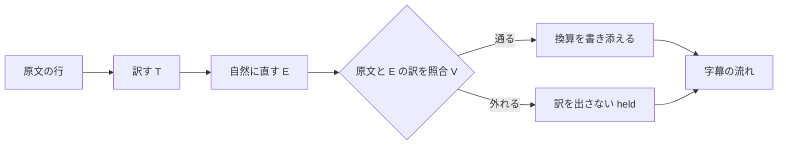

# 会話字幕：日英の双方向翻訳を、会議、動画、配信の上に出す

日本語話者と英語話者が話すとき、相手の言葉を自分の言語で読めるようにする。
日本語の発話は英語へ、英語の発話は日本語へ訳し、どちらも 1 枚の重ね窓に出す。
字幕は Zoom、Teams、YouTube、MPC-HC の上に重ねて読め、OBS を通して相手へも届く。
動画ファイルを指定すれば、同じ directory に SRT を書き出す。
通貨や長さなどの値には、読む側の地の単位へ換算した値を括弧で書き添える。

## 1. 結論

作る物は次の 5 つである。

- **訳の中継**（`hayamimi-relay live`）：2 つの認識 process の確定文と清書を受け、訳す、自然に直す、原文と照合する、の 3 段を通し、単位の換算を書き添えて、1 本の字幕の流れにまとめる。
- **重ね窓**（`hayamimi-overlay`）：中継の流れを読み、透明で最前面の窓に出す。
- **OBS の字幕頁**：重ね窓と同じ画面部品を web 向けに組み、中継が配る。自分の発話の英訳だけを映す。
- **SRT の書き出し**（`hayamimi-relay srt`）：動画ファイルから、同じ 3 段と換算を通した SRT を書く。
- **為替の取得**（`hayamimi-relay fx-fetch`）：1 日 1 回、朝に公開の参照値を取り、file に保存する。

作らない物は次の 5 つである。

- YouTube Live の字幕取り込みへの送信。配信では OBS の字幕頁を映像に焼き込む経路で足りる。
- 認識の作り直し。認識は今の Python の process（`scripts/realtime_transcribe.py`）を使い、event に項目を足すだけにする。
- CPU の翻訳器を GPU の翻訳器の代わりに立てる経路。理由は 3.6 に書く。
- 換算の上書き。原文の値は残し、換算値は必ず括弧の中に添える。
- Rust の chrF。訳の採点は既存の sacrebleu の harness（`scripts/eval_translate.py`）だけで行う。

翻訳のモデルと、自然に直す段のモデルは、9 の決め方で held-out の実測から決める。

## 2. 数えた結果

数えた日時は 2026-10-13 10:1x JST、範囲は repo の全体（`node_modules`、`build`、`target` を除く）である。

### 2.1 字幕の event の producer と consumer

| pattern | 当たった file | 陽性対照 |
|---|---|---|
| `["']translation["']` | 11 本：`scripts/realtime_transcribe.py`、`scripts/subtitle_server.py`、`tests/test_embed_runtime.py`、`docs/guide/embedding.md`、`docs/guide/embedding.ja.md`、`mobile/hayamimi_core/lib/server/subtitle_event.dart`、`mobile/hayamimi_core/lib/remote/remote_event.dart`、`mobile/hayamimi_core/test/remote_event_test.dart`、`mobile/hayamimi_core/README.md`、`demo/remotion/src/timeline.ts`、`demo/remotion/src/components/ReplayUI.tsx` | 同じ式で `scripts/subtitle_server.py` の `"refine"` が 3 件 |
| `audio_s\|audioS` | 36 本（scripts 12、mobile 15、docs 5、tests 4。`rg -l` の一覧を数えた） | `scripts/subtitle_server.py` に在る |
| `== *\{"type": *"(final\|refine)"`（形を固定する test） | 1 件：`tests/test_embed_runtime.py` の `test_eventhub_replays_refine_events_to_new_subscribers`。自分で publish した dict を比べており、producer に項目を足しても落ちない | 同じ式で `translation` が 1 件（`test_translation_worker_publishes_on_hub_with_no_http_server`） |

| consumer | 読む物 | 項目を足したときの扱い |
|---|---|---|
| `scripts/subtitle_server.py` の `OVERLAY_HTML` | `partial`、`final` | 変えない。OBS には中継の字幕頁を使う |
| `scripts/subtitle_server.py` の `DASHBOARD_HTML` | `final`、`translation`（直前の card に貼る） | 変えない。Python の `translation` は今の形のまま出し続ける |
| `mobile/hayamimi_core/lib/remote/remote_event.dart` | 全 type を key で読み、知らない type は `default` の枝 | 互換 |
| `mobile/hayamimi_core/lib/server/subtitle_event.dart` | desktop の wire 形式を写して出す | 互換。「desktop と同じ形」と書いた `subtitle_event_test.dart` は足した項目を持たないまま古くなる |
| `docs/guide/embedding.md`、`embedding.ja.md` の event の表 | `final`、`refine` の項目 | 古くなる。実装の commit で 5 項目を足す |
| `tests/test_embed_runtime.py` | `translation` の形を等号で固定 | Python の `translation` を変えないので落ちない |
| `demo/remotion/src/timeline.ts` | 録った event を再生 | 互換 |
| `mobile/lib/remote/remote_page.dart` | `translation` を最後の確定文（`_finals.last`）に貼る | 変えない。Python の port を読み、その `translation` の形は変わらない。訳の遅れで別の行に貼る弱さは残るが、会話字幕の経路（中継）は通らない |
| 訳の中継（新しい consumer） | `final`、`refine` の 5 項目 | 足した項目が要る |

### 2.2 いまの翻訳の経路

`scripts/realtime_transcribe.py` の翻訳は、認識の言語が `ja` のときだけ走る。
英→和の経路は、いまの repo に無い。
数字の守りは `digits_consistent` で、ASCII の数字の並びだけを比べ、漢数字は素通しする。

### 2.3 試しの実測

出所は `testdata/probe1_*.log` と `testdata/conv20.tsv`（どちらも 2026-10-13 に採った）。
`conv20.tsv` の参照訳は agent が書いた物で、人は確かめていない。
3 本は測った時の機械の混み方が違い、ms を厳密には比べられない（`testdata/probe1_cat-translate-3.3b.log` の末尾の注）。

| 項目 | CAT-Translate-3.3b（正式版、自分で Q8_0 へ変換） | TranslateGemma-4B-it（第三者の Q8_0） | CAT-Translate-3.3b-beta（Q8_0） |
|---|---|---|---|
| 初回 | 418 ms | 298 ms | 1910 ms |
| 2 回目以降 39 回の中央値と p95 | 148 / 277 ms | 262 / 401 ms | 321 / 866 ms |
| 同時 2 件（3 組の遅い側） | 572、326、319 ms | 800、992、561 ms | 936、493、502 ms |
| VRAM の増え | 約 4013 MiB | 約 4590 MiB | 約 4026 MiB |
| 末尾の `</s>` | 40 行中 40 行 | 40 行中 0 行 | 40 行中 40 行 |
| 前置きの混入 | 0 行 | 0 行 | 1 行（j12） |
| 訳さずに原文の言語のまま返した行 | 0 | 0 | 2（e10、e12） |
| 数の取り違え（2 以上の値） | 4 行：j08（五百万円が 1,500,000 yen）、j12（10-day を足す）、e01（100% を足す）、e20（10時を足す） | 0 行 | 5 行（j07 の 3 時が 1 p.m.、ほか CAT 正式版と同じ 4 行） |
| 1 を足した行 | 3 行：e02、e09、e16 | 0 行 | 2 行 |
| 意味の変わった行（読んで判定） | e11 | j13、e05 | e11 |
| 許諾 | MIT（S1） | Gemma の利用条件 | MIT |

行の数え方：`awk -F'\t' 'NF>=5 && $1 ~ /^[je][0-9][0-9]$/' <log> | wc -l` が 3 本とも 40（陽性対照は j01 の行）。
`</s>` で終わる行は同じ式に `$5 ~ /<\/s>$/` を足して CAT 正式版 40。
TranslateGemma は `grep -c '</s>'` が 0（rc=1。同じ式が CAT の log では 43 を返し、うち 3 行は log の見出しと注）。
数の取り違え、1 を足した行、意味の変わった行は、40 行を読んで数えた。

CAT 正式版を量子化せずに f16 で動かした log（`testdata/probe4_cat-translate-3.3b-f16.log`）でも、j08、e01、e20、j14 は Q8_0 と同じ訳を返し、j12 は別の誤り（`14‑day` を足す）を返した。
CAT の数の取り違えは量子化によるものではなく、model 自体の癖である。

### 2.4 外の事実と出所

| 番号 | 事実 | 出所（取得日 2026-10-13） |
|---|---|---|
| S1 | CAT-Translate-3.3B の BLEU の平均は全体 36.16、ja→en 37.51、en→ja 34.80。同じ表で translategemma-4b-it は 28.09、29.41、26.76。許諾は MIT。推奨の prompt は `Translate the following {src_lang} text into {tgt_lang}.` の後に空行と原文 | https://huggingface.co/cyberagent/CAT-Translate-3.3b |
| S2 | Zoom で外部の字幕を送るには、host が web の設定で caption API token を許し、会議中に host が token を写して渡す。token は会議が続く間だけ有効 | https://support.cmts.jhu.edu/hc/en-us/articles/40888716745997-Setting-Up-Closed-Captioning-in-Zoom-Using-a-Third-Party-Captioning-Service 、https://live.maestra.ai/help/zoom （第三者の手引き） |
| S3 | Teams の CART 字幕は、主催者が会議の option で「Provide CART Captions」を入れて link を作り、字幕者へ渡す | https://support.microsoft.com/en-US/teams/meetings-events/use-cart-captions-in-a-microsoft-teams-meeting-human-generated-captions |
| S4 | ECB のユーロ参照為替は、TARGET の休業日を除く毎営業日の 16:00 CET ごろに更新される。JPY、USD、GBP、CAD、AUD を含む。情報のための値で、取引への使用は勧めない。2026-10-12 の値は USD 1.1181、JPY 177.33。日次の file は `https://www.ecb.europa.eu/stats/eurofxref/eurofxref-daily.xml` | https://www.ecb.europa.eu/stats/policy_and_exchange_rates/euro_reference_exchange_rates/html/index.en.html |
| S5 | llama-server の `/completion` は `stop`（止める文字列の配列）を受け、止めた文字列を出力から除く。`-np` は slot の数 | https://github.com/ggml-org/llama.cpp/blob/master/tools/server/README.md |
| S6 | 字形の file：cinecaption 2.28（`cinecaption2.28.ttf`）と UDEV Gothic v2.2.0（`UDEVGothic35-Regular.ttf` ほか）。配布条件は cinecaption が無料、改造禁止、再配布自由、UDEV Gothic が OFL 1.1 | `C:\Users\user01\hayamimi_fonts\` の 2 つの zip（`unzip -l` で確かめた）。配布条件は `state.json` の `fonts` の転記 |
| S7 | 換算の係数：mile 1609.344 m、ft 0.3048 m、in 0.0254 m、yd 0.9144 m、sq ft 0.09290304 m²、英ガロン 4.54609 L、°C = (°F − 32)/1.8 は厳密値。lb 0.4535924 kg、oz 28.34952 g、米ガロン 3.785412 L、米 fl oz 29.57353 mL、英 fl oz 28.41306 mL、acre 4046.873 m²（米測量 ft） | https://www.nist.gov/pml/special-publication-811/nist-guide-si-appendix-b-conversion-factors/nist-guide-si-appendix-b9 |
| S8 | 住宅の畳数の表示は 1 畳 = 1.62 m² 以上（不動産の表示に関する公正競争規約施行規則とされる） | https://smtrc.jp/useful/glossary/detail?n=3751 （用語集。規約の原文は確かめていない） |
| S9 | 既存の ja→en の採点：FLEURS validation、n=50、seed 0、sacrebleu の corpus chrF で FuguMT 47.57、M2M-100 418M 48.88 | `docs/eval/translate_candidates.md` |

## 3. 方針と理由

### 3.1 音源と言語の規則

話者は音源で決め、音源ごとに 1 つの認識 process を動かす。
マイクは自分の声で、言語は `ja` に固定する。
スピーカー出力（loopback）は場面で規則が変わるので、process の起動引数 `--scene` で選ぶ。

| `--scene` | loopback の言語 | 訳 | 理由 |
|---|---|---|---|
| `meeting`（Zoom、Teams） | `en` に固定 | en→ja | 会議の相手は英語話者で、言語判定の取り違えで字幕が途切れることを避ける |
| `media`（YouTube、MPC-HC） | 既存の認識の言語判定に任せ、候補は絞らない | `en` なら en→ja。`ja` と、それ以外の言語は訳さず原文だけを出す | 鳴る音は日本語のことも第三の言語のこともあり、`en` に固定すると崩れる |

言語判定は既存の認識が持つ物を使い、新しい段は足さない。

### 3.2 訳の中継を 1 か所に置く

2 つの認識 process の event は、訳の中継 1 本が受ける。
中継が `id` で行と訳を結び、1 本の字幕の流れ（SSE）として重ね窓と OBS の字幕頁へ配る。
相手への送信（OBS、Zoom、Teams）も中継が行う。

### 3.3 event に足す項目

`final` と `refine` の両方に、同じ次の 5 項目を足す。
既存の項目は変えない。

| 項目 | 型 | 意味 |
|---|---|---|
| `id` | string | `<source>-<連番>`。process の起動ごとに 1 から数える。確定文と清書は別々に番号を取る |
| `source` | `"mic"` \| `"loopback"` \| `"file"` | どの音源か |
| `t0_s` | float | 流れの先頭からの発話の始まり（秒）。動画では動画の先頭から |
| `t1_s` | float | 同じく発話の終わり |
| `end_wall_ms` | integer | 発話の終わりを VAD が決めた時刻（epoch ms） |

重ね窓は確定文の訳だけを出し、清書の訳は SRT と議事の写しに使う。
清書の訳で重ね窓の行を置き換えないので、清書と確定文を結ぶ項目は要らない。

中継が出す `translation` は、次の形にする。
Python の `translation` とは別の port に出し、Python 側の形は変えない。

```
{"type":"translation","id":str,"of":"final"|"refine","source":str,"src_lang":str,"lang":str,
 "status":"ok"|"held",
 "hold_reason":null|"number"|"negation"|"uncertainty"|"proper_noun"|"form"|"unavailable",
 "text":str,"annotations":[{"start":int,"end":int,"text":str}]}
```

訳は `id` で行に結ぶ。
直前の行に貼る形では、訳が遅れて次の確定文が先に着くと、訳を別の行に貼るためである。

### 3.4 翻訳の 3 段

訳は次の 3 段を、この順に 1 回ずつ通す。



照合は E の訳と原文の 1 組にだけ 1 回掛け、通った訳にだけ換算を添える。

- **T（訳す）**：原文の意味を対象の言語へ移す。llama-server に 1 回頼む。`stop` に `</s>` を渡す（S5）。
- **E（自然に直す）**：T の訳と原文を渡し、対象の言語として自然な語順、つなぎ、話し言葉の調子に直させる。事実、数、固有名、否定、不確実性は変えないと指示する。和訳では 3.5 の和文の型の表（敬体にそろえる、直訳の型を避ける）も渡す。llama-server に 1 回頼む。
- **V（照合する）**：原文と E の訳を 1 回だけ比べる。T の訳は比べない。言語モデルを使わず、規則と表で決める Rust の関数にする。比べるのは次の 5 つで、1 つでも外れたら STOP とする。

| 照合 | 規則 |
|---|---|
| 数 | 両方から値を取り出して正規化し（算用数字、全角、漢数字の万と億、英語の数詞、桁区切り）、2 以上の値の多重集合が一致すること。値 1 は比べない（「もう一度」「a week」のように、片方にだけ 1 が出る言い回しが多いため） |
| 否定 | 否定の印（`ない`、`ません`、`ず`、`not`、`n't`、`no`、`never`、`without` ほか）の有無が一致すること。否定でない定型句（`すみません`、`申し訳ありません`、`ないといけ`、`なければなら` ほか）は数えない |
| 不確実性 | 推量と概数の印（`かもしれ`、`可能性`、`と思`、`そう`、`想定`、`約`、`くらい`、`may`、`might`、`probably`、`think`、`seem`、`look like`、`around`、`about` ほか）の有無が一致すること。依頼の `Could you`、`Can you` は数えない |
| 固有名 | 用語表に載った語が原文に在れば、表の訳語が訳に在ること。和→英では、原文の英字の語が訳にそのまま在ること |
| 形 | 訳が空でない、原文と同じでない、対象の言語の文字である、前置きと原文に無い引用符で包んでいない |

印の一覧、定型句、用語表は repo の既定の表から始め、利用者の設定の directory（`%APPDATA%\hayamimi\`）の file で上書きできる。
file が変わったら再起動せずに読み直し、読めない file は使わずに前の内容を使い、warn を 1 行出す。

STOP の行を訳し直さない理由は 2 つある。
T は正本（原文）から直接訳した物だが、照合を通っていないので、照合の 1 回を増やさずには出せない。
温度 0 で同じ原文を渡すと同じ訳が返り、訳し直しても同じ所で外れる。

STOP のときに字幕へ出す物は次のとおりである。

| 場合 | 自分の重ね窓 | SRT | 相手へ（OBS、Zoom、Teams） |
|---|---|---|---|
| V が外れる（`held`） | 原文を原文の字形で、薄くして、頭に「原文」の印を付けて出す | 原文の cue の頭に「〔訳を控えました〕」を付ける | 何も送らない |
| 翻訳器が答えない（`unavailable`） | 原文に「訳なし」の印 | 書き出しを止め、何行目で止まったかを言う | 何も送らない |

相手へ原文を送らないのは、相手は原文の言語を読めない前提で、印の付いた原文は字幕の幅を使うだけだからである。
数を取り違えた訳を出すより、訳を出さない方が害が小さい。
一方、V が正しい訳を誤って止めると相手の字幕が消えるので、誤って止める数を CS-24 で測る。

### 3.5 自然さの 3 段（測る、作り込む、見張る）

**評価の文の 2 組**：訳の文の組を、調整用と held-out に分ける。

| 組 | file | 行数 | 書く席 | 見てよい席 |
|---|---|---|---|---|
| 調整用 | `testdata/conv20.tsv`（既存） | 和 20、英 20 | 既存（agent 作成、人の確認なし） | 全員 |
| held-out | repo の外の file。path は code に書かず、`eval --final --heldout <path>` の引数で渡す | 和 40、英 40 | test-designer が実装の前に書き、参照訳を付ける（agent 作成。人が確かめたら、その旨を file の頭に書く） | test-designer と検証の席だけ。V、表、E の指示文を直す席の brief には path を書かない |

held-out の文は、会議の言い回しのほか、数、否定、推量、固有名、通貨と単位を含む行を方向ごとに 10 行以上入れる。
合否は held-out の数でだけ出し、調整用の数は記録だけにする。

held-out は 1 batch ごとに 1 回だけ合否に使う。

| 決め事 | 内容 |
|---|---|
| batch の sha256 | 1 本目の batch は未作成である。書いた test-designer が、この行に sha256 を書く |
| 結果の file に残す物 | `heldout_sha256`、`tables_sha256`（8 の表の file をつないだ bytes の sha256）、T と E の model の名前、日付、方向ごとの行数と STOP の数 |
| 2 回目の拒み | `eval --final` は、結果の file に同じ `heldout_sha256` が別の `tables_sha256` で既に在れば、打たずに止まり `eval.heldout.spent` を出す（CS-30）。使った batch は燃やした物として扱い、決め直すときは新しい batch を書く |
| 落ちたときの出力 | CS-4b と CS-24 が落ちたときに出すのは、行の id と件数だけで、文の本文は出さない |
| 読み取りの gate | held-out の directory の名前に当たる Read、Grep、Glob、Bash を止める PreToolUse の gate を、hooks の repo で作る（9 の「この文書の外で直す物」） |

診断のために、`eval` は E を外して T の訳に V を掛ける腕（`--t-only`）を 1 本持つ。
この腕の数は記録だけにし、合否にも batch の燃やしにも数えない。

**測る**：held-out に、中継の評価の subcommand（`hayamimi-relay eval --final --heldout <path>`）を通す。
次を機械で数え、`docs/results/translate_conv.md` へ日付と model の名前と一緒に追記する。

| 指標 | 数え方 | 扱い |
|---|---|---|
| 照合の STOP | V が `held` を返した行の数 | 合否：方向ごとに 40 行中 2 行以下 |
| 誤った STOP | held-out の原文と参照訳の 80 組に V を掛け、STOP した組の数 | 合否：0（CS-24） |
| 形の欠け | `</s>`、前置き、包みの引用符、対象の言語でない行 | 合否：0 |
| 直訳の型 | 直訳の型の表に当たった行。T の訳と E の訳の両方で数える | 合否：E の数が T の数以下（CS-26） |
| 和文の型 | 和訳の 1 行の中で敬体と常体が混ざる行、和文の型の表に当たった行 | 合否：E の訳で 0（CS-27） |
| chrF（参照訳との文字 n-gram の F 値） | sacrebleu の corpus chrF を `scripts/eval_translate.py` で数える | 記録だけ。参照訳が agent 作成のため合否に使わない |
| FLEURS の ja→en chrF | S9 と同じ harness、同じ n=50、seed 0 | 合否：FuguMT の 47.57 を超える（CS-3） |

FLEURS の採点では、`scripts/eval_translate.py` に 2 つの option を足す。
`--dump-pairs <tsv>` は、採点に使う原文と参照訳を書き出す。
`--score-hyps <tsv>` は、中継が書いた訳を読み、同じ sacrebleu の式で採点する。
訳は Rust の中継が 3 段を通して作り、採点だけを既存の Python の harness が行う。
V が STOP した行は、hyp を空の文字列として採点に入れる。
除くと止めた行の分だけ点が上がり、止めるほど得をする形になるからである。
harness に llama-server の backend を足す形は採らない。
T だけを採点することになり、3 段を通した訳を測れないからである。

**作り込む**：E の指示文、用語表、直訳の型の表、和文の型の表、否定と不確実性の定型句の表を直す。
直したら調整用の 40 行で測り、悪くならないときだけ残す。
model と llama.cpp は外が更新する物なので、版と sha256 は結果の file に記録するだけにし、動作の条件にしない。

**見張る**：中継は、1 行ごとに次の log を JSONL で stdout へ出す。
本文、原文、訳文、token、link は log に書かない。

| event | 項目 |
|---|---|
| `translate.line.ok`、`translate.line.held` | `id`、`source`、`hold_reason`、`t_ms`、`e_ms`、`v_ms` |
| `translate.request.failed` | `id`、`dependency: "llama-server"`、`duration_ms`、`error_code` |
| `annotate.line.added`、`annotate.line.skipped` | `id`、`kind`（currency、length ほか）、`reason`（ambiguous、no_rate、stale_rate ほか） |

直近 50 行で `held` が 5 行を超えたら、warn の event `translate.hold_rate.high` を 1 回出す。

### 3.6 翻訳器が落ちた、遅い、余計な文を返したとき

1 回の依頼の上限は 1500 ms とする。
上限を超えた、接続できない、5xx を返した場合は、その行を `hold_reason: unavailable` で出し、次の行は改めて頼む。
説明文や前置きを返した場合は、V の「形」で STOP になる。

CPU の翻訳器（`scripts/translate_ja_en.py` ほか）を代わりに立てる経路は作らない。
その訳の質が、この作り直しの理由そのものだからである。
したがって会話字幕の訳には GPU が要る。
認識は今のまま CPU で動く。

### 3.7 llama-server を置く場所

llama-server は WSL で、既存の CUDA 版の build（`/home/fukugan/source/llama.cpp/build-cuda120`）を使って動かす。
model は `/mnt/h3-models` に置き、使う前に llama.cpp を fetch して再 build する。
Windows 側の中継は `http://127.0.0.1:<port>` で届く。
WSL の VM が止まると訳が止まるので、Windows の端末を閉じた後も VM が残るかを CS-20 で測る。
slot は 2 とし（`-np 2`）、中継は音源ごとに先入れ先出しの列を持つ。
1 行は T と E の 2 回の依頼を順に打つので、2 つの音源が同時に話しても slot は 2 で足りる。

### 3.8 部品ごとの言語

| 部品 | 言語 | 理由 |
|---|---|---|
| 認識（マイク、loopback、動画） | Python（既存の `scripts/realtime_transcribe.py`） | 既に在る。event に項目を足すだけにし、部品は増やさない |
| 訳の採点 | Python（既存の `scripts/eval_translate.py` に option を 2 つ足す） | 既存の harness と同じ式で比べる |
| 訳の中継、3 段、照合、換算 | Rust（`hayamimi-relay`） | 新しく作る部品は Rust にする |
| SRT の書き出し | Rust（`hayamimi-relay srt`）。音声の取り出しと認識は既存の Python を子 process で呼ぶ | 3 段と換算を live と同じ関数で通す |
| 為替の取得と、その予定の登録 | Rust（`hayamimi-relay fx-fetch`、`fx-schedule`） | 新しく作る部品は Rust にする |
| 重ね窓 | Rust、Dioxus desktop（`hayamimi-overlay`） | 画面は Dioxus |
| OBS の字幕頁 | Rust、Dioxus web。重ね窓と同じ画面部品を web 向けに組み、中継が配る | 画面は Dioxus。部品を 1 つにする |
| 相手への送信（Zoom、Teams） | Rust（中継の中） | 新しく作る部品は Rust にする |
| 翻訳 | llama.cpp（`llama-server`、CUDA） | 既存の build を使う |

Rust は repo の `native/` に 1 つの workspace として置く。
Windows 向けの build は WSL から `x86_64-pc-windows-gnu` で行う。

### 3.9 Rust へ移す条件

認識を Rust へ移すのは、CS-7 が落ち、かつその測定で認識の分（`final` の `latency_ms` の p95）が 1000 ms を超えたときだけである。
訳の分が遅いときは、認識を移しても縮まないので、model と slot の設定で直す。

### 3.10 相手へ届ける経路

| 経路 | 前提 | 既定か |
|---|---|---|
| OBS の字幕頁を焼き込み、OBS の仮想カメラを会議のカメラにする | 前提なし。guest でも使える | 既定 |
| Zoom の字幕 API へ和→英を送る | host が caption API token を許し、token を渡す（S2） | token が在るときだけ |
| Teams の CART 字幕へ和→英を送る | 主催者が CART の link を作って渡す（S3） | link が在るときだけ |

Zoom と Teams の字幕は参加者全員に 1 本だけ届くので、送るのは和→英だけにする。
token と link は会議ごとに変わるので、`%APPDATA%\hayamimi\send.toml` に書き、再起動せずに読み直す。
この file の権限は、今の利用者と SYSTEM と Administrators だけが読める形にする。
中継は読み直しのたびに ACL を見て、ほかの主体が読めるなら送信を止め、`send.config.too_open` を error で出す（CS-28）。

### 3.11 単位の換算

**順番**：換算は V を通った後に行い、V の比べる対象に入れない。
書き添えた値は `annotations` に位置と一緒に持ち、V に渡す文字列には含めない。

**部品**：換算は言語モデルを使わず、Rust の規則と表で決める。
数の読み取りは V と同じ関数を使う。
認識の文字列が「a hundred dollars」のように語で来ても、この関数が 100 と読むので、ITN（語を数字へ直す段）は足さない。

**書き方**：原文の値は訳の中にそのまま残し、その直後に換算値を括弧で添える。
添える位置は、訳の中で原文と同じ値を持つ単位の表現の直後とし、1 か所に決まらないときは添えない。
換算値は有効数字 3 桁に丸め、「約」と「about」を付ける。
通貨には為替の日付を添える。
添え書きの型は locale の文字列表に置き、code に直書きしない。

| 読む側の言語 | 原文 | 字幕 |
|---|---|---|
| ja | $100 | `100ドル（約 15,900 円、10/12 の値）` |
| ja | 5 miles | `5 マイル（約 8.05 km）` |
| ja | 98.6°F | `98.6°F（約 37.0℃）` |
| ja | 10 lb | `10 ポンド（約 4.54 kg）` |
| en | 五百万円 | `five million yen (about $31,500, rate of Oct 12)` |
| en | 3 坪 | `3 tsubo (about 9.92 m², 107 sq ft)` |

通貨の例は S4 の 2026-10-12 の値（USD 1.1181、JPY 177.33）から EUR を介して出した。
字幕は「$100（15000円）」の形より長くなる。
「約」は為替と丸めで値が目安であることを、日付は為替が日ごとに動くことを読む側に示すために付け、7 日の打ち切りは古い値を今の値と読ませないために置く。

**地の単位と係数の表**：言語の組ごとに表で持ち、repo の既定を利用者の設定の directory の file で上書きできる。
多言語へ広げるときは、表に行を足す。

| 読む側の言語 | 通貨 | 長さ | 重さ | 温度 | 体積 | 面積 |
|---|---|---|---|---|---|---|
| ja | JPY | m、km、cm | kg、g | ℃ | L、mL | m² |
| en | USD | mile、ft、in | lb、oz | °F | US gallon、US fl oz | sq ft、m² の併記 |

| 元の単位 | 換算先 | 係数 | 出所 |
|---|---|---|---|
| mile | km | 1.609344 | S7（厳密） |
| ft | m | 0.3048 | S7（厳密） |
| inch | cm | 2.54 | S7（厳密） |
| yd | m | 0.9144 | S7（厳密） |
| lb | kg | 0.4535924 | S7 |
| oz | g | 28.34952 | S7 |
| °F | ℃ | (x − 32)/1.8 | S7（厳密） |
| US gallon | L | 3.785412 | S7 |
| US fl oz | mL | 29.57353 | S7 |
| sq ft | m² | 0.09290304 | S7（厳密） |
| acre | m² | 4046.873 | S7 |
| 坪 | m² | 400/121（≒ 3.305785） | 1 尺 = 10/33 m からの導出（9 の H14） |
| 畳 | m² | 1.62 | S8（住宅の広告の表示の目安） |
| km | mile | 1 / 1.609344 | S7 の逆数 |
| m | ft | 1 / 0.3048 | S7 の逆数 |
| cm | inch | 1 / 2.54 | S7 の逆数 |
| kg | lb | 1 / 0.4535924 | S7 の逆数 |
| g | oz | 1 / 28.34952 | S7 の逆数 |
| ℃ | °F | x × 1.8 + 32 | S7 の逆 |
| L | US gallon | 1 / 3.785412 | S7 の逆数 |
| mL | US fl oz | 1 / 29.57353 | S7 の逆数 |
| m² | sq ft | 1 / 0.09290304 | S7 の逆数 |

逆向きの行は、和→英の字幕で日本語の側の値を en の地の単位へ直すために使う。
坪と畳は、m² を経て sq ft へ直す。

**曖昧な物**：決められないときは添えない。

| 表現 | 扱い |
|---|---|
| `$`、`dollar` | 表の既定（en は USD）とみなす。`C$`、`CA$`、`Canadian dollar` は CAD、`A$`、`AU$` は AUD |
| `pound` の語だけ | 添えない。`£`、`GBP`、`pounds sterling` は GBP、`lb`、`lbs` は重さ |
| `in` | 単位として読まない（"at 5 in the morning" のように前置詞と区別できない）。`inch`、`inches`、数の直後の `″` だけを inch とする |
| `gallon` の語だけ | 添えない（米ガロンと英ガロンで約 20% 違う、S7）。`US gallon` と `imperial gallon` だけ換算する |
| `fl oz` | 米 fl oz とみなす。英 fl oz との差は約 4%（S7）で、「約」の幅に収める |
| `oz` | 重さとみなす。`fl oz` は体積 |
| `ton` | 添えない（米、英、メートル法の 3 つがある） |
| `degrees` だけ | 添えない |
| `billion`、億 | 値の読み取りは行い（10^9、10^8）、単位が付いたときだけ換算する |

**為替の値**：字幕は、為替の file の値だけを基準にする。
字幕を出している間は網に出ない。

| 決めること | 決定 |
|---|---|
| 取得先 | ECB のユーロ参照為替の日次の XML（S4）。毎営業日 16:00 CET ごろに出る。JPY と他の通貨の交差値は EUR を介して計算する |
| 起動の仕組み | Windows のタスク スケジューラ。`hayamimi-relay fx-schedule --install` が task を登録し、毎日 07:30 JST に `fx-fetch` を打つ。「逃した実行は起動後すぐに走らせる」を入れる。`--remove` で消す。task の名前は既定が `hayamimi-fx-fetch` で、`--task-name <名>` で替えられる。test は本番の名前を使わず、`hayamimi-fx-fetch-test-<連番>` を渡す。test は `--out` で書き先を、`--source-url` で取得先を替える。WSL の cron は、朝に WSL の VM が起きている保証が無いので使わない |
| 網に出す物 | 上の URL への GET 1 本だけ。body も query も付けない |
| file の path と形式 | `%LOCALAPPDATA%\hayamimi\fx_rates.json`。項目は `source_url`、`rate_date`（ECB が値に付けた日）、`fetched_at`（RFC 3339、+09:00）、`base: "EUR"`、`rates`（通貨 code と値）。同じ directory の一時 file に書いてから rename で入れ替える |
| 何日の値かの示し方 | `rate_date` を「10/12 の値」「rate of Oct 12」と添える。取得した日ではなく、ECB が値を出した日を示す |
| 取得に失敗したとき | 前の file をそのまま使い、日付もそのまま示す。`fx.fetch.failed` を error で出す |
| 古すぎる値 | `rate_date` が今日から 7 日より前なら、通貨の換算を添えない（reason `stale_rate`） |
| 週末と祝日 | ECB は値を出さないので、朝の取得は前の営業日の値を取る。月曜の朝は金曜の値を示す。7 日の上限は、連休をまたいでも越えない幅として置く |
| file が無いとき | 通貨の換算を添えない（reason `no_rate`）。長さや重さの換算は為替に依らないので添える |

中継は file の変更を検知して読み直し、読めない file は使わずに前の内容を使う。

### 3.12 字幕の字形と重ね窓の画面

hayamimi に Figma の板は無い。
画面の要素と寸法と条件をここに書き、見た目の詰めは designer の席が持つ。

**字形**：日本語の行は cinecaption（`cinecaption2.28.ttf`）、英語の行は UDEV Gothic 35（`UDEVGothic35-Regular.ttf` と `-Bold.ttf`）で描く。
字形の file は repo に入れず、Windows にも入れない。
設定 file に書いた path から `@font-face` で読み、OBS の字幕頁には中継が同じ file を localhost でだけ配る。
file が無いときは Yu Gothic UI で描き、`overlay.font.missing` を warn で 1 回出す。
cinecaption に無い字は Yu Gothic UI で描く。

**窓**：枠と題名の帯を持たず、背景は透明で、常に最前面にあり、クリックを下のアプリへ素通しする。
窓の影と 1 px の縁も出さない。
閉じる手段は taskbar の項目だけにする。
DPI は monitor ごとに追う（per-monitor DPI aware）。

**並べ方**：画面の下に、作業領域の幅の 80% の帯を 1 本置く。

| 段 | 中身 | 字形と大きさ（100% のとき） | 行数 |
|---|---|---|---|
| 上の段（相手の段） | loopback の行：相手の発話の和訳（en→ja）、または media の原文 | cinecaption、36 px、白 | 新しい 2 行 |
| 下の段（自分の段） | mic の行：自分の発話の英訳（ja→en）。相手に届く物の確認 | UDEV Gothic 35、26 px、白で不透明度 0.8 | 新しい 1 行 |

**OBS の字幕頁**は下の段（自分の段）だけを映す。
頁は相手へ届ける経路であり、相手が読むのは自分の発話の英訳だからである。

1 行は最後の更新から 8 秒で消える。
字の縁は 2 px の黒い線で描き（`paint-order: stroke`）、明るい背景の上でも読めるようにする。
`held` の行は原文の字形で、不透明度 0.6、頭に「原文」の印を付ける。
印と添え書きの文言は locale の文字列表から取る。

**字が切れない条件**：行の高さは字の大きさの 1.5 倍、帯の下に字の大きさの 0.3 倍の余白を置く。
窓の高さは「表示する行数 × 行の高さ + 余白」を CSS px で計算し、拡大率を掛けて物理 px にする。
拡大率 100%、125%、150%、200% のどれでも、各行の要素で `scrollHeight` が `clientHeight` 以下であること（CS-11）。

### 3.13 SRT の書き出し

動画ファイルを 1 つ指定すると、最初に `<動画名>.ja.srt` と `<動画名>.en.srt` の有無を見る。
どちらかが在れば、音声を取り出す前に止めて知らせる。
上書きの option は作らない。

無ければ、音声を取り出して認識（`--scene media` と同じ言語の規則）を通し、清書の行ごとに 3 段と換算を通す。
書き出す file は、行の言語で決める。

| 行の言語 | `<動画名>.ja.srt` | `<動画名>.en.srt` |
|---|---|---|
| ja | 原文 | 書かない |
| en | 和訳（STOP の行は印つきの原文） | 原文 |
| それ以外 | 原文 | 書かない |

`.en.srt` は en の行が 1 行以上あるときだけ作る。
したがって日本語だけの動画では `.ja.srt` だけができる。
cue の時刻は清書の `t0_s` と `t1_s` から作り、文字コードは BOM 無しの UTF-8 とする。
書き終えるまでは一時 file に書き、最後に rename で置く。

## 4. 採らない手段

- **クラウドの翻訳 API と音声認識 API**：会話の音声と文字を外へ出すため。為替の取得も、会話の文字を含まない GET だけにする。
- **filmboard の Figma の台帳と板を持ち込む**：別の app の物であり、hayamimi の画面は 3.12 の条件で決める。
- **Python の部品を増やす**：新しい部品はすべて Rust で作る。既存の認識と採点の harness は 3.8 の表のとおり使い続ける。
- **言語モデルに単位を換算させる、または照合させる**：試しで言語モデルが数を取り違えた（2.3）。数を扱う段は規則と表で決める。
- **T の訳にも照合を掛けて、E が外れたら T を出す**：照合が 2 回になり、どちらの訳を出したかで字幕の扱いが 2 通りになる。照合は E の訳に 1 回だけ掛ける。
- **Rust で chrF を書く**：sacrebleu と一致させる検査が 1 つ増える。採点は既存の harness で足りる。
- **調整用の 40 行で合否を出す**：表を直す席が同じ行で合格を作れてしまう。合否は held-out で出す。
- **重ね窓が 2 つの port を直接読む**：行と訳を結ぶ所が 2 か所に分かれる。中継 1 本で結ぶ。
- **マイクとスピーカー出力を 1 本に混ぜて言語判定で分ける**：話者を言語判定で推すことになり、音源で分けるより確かでない。
- **loopback を常に `en` に固定する**：日本語の動画で英語の認識器に日本語が入る（3.1）。
- **YouTube Live の字幕取り込みへ送る**：OBS の焼き込みで配信に字幕が載る。
- **CPU の翻訳器を代わりに立てる**：3.6。
- **CTranslate2 のまま GPU へ移す**：質の問題は翻訳の model にあり、実行の部品を替えても直らない。
- **SRT の上書き option**：消すか名を変えるかで足りる。
- **為替を字幕の度に網から取る**：字幕を出す間に網へ出ることになり、遅れも増える。
- **WSL の cron で為替を取る**：朝に WSL の VM が起きている保証が無い。

## 5. 構造

```
マイク ───────▶ 認識 ja 固定（Python）──┐
                                         │ final / refine（id, source, t0_s, t1_s, end_wall_ms）
loopback ─────▶ 認識 --scene（Python）──┤
                                         ▼
                              訳の中継（Rust、Windows）
                   T ─▶ E ─▶ V ─▶ 換算 ◀── fx_rates.json ◀── fx-fetch（タスク スケジューラ、毎朝 07:30、GET 1 本）
                    │                  │
          llama-server（WSL、CUDA）     ├─▶ SSE ─▶ 重ね窓（上の段：相手、下の段：自分）
                                       ├─▶ SSE ─▶ OBS の字幕頁（自分の段だけ）─▶ OBS 仮想カメラ
                                       └─▶ Zoom 字幕 API / Teams CART（token か link が在るとき）
動画ファイル ─▶ hayamimi-relay srt ─▶ 認識（Python、子 process）─▶ T ─▶ E ─▶ V ─▶ 換算 ─▶ <名>.<言語>.srt
```

認識だけが Python で、訳と照合と換算と画面と送信は Rust の 1 か所を通る。

## 6. 受入 ID

時刻と遅れは、中継と重ね窓の JSONL の log から数える。
`<relay>` は `native/target/x86_64-pc-windows-gnu/release/hayamimi-relay.exe` を指す。
`cargo test` は `native/` で打つ。

### 6.1 翻訳の検証ベクトルとの対応

| `readme-writing.md` の検証ベクトル | この設計での形 | 受入 ID |
|---|---|---|
| JA-EN-default、explicit-other（工程の順） | 正本は話者の原文。訳す、自然に直す、照合する、を 1 回ずつ、この順に通す | CS-25 |
| EN-literal-vs-natural | E が英訳の語順、つなぎ、調子を組み替え、直訳の型を減らす | CS-26 |
| semantic-drift | 数、否定、不確実性、固有名を変えた訳は STOP。正しい訳を誤って止めない | CS-4a、CS-4b、CS-24、CS-5 |
| target-language-edit | 和訳は和文の型の表（敬体、直訳の型）に従って直す | CS-27 |

### 6.2 表

| ID | 測る物 | command | 期待値 | 陽性対照 | 陰性対照 |
|---|---|---|---|---|---|
| CS-1 | 英語の発話が和訳されて重ね窓に出る | Zira の英語の wav を loopback で鳴らし `cargo test --release --test cs01 -- --ignored` | `translate.line.ok` の `source: loopback` が 1 件以上、その `id` の `overlay.line.rendered` が在り、訳は仮名か漢字を含み原文と違う | 同じ test が `ok` を数える | 原文を素通しする偽の翻訳器では `held`（形）になり落ちる |
| CS-2 | 日本語の発話が英訳される | Haruka の wav を `--wav` でマイクの process へ流し `cargo test --release --test cs02 -- --ignored` | `source: mic` の `translate.line.ok` が 1 件以上、訳に仮名と漢字が無い | 同上 | 素通しの偽の翻訳器で落ちる |
| CS-3 | ja→en の訳の質を既存と同じ harness で比べる | `python scripts/eval_translate.py --dump-pairs pairs.tsv --targets en --n 50`、`<relay> eval --pairs pairs.tsv --out hyps.tsv`、`python scripts/eval_translate.py --score-hyps hyps.tsv --targets en --n 50` | 3 段を通した訳の corpus chrF が 47.57 を超える | `--backend fugumt` を同じ式で採ると 47.57 が出る | 原文をそのまま返した hyps では 47.57 を割る |
| CS-4a | 照合 V が取り違えを止め、調整用の訳を通す（中継も llama-server も要らない） | `cargo test --release --test cs04a` | 調整用 40 組（原文と参照訳）が全部通り、CAT 正式版の j08、j12、e01、e20 の 4 行が全部 `number` で STOP。落ちたら行の id と件数だけを出す | 調整用 40 組 | 4 行の取り違え |
| CS-4b | held-out での model の出力の STOP の数 | `<relay> eval --final --heldout <path>` の後に `cargo test --release --test cs04b -- --ignored` が結果の file を読む | STOP が方向ごとに 40 行中 2 行以下。落ちたら行の id と件数だけを出す | 結果の file に `heldout_sha256` と行数 80 が在る | 数を変える偽の E では 2 行を超えて落ちる |
| CS-5 | STOP のときの出し方 | `cargo test --release --test cs05` | `held` の行は重ね窓に原文と印、相手への送信は 0 件、SRT は印つきの原文 | V を通る行は `ok` で送られる | 数を変える偽の翻訳器 |
| CS-6 | 3 段が遅れに足す時間 | 2 音源を同時に 10 分流し `cargo test --release --test cs06 -- --ignored` | 1 行の T+E+V の p95 が 800 ms 以下、V の p95 が 5 ms 以下、E を外した時との差の p95 が 400 ms 以下 | 1 音源だけの測定も同じ式で出る | 偽の翻訳器に 600 ms の遅れを入れると落ちる |
| CS-7 | 発話の終わりから重ね窓に訳が出るまで（負荷下） | Zoom の会議、OBS、2 つの認識、llama-server を同時に動かし 10 分流し `cargo test --release --test cs07 -- --ignored` | `overlay.line.rendered` の時刻 − `end_wall_ms` の p95 が 2000 ms 以下 | 同じ式で 1 音源、無負荷の値も出る | 認識に 2 秒の遅れを入れた run で落ちる |
| CS-8 | 訳の末尾に `</s>` が残らない | `cargo test --release --test cs08` | T と E の依頼に `stop: ["</s>"]` が入り、`</s>` で終わる応答を受けたら `form` で STOP | `</s>` の無い応答は通る | `stop` を外した偽の依頼 |
| CS-9 | loopback の言語の規則 | 日本語の wav を loopback へ `--scene media` と `--scene meeting` で流し `cargo test --release --test cs09 -- --ignored` | media：`lang` が `ja`、その `id` の `translation` が 0 件で原文の行が出る。meeting：`lang` が `en` | 英語の wav では media でも en→ja が出る | 言語判定を外した build で落ちる |
| CS-10 | 2 つの音源が 1 枚の重ね窓に並ぶ | CS-1 と CS-2 を同時に流し `cargo test --release --test cs10 -- --ignored` | `mic-` と `loopback-` の `id` が両方描かれ、上の段に loopback、下の段に mic | 片方だけ流すと片方だけ出る | 中継を止めると 0 件 |
| CS-11 | 字が切れない、枠と影が出ない | 拡大率 100、125、150、200% で `hayamimi-overlay --layout-probe` を起こし `cargo test --release --test cs11 -- --ignored` | 各行で `scrollHeight ≤ clientHeight`。窓の外周 8 px の画素が、窓を出す前の画面と全部一致 | 100% の値 | 余白を 0 にした build では 150% で落ちる |
| CS-12 | 字形 | `cargo test --release --test cs12` | 和の行が cinecaption、英の行が UDEV Gothic 35。cinecaption に無い字の数を出し、Yu Gothic UI で描くことを確かめる。file を外すと `overlay.font.missing` が 1 件 | 字形の file が在るとき | path を壊した設定 |
| CS-13 | OBS の字幕頁が透明で、自分の段だけを映す（OBS は使わない） | 前提：`chrome-headless-shell --default-background-color=00000000 --screenshot http://127.0.0.1:<port>/obs` で撮り、字幕の帯の外の画素の alpha を数える。本体：中継へ `mic-1` と `loopback-1` の試しの event を入れ、`chrome-headless-shell --dump-dom http://127.0.0.1:<port>/obs` | 帯の外の画素の alpha が全部 0。dump に `mic-1` の行が在り、`loopback-1` の行が無い | `mic-1`、帯の中の画素の alpha が 0 でない | `loopback-1`。背景に色を付けた頁では alpha が 0 にならず落ちる |
| CS-14 | 動画から SRT が同じ directory に出る | `<relay> srt <英語の試しの mp4>` と `<relay> srt <日本語の試しの mp4>` の後に `cargo test --release --test cs14 -- --ignored` | 英語の動画：`.ja.srt` と `.en.srt` ができ、cue の数が清書の行の数と同じ、時刻が `t0_s` と `t1_s` に合う、`held` の cue に印がある。日本語の動画：`.ja.srt` だけで `.en.srt` が無い | 英語の mp4 | 日本語の mp4 で `.en.srt` が無いこと、音声の無い mp4 で 0 cue のまま止まって知らせること |
| CS-15 | 既存の SRT で、取り出しの前に止まる | 同じ mp4 で 2 回目を打ち `cargo test --release --test cs15 -- --ignored` | `srt.output.exists` が出て、`srt.extract.started` が 0 件、file の sha256 が 1 回目と同じ | 1 回目では `srt.extract.started` が出る | file を消した run では止まらない |
| CS-16 | guest でも相手へ届く（OBS 仮想カメラ） | 利用者の OBS には測りを掛けない。portable の別の OBS を、利用者の OBS が仮想カメラを使っていないときだけ起こす。その scene の JSON を `jq` で読んで `/obs` の browser source を確かめ、`ffmpeg -f dshow -i video="OBS Virtual Camera" -frames:v 1 frame.png` で 1 frame を取り、`cargo test --release --test cs16 -- --ignored` | scene に中継の `/obs` が在り、frame の字幕の帯の領域に、字幕を出す前の frame と違う画素が在る | 字幕を出した frame | 字幕の無い時の frame |
| CS-17 | Zoom の字幕 API へ届く（token が在るときだけ） | `send.toml` に token を入れ、1 行を送る `cargo test --release --test cs17 -- --ignored` | HTTP 200 で、会議の字幕に出る | 有効な token | 期限の切れた token で `translate.send.failed` |
| CS-18 | Teams の CART へ届く（link が在るときだけ） | `send.toml` に link を入れ、1 行を送る `cargo test --release --test cs18 -- --ignored` | HTTP 200 で、会議の字幕に出る | 有効な link | 壊した link で失敗の event |
| CS-19 | 翻訳器が落ちても字幕が止まらない | 中継を動かしたまま llama-server を止め、5 秒後に戻す `cargo test --release --test cs19 -- --ignored` | 止めた間の行は `unavailable` で原文と印。中継は落ちない。戻して最初の行が `ok` | 動いている時の行 | 戻さない run では `ok` が出ない |
| CS-20 | WSL の llama-server に、端末を閉じた後も届く | Windows の端末をすべて閉じて 10 分後に `curl http://127.0.0.1:<port>/health` | `{"status":"ok"}` | 端末を開いた直後の同じ command | `wsl --shutdown` の後は届かない |
| CS-21 | 2 音源の同時の依頼で行が落ちない | 2 音源を 10 分流し `cargo test --release --test cs21 -- --ignored` | 受けた `final` と `refine` の `id` のすべてに `translation` が 1 つずつある | 1 音源の run | 列を 1 にした設定で落ちる |
| CS-22 | 訳が遅れても別の行に付かない | 偽の翻訳器で 1 行目だけ 1200 ms 遅らせ `cargo test --release --test cs22` | 1 行目の訳が 1 行目の `id` に付く | 遅れの無い run | 直前の行に貼る作り |
| CS-23 | 実マイクの経路（入力の装置が在るときだけ） | `Get-PnpDevice -Class AudioEndpoint` で入力が 1 個以上を確かめ、マイクで日本語を話して CS-2 の test を打つ | CS-2 と同じ | 入力の装置の数 | 0 個のときは test を打たず「前提なし」と出す |
| CS-24 | V が正しい訳を誤って止めない | `<relay> eval --final --heldout <path> --verify-refs` | held-out の原文と参照訳の 80 組で STOP が 0。落ちたら行の id と件数だけを出す | 調整用 40 組でも 0 | CS-4a の 4 行は STOP する |
| CS-25 | 3 段がこの順に 1 回ずつ走る | `cargo test --release --test cs25` | 偽の llama-server が受けた依頼が T、E の順に 1 本ずつで、E の依頼に T の訳が入る。V の呼び出しが 1 回で、渡された訳が E の応答と同じ。換算は V の後 | 正しい順の run | V を T の訳に掛ける作り、換算を V の前に置く作り |
| CS-26 | E が英訳を自然にする | `<relay> eval --final --heldout <path> --direction ja-en` | 直訳の型に当たる行の数が、E の訳で T の訳以下。形の欠けが 0 | 調整用で同じ数が出る | E を素通しにした build で、型の表を 1 語足した行が残る |
| CS-27 | E が和訳を和文の型に合わせる | `<relay> eval --final --heldout <path> --direction en-ja` | E の訳で、敬体と常体が混ざる行が 0、和文の型の表に当たる行が 0 | 調整用で同じ数が出る | 常体の行を混ぜた偽の E の応答で落ちる |
| CS-28 | token と link の file の権限と、log に出ないこと | `cargo test --release --test cs28 -- --ignored`（`icacls %APPDATA%\hayamimi\send.toml` を読む） | ACL が今の利用者、SYSTEM、Administrators だけ。試しの token の文字列が、中継の 10 分の log に 0 件 | 同じ test が `send.toml` に試しの token が在ることを数える | Users に読みを足すと `send.config.too_open` を出して送信を止める |
| CS-29 | 第三の言語の行は訳さず原文だけ | 中国語の wav を `--scene media` で loopback へ流し `cargo test --release --test cs29 -- --ignored` | `final` の `lang` が `ja` でも `en` でもなく、その `id` の `translation` が 0 件、上の段に原文が出る | 英語の wav では訳が出る | 言語を `en` に固定した run では原文の行が出ない |
| CS-30 | 使った held-out の batch を別の表で 2 回目に使えない | `cargo test --release --test cs30`（試しの batch と試しの結果の file で打つ） | 結果の file に同じ `heldout_sha256` が別の `tables_sha256` で在ると、`eval --final` が訳を 1 行も頼まずに止まり、`eval.heldout.spent` を 1 件出す | 新しい batch（別の sha256）なら走る | 拒みを外した build では 2 回目が走って落ちる |
| CX-1 | `$100` に換算が照合の後で添えられる | `cargo test --release --test cx01` | 「I paid $100.」の訳が V を通った後に `100ドル（約 15,900 円、10/12 の値）` の形を持ち、V に渡した文字列に括弧が無い（試しの `fx_rates.json` は S4 の 2026-10-12 の値） | 試しの `fx_rates.json` | 換算を V の前に置いた順 |
| CX-2 | 曖昧な物には添えない | `cargo test --release --test cx02` | 「ten pounds」「two tons」「5 gallons」「at 5 in the morning」には添えず reason が `ambiguous`。「10 lb」「5 inches」「2 US gallons」には添える | `lb`、`inches`、`US gallons` の行 | `pound`、`ton`、`gallon`、前置詞の `in` の行 |
| CX-3 | 換算が遅れに足す時間 | `cargo test --release --test cx03` | 1 行の換算の p95 が 5 ms 以下（調整用 40 行を 100 回） | 同じ式で V の時間も出る | 1 行に 50 ms の待ちを入れた偽で落ちる |
| CX-4 | 為替の file が無いときは通貨を添えない | `cargo test --release --test cx04` | 通貨の行に添えず reason `no_rate`。同じ行の mile には添える | file が在る run | file を消した run |
| CX-5 | 古い値には日付が付き、7 日より前なら添えない | `cargo test --release --test cx05` | `rate_date` が 3 日前なら日付つきで添える。8 日前なら添えず reason `stale_rate` | 3 日前 | 8 日前 |
| CX-6 | 取得の部品が会話の文字を送らない | `cargo test --release --test cx06` | 試しの HTTP server が受けた request が GET 1 本で、path が S4 の path と同じ、body と query が空。字幕の流れに在った文字列が request の bytes に 0 件 | 受けた request の数が 1 | 字幕の文字を query に足した偽の取得で落ちる |
| CX-7 | 取得に失敗しても前の file を使う | `cargo test --release --test cx07` | 試しの server が 500 を返すと、file の bytes が前と同じで `fx.fetch.failed` が 1 件 | 200 のときは file が新しくなる | 書き込みの途中で落とした偽でも、file が前の内容 |
| CX-8 | 週末の値の日付 | `cargo test --release --test cx08` | 月曜の朝に金曜の `rate_date` の XML を受けると、添え書きが金曜の日付を示す | 平日の XML | 取得日を示す書き方で落ちる |
| CX-9 | 大きさ、重さ、温度、体積、面積の係数と丸め | `cargo test --release --test cx09` | 3.11 の係数の表の全行（逆向きの行を含む）について、表の係数で出した値の有効数字 3 桁が test の期待値と一致する（5 mile → 8.05 km、10 lb → 4.54 kg、98.6°F → 37.0℃、2 US gallon → 7.57 L、3 坪 → 9.92 m² と 107 sq ft、6 畳 → 9.72 m²、10 km → 6.21 mile、70 kg → 154 lb、20℃ → 68.0°F ほか、行ごとに 1 件以上） | 厳密値の行（mile、ft、in、sq ft） | 係数を 1 桁ずらした表、4 桁に丸める書き方で落ちる |
| CX-10 | 毎朝 1 回の取得の予定（本番の task には触れない） | `cargo test --release --test cx10 -- --ignored` が、`<relay> fx-schedule --install --task-name hayamimi-fx-fetch-test-<連番> --out <test の directory>\fx_rates.json` を打ち、`schtasks /Query /TN <その名> /XML` を読み、`schtasks /Run /TN <その名>` を打ち、最後に `--remove --task-name <その名>` を打つ。試しの HTTP server を取得先に渡す | XML に毎日 07:30 の trigger と `StartWhenAvailable` が true。`/Run` の後に test の directory の `fetched_at` が打つ前より新しい。`--remove` の後の `/Query` は rc 1。本番の `hayamimi-fx-fetch` の `/Query` の出力が test の前後で同じ | 登録直後の `/Query` が rc 0 | `--remove` の後の `/Query`。翌朝の発火は完了条件に入れない |

## 7. test の名前

実装の最初の slice は、表の順 1〜12（照合、`</s>`、為替の取得、換算）とする。
各 ID の下の case 行（`T-<ID>-nnn`）は test-designer が、この節の下に書く。

| 順 | ID | 受入 test の名前 | 置き場 | 陰性の case |
|---|---|---|---|---|
| 1 | CS-4a | `cs04a_verify_passes_tuning_refs_and_stops_known_drift` | `native/hayamimi-relay/tests/cs04a.rs` | j08、j12、e01、e20 |
| 2 | CS-8 | `cs08_eos_marker_never_reaches_a_subtitle` | `native/hayamimi-relay/tests/cs08.rs` | `stop` を外した依頼 |
| 3 | CX-6 | `cx06_rate_fetch_sends_a_bare_get_only` | `native/hayamimi-relay/tests/cx06.rs` | 字幕を query に足した取得 |
| 4 | CX-7 | `cx07_failed_fetch_keeps_the_previous_file` | `native/hayamimi-relay/tests/cx07.rs` | 書き込みの途中の失敗 |
| 5 | CX-8 | `cx08_weekend_shows_the_ecb_rate_date` | `native/hayamimi-relay/tests/cx08.rs` | 取得日を示す書き方 |
| 6 | CX-10 | `cx10_test_task_is_scheduled_runs_and_removes` | `native/hayamimi-relay/tests/cx10.rs` | `--remove` の後。本番の task が変わらないこと |
| 7 | CX-1 | `cx01_dollar_amount_is_annotated_after_verification` | `native/hayamimi-relay/tests/cx01.rs` | V の前に換算する順 |
| 8 | CX-2 | `cx02_ambiguous_units_are_left_unannotated` | `native/hayamimi-relay/tests/cx02.rs` | `pound`、`ton`、`gallon`、前置詞の `in` |
| 9 | CX-3 | `cx03_annotation_adds_under_five_ms` | `native/hayamimi-relay/tests/cx03.rs` | 50 ms の待ち |
| 10 | CX-4 | `cx04_missing_rate_file_skips_currency_only` | `native/hayamimi-relay/tests/cx04.rs` | file を消した run |
| 11 | CX-5 | `cx05_old_rates_show_their_date_and_expire_after_seven_days` | `native/hayamimi-relay/tests/cx05.rs` | 8 日前の値 |
| 12 | CX-9 | `cx09_unit_factors_and_three_digit_rounding` | `native/hayamimi-relay/tests/cx09.rs` | 1 桁ずれた係数 |
| 13 | CS-30 | `cs30_spent_heldout_batch_is_refused` | `native/hayamimi-relay/tests/cs30.rs` | 拒みを外した build |
| 14 | CS-25 | `cs25_stages_run_in_order_t_e_v_once` | `native/hayamimi-relay/tests/cs25.rs` | T の訳に V を掛ける作り |
| 15 | CS-5 | `cs05_held_line_shows_marked_source_and_sends_nothing` | `native/hayamimi-relay/tests/cs05.rs` | 数を変える翻訳器 |
| 16 | CS-3 | `cs03_fleurs_ja_en_beats_fugumt` | `native/hayamimi-relay/tests/cs03.rs` | 原文を返した hyps |
| 17 | CS-26 | `cs26_edit_reduces_english_calques` | `native/hayamimi-relay/tests/cs26.rs` | E を素通しにした build |
| 18 | CS-27 | `cs27_japanese_edit_follows_the_ja_style_table` | `native/hayamimi-relay/tests/cs27.rs` | 常体を混ぜた E の応答 |
| 19 | CS-1 | `cs01_loopback_english_reaches_overlay_in_japanese` | `native/hayamimi-relay/tests/cs01.rs` | 原文を素通しする翻訳器 |
| 20 | CS-2 | `cs02_mic_japanese_is_translated_to_english` | `native/hayamimi-relay/tests/cs02.rs` | 原文を素通しする翻訳器 |
| 21 | CS-6 | `cs06_three_stages_stay_within_budget_under_two_sources` | `native/hayamimi-relay/tests/cs06.rs` | 600 ms 遅れる翻訳器 |
| 22 | CS-7 | `cs07_speech_end_to_overlay_p95_under_load` | `native/hayamimi-relay/tests/cs07.rs` | 2 秒遅れる認識 |
| 23 | CS-9 | `cs09_loopback_language_follows_the_scene` | `native/hayamimi-relay/tests/cs09.rs` | 言語判定を外した build |
| 24 | CS-29 | `cs29_third_language_shows_source_only` | `native/hayamimi-relay/tests/cs29.rs` | 言語を `en` に固定した run |
| 25 | CS-10 | `cs10_both_sources_share_one_overlay` | `native/hayamimi-overlay/tests/cs10.rs` | 中継の停止 |
| 26 | CS-11 | `cs11_no_clipping_and_no_frame_at_any_scale` | `native/hayamimi-overlay/tests/cs11.rs` | 余白 0 の build |
| 27 | CS-12 | `cs12_japanese_in_cinecaption_english_in_udev_gothic` | `native/hayamimi-overlay/tests/cs12.rs` | 壊した字形の path |
| 28 | CS-13 | `cs13_obs_page_shows_only_my_lane` | `native/hayamimi-relay/tests/cs13.rs` | `loopback-1` の行 |
| 29 | CS-14 | `cs14_video_yields_srt_files_by_line_language` | `native/hayamimi-relay/tests/cs14.rs` | 日本語の mp4 の `.en.srt` |
| 30 | CS-15 | `cs15_existing_srt_stops_before_extraction` | `native/hayamimi-relay/tests/cs15.rs` | file を消した run |
| 31 | CS-16 | `cs16_virtual_camera_frame_carries_the_subtitle_band` | `native/hayamimi-relay/tests/cs16.rs` | 字幕の無い frame |
| 32 | CS-19 | `cs19_translator_outage_keeps_subtitles_flowing` | `native/hayamimi-relay/tests/cs19.rs` | 戻さない run |
| 33 | CS-20 | `cs20_wsl_server_survives_closed_terminals` | `native/hayamimi-relay/tests/cs20.rs` | `wsl --shutdown` の後 |
| 34 | CS-21 | `cs21_every_line_gets_exactly_one_translation` | `native/hayamimi-relay/tests/cs21.rs` | 列を 1 にした設定 |
| 35 | CS-22 | `cs22_late_translation_attaches_to_its_own_line` | `native/hayamimi-relay/tests/cs22.rs` | 直前の行に貼る作り |
| 36 | CS-28 | `cs28_send_config_is_private_and_never_logged` | `native/hayamimi-relay/tests/cs28.rs` | Users に読みを足した ACL |
| 37 | CS-17 | `cs17_zoom_caption_api_accepts_a_line` | `native/hayamimi-relay/tests/cs17.rs` | 期限切れの token |
| 38 | CS-18 | `cs18_teams_cart_accepts_a_line` | `native/hayamimi-relay/tests/cs18.rs` | 壊した link |
| 39 | CS-23 | `cs23_real_microphone_reaches_the_relay` | `native/hayamimi-relay/tests/cs23.rs` | 入力の装置が 0 個 |
| 40 | CS-24 | `cs24_verify_never_stops_a_reference_translation` | `native/hayamimi-relay/tests/cs24.rs` | CS-4a の 4 行 |
| 41 | CS-4b | `cs04b_heldout_stop_count_within_two_of_forty` | `native/hayamimi-relay/tests/cs04b.rs` | 数を変える偽の E |

CS-24、CS-4b、CS-26、CS-27 は held-out の batch を燃やすので、Q1 と Q2 を決める 1 回の `eval --final` でまとめて打つ。

## 8. 照合と換算で使う既定の表の置き場

表は repo の `native/hayamimi-relay/data/` に既定を置き、利用者の設定の directory（`%APPDATA%\hayamimi\`）の同名の file で上書きする。

| file | 中身 |
|---|---|
| `verify_markers.toml` | 否定と不確実性の印、数えない定型句 |
| `glossary.toml` | 固有名の用語表 |
| `calques.toml` | 英訳の直訳の型 |
| `ja_style.toml` | 和文の型（敬体と常体の語尾、和訳の直訳の型） |
| `local_units.toml` | 言語ごとの地の単位、係数、曖昧な表現の扱い |
| `strings.<locale>.toml` | 「原文」「訳なし」「訳を控えました」、換算の添え書きの型 |

## 9. 残る穴

モデルの決め方（評議の条件つきの手順、順位づけ）：

- **Q1 T のモデル**と**Q2 E のモデル**は、held-out で方向ごとに「STOP が 40 行中 2 行以下」と CS-6 の両方を満たす組を採る。各組の STOP の数は、採らなかった組の分もすべて `docs/results/translate_conv.md` に残す。満たす組が 2 つ以上なら STOP の少ない方を採り、STOP の差が 1 行以内の組は同じと扱って CS-6 の p95 の小さい方を採る。どの組も満たさなければ評議へ戻す。診断のために `eval --t-only`（E を外して T の訳に V を掛ける腕）を打ってよいが、その数は順位に使わない。運用で `translate.hold_rate.high` が出たら、Q1 を評議へ戻す。CAT の数の取り違えは f16 でも出た（2.3）ので、量子化を上げても直らない前提で比べる。候補は T が CAT-Translate-3.3b 正式版と TranslateGemma-4B、E が T と同じ model と、指示に従う別の model である。E に別の model を立てる場合の VRAM は 16311 MiB のうち、他の process が約 1.3 GiB、T の model が約 4 GiB を使う（2.3）。

閾値で残る弱さ：

- **Q3** 40 行中 2 行（5%）の合否は、本当の STOP の率が 10% の model でも 40 行中 2 行以下に収まる見込みが小さくない（二項分布で約 2 割）。合否はこの弱さを持ったまま置き、`docs/results/translate_conv.md` に行数と STOP の数を残す。CS-6 の 800 ms、CS-7 の 2000 ms、3.9 の 1000 ms は、この文書が置いた値で、実測に基づかない。

事実が足りない物：

- **H1** Zoom と Teams で利用者が host か guest か、どのプランか。分かるまで CS-17 と CS-18 は打てない。聞き返しはセラが持つ。
- **H2** S2 は第三者の手引きで、Zoom 自身の文書では確かめていない（NOT VERIFIED）。CS-17 を打つ時に確かめる。
- **H3** MPC-HC が `<動画名>.ja.srt` を自動で読むか（NOT VERIFIED）。試し 3 はセラが `mpc-hc64.ini` を控えてから打つ。読まないなら名前の規則を変える前に評議へ戻す。
- **H4** 実マイクは RDP の録音のリダイレクトを入れないと開けない。入れるのは利用者で、CS-23 はそれまで「前提なし」で止まる。
- **H5** CAT の応答の末尾に `</s>` が文字として残る理由は未特定である（変換時の tokenizer の設定と推測、ASSUMPTION）。`stop` で出力から除けるかは CS-8 で確かめる。
- **H6** held-out を V と表を直す席に見せないことは、repo の外に置くこと、brief に path を書かないこと、9 の外で作る読み取りの gate、使った batch を燃やす拒み（CS-30）で守る。gate ができるまでは、file を開くこと自体は止められない。
- **H7** 照合の規則は語の印で決めるので、印の無い言い回しの意味の変化（2.3 の CAT の e11）は捕まえない。
- **H8** cinecaption に無い字の数は数えていない（NOT VERIFIED）。CS-12 で数える。
- **H9** 窓の影を切る tao の設定の名前と、WebView2 で `@font-face` に localhost の file を読ませる方法は確かめていない（NOT VERIFIED）。試し 2 の crate で、実装の席が CS-11 と CS-12 の前に確かめる。
- **H10** WSL の VM が端末を閉じた後も残るかは測っていない（NOT VERIFIED）。CS-20 で測り、残らないなら llama-server を Windows 側で動かす案を評議へ出す。
- **H11** 頁そのものの透明は、OBS を使わずに CS-13 の前提（headless shell の画素の alpha）で測る。利用者の OBS には新しい測定を掛けない。OBS の browser source が透明に描くか、Windows に ffmpeg が在り `OBS Virtual Camera` を dshow で読めるかは試していない（NOT VERIFIED）。OBS の中での実測は CS-16 の手番に、portable の別の OBS で、利用者の OBS が仮想カメラを使っていないときだけ行う。
- **H12** 試し 2 の `CopyFromScreen` が時々「ハンドルが無効です」で失敗した原因は未特定である。CS-11 と CS-16 の画素の比較では、失敗した回は数えずに打ち直し、打ち直した回数を test の出力に残す。
- **H13** 認識の英語の出力が数を語で出すか数字で出すかは確かめていない。数の読み取りが両方を読むので換算は動くが、CS-1 の log で確かめる。
- **H14** 坪の係数 400/121（1 尺 = 10/33 m）は、二次の解説 2 本（https://qiita.com/sen-ltd/items/f67d8e4707ab3b59e233 、https://www.livable.co.jp/l-note/?p=11424 、取得日 2026-10-13）で一致し、どちらも計量法施行法を根拠に挙げる。e-Gov の条文は取得できず、一次の出所は確かめていない（NOT VERIFIED）。S8 の畳の 1.62 m² も用語集の転記である。test-designer が CX-9 を書く前に条文を取り、違えば表を直す。条文が取れないまま CX-9 を書くなら、坪と畳の行を CX-9 の合否から外して記録だけにする。

この文書の外で、実装の commit と同じ手番で直す物：

- `docs/design/goals.md` の「GPU はオプション」。会話字幕の訳だけは GPU が要る（3.6）。
- `docs/guide/embedding.md` と `embedding.ja.md` の event の表に、3.3 の 5 項目を足す。
- `THIRD_PARTY_NOTICES.md` に、9 の手順で選んだ model の許諾、字形 2 つの配布条件、ECB の参照為替の出典（S4）を足す。
- `scripts/eval_translate.py` に `--dump-pairs` と `--score-hyps` を足す（3.5）。
- `state.json` の `acceptance` を「CS-1〜CS-30（CS-4 は CS-4a と CS-4b）、CX-1〜CX-10」に替える。
- hooks の repo に、held-out の directory の名前に当たる Read、Grep、Glob、Bash を止める PreToolUse の gate を作る（3.5）。作るのは hook-engineer の席である。
